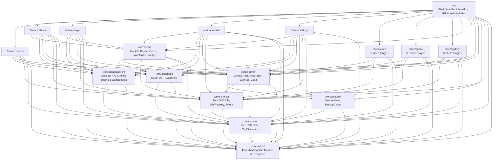

# Raven Architecture & Engineering Blueprint (`ARCHITECTURE.md`)

> **Project**: Raven (`渡鸦`) · **Application ID**: `com.raven.app` (Debug: `com.raven.app.debug`)  
> **Architecture Baseline**: Clean Multi-Module Kotlin / Jetpack Compose Android Native Application  
> **Status**: Foundation Locked (Phase 2) — Single Source of Truth for all parallel builders

---

## 1. Branding, Identity & Locked Toolchain

### 1.1 Application Identity & Launcher Assets
| Item | Release | Debug | Source / Notes |
|---|---|---|---|
| **English Name** | `Raven` | `Raven Debug` | `app/src/main/res/values/strings.xml` / `app/src/debug/res/values/strings.xml` |
| **Chinese Name** | `渡鸦` | `渡鸦 开发版` | `app/src/main/res/values-zh/strings.xml` / `app/src/debug/res/values-zh/strings.xml` |
| **Application ID** | `com.raven.app` | `com.raven.app.debug` | `app/build.gradle.kts` (`applicationIdSuffix = ".debug"`) |
| **Launcher Icon** | Adaptive Icon (API 26+) + legacy mipmaps | Same | Derived read-only from `D:\rule34\design\raven\raven-icon.svg`, `raven-foreground.svg`, `raven-monochrome.svg` |

**Adaptive Icon Specification** (from `raven-icon.svg` / `raven-foreground.svg` / `raven-monochrome.svg`):
- **Background layer**: Vertical dark obsidian gradient `#1B1B20` -> `#07070A` with subtle `#FF4D58` (`12%` opacity) radial highlight centered at `(69%, 24%)`.
- **Foreground layer**: Geometric silver-white raven (`#FFFFFF` -> `#D8D5D9` with faceted wing shading `#C9C7CC` / `#E4E1E4` / `#CCC9CE`) and Raven Crimson eye `#FF4D58`.
- **Monochrome layer**: Solid silhouette cutout for Android 13+ themed icons (`raven-monochrome.svg`).

### 1.2 Locked Toolchain & API-36 Compatibility Matrix
All versions in [libs.versions.toml](../gradle/libs.versions.toml) are verified against `compileSdk = 36`, `AGP 9.0.1`, and `JDK 17` (do **NOT** bump AndroidX/Compose/Coil past API-36 limits; `compose-bom:2026.08+`, `core-ktx:1.19+`, `lifecycle:2.11+`, `navigation:2.10+`, and `coil3:3.6+` require `minCompileSdk = 37`).

| Layer | Artifact / Tool | Locked Version | Hard Rules |
|---|---|---|---|
| **Build Tool** | Gradle Wrapper | `9.1.0` | Reuses cached `gradle-9.1.0-all.zip` |
| **Android Plugin** | AGP (`application` / `library`) | `9.0.1` | Built-in Kotlin enabled; **NEVER** apply `org.jetbrains.kotlin.android` or `kotlin-kapt` |
| **Kotlin** | KGP / JVM / Compose / Serialization | `2.3.21` | Overrides AGP's bundled `2.2.10` via root `buildscript { classpath(libs.kotlin.gradle.plugin) }` |
| **KSP** | `com.google.devtools.ksp` | `2.3.14` | Applied **ONLY** in `:core:database` (Room compiler) |
| **DI** | Koin BOM (`core`, `android`, `compose`, `workmanager`) | `4.2.2` | Zero global KSP overhead (crucial for Windows `kotlin.incremental=false`) |
| **Android SDK** | `compileSdk` / `targetSdk` / `minSdk` / `buildTools` | `36` / `36` / `24` / `36.0.0` | `JavaVersion.VERSION_17`, `JvmTarget.JVM_17`; pure-JVM modules must avoid API 26+ JDK APIs (`java.time.*`, `java.util.Base64`) |
| **Compose** | `compose-bom` / `adaptive` / `adaptive-nav-suite` | `2026.06.01` / `1.2.0` / `1.4.0` | Material 3 `1.4.0`; zero dead third-party `backdrop` library |
| **AndroidX** | `core-ktx` / `activity` / `lifecycle` / `navigation` | `1.18.0` / `1.13.0` / `2.10.0` / `2.9.8` | Type-safe `@Serializable` Compose navigation |
| **Persistence** | `room` / `datastore-preferences` / `work` | `2.8.5` / `1.3.0` / `2.12.0` | Exported Room schemas in `core/database/schemas` |
| **Media & Image** | `media3` / `coil3` | `1.11.1` / `3.4.0` | Media3 `exoplayer`, `hls`, `dash`, `datasource-okhttp`, `ui`, `database`, `session`; Coil3 `compose`, `network-okhttp`, `gif` |
| **Network & Parse** | `okhttp` / `jsoup` / `serialization` / `coroutines` | `4.12.0` / `1.18.3` / `1.10.0` / `1.10.2` | Single OkHttp `4.12.0` across Network, Coil3, and Media3 |
| **Test Stack** | `junit` / `coroutines-test` / `turbine` / `mockwebserver` | `4.13.2` / `1.10.2` / `1.2.1` / `4.12.0` | Pure JVM fast-path tests in every module |

> **Local Environment Note**: `local.properties` sets `sdk.dir=D\:/Android/Sdk` and is git-ignored. `gradle.properties` enables parallel + build caching with `-Xmx4g` and **never** hardcodes localhost proxy ports.

---

## 2. 17-Module Architecture, Dependency Graph & Ownership

### 2.1 Module Dependency DAG



### 2.2 Module Catalog & Parallel Builder Ownership Rules

| # | Module | Type | Package / Namespace | Responsibility | Ownership & Mutation Boundary |
|---|---|---|---|---|---|
| 1 | `:core:model` | Pure JVM | `com.raven.app.core.model` | All `@Serializable` domain, feed, personal, backup models & `SiteException` | **LOCKED by Foundation Lead** — additive changes only with coordinator approval |
| 2 | `:core:common` | Pure JVM | `com.raven.app.core.common` | `AppDispatchers`, `NaturalSortComparator`, `UrlSanitizer`, `ContentFilter`, `TagDictionary` (165 entries), `TimestampParser`, `PageSelectionParser` | **LOCKED by Foundation Lead** |
| 3 | `:core:site-spi` | Pure JVM | `com.raven.app.core.sitespi` | Composable `SitePlugin` SPI, `HttpClientAdapter`, immutable `SiteRegistry`, 9 `SiteKit` pure-Kotlin utilities | **LOCKED by Foundation Lead** |
| 4 | `:core:security` | Android Lib | `com.raven.app.core.security` | `SessionVault` (AndroidKeyStore AES-256-GCM), `BackupCodec` (`RVNBK01` + `R34VBK01` import), TLS/cert helpers | Core Infra Builder |
| 5 | `:core:network` | Android Lib | `com.raven.app.core.network` | Shared OkHttp pool (`page`/`api`/`image`/`media`/`probe`), coroutine `HostPacer`, `Ipv4FirstDns`, `SystemProxySelector`, `MediaRedirectCache`, encrypted `SiteCookieJar`, `SiteHttpClient`, single Coil3 `ImageLoader` | Core Infra Builder |
| 6 | `:core:database` | Android Lib + KSP + Room | `com.raven.app.core.database` | `RavenDatabase`, 18 Room entities/DAOs, repositories, `SettingsDataStore` | Core Infra Builder |
| 7 | `:core:designsystem` | Android Lib + Compose | `com.raven.app.core.designsystem` | Raven Obsidian × Apple HIG × Netflix Cinema tokens, typography, adaptive navigation shell, cards, sheets, HUD components | Design System Builder |
| 8 | `:core:media` | Android Lib | `com.raven.app.core.media` | Media3 `PlayerSessionController`, `StreamSelection`, `StallPolicy`, 4-tier caches, `RouPngDataSource`, `GalleryPageStore` + `ImageStructure` + JMComic strip bitmap renderer, `DownloadCoordinator` (Video + Gallery), `StorageRootManager`, `LocalLibraryImporter`, `DuplicateScanner` | Media & Download Builder |
| 9 | `:sites:video` | Android Lib | `com.raven.app.sites.video` | 8 video plugins: `r34v`, `hanime1`, `iwara` (dual-media), `missav`, `jable`, `rouvideo`, `kbjfree`, `pornhub` + JVM fixture tests | Video Sites Builder |
| 10 | `:sites:comic` | Android Lib | `com.raven.app.sites.comic` | 6 comic plugins: `ehentai`, `exhentai`, `nhentai`, `hitomi`, `wnacg`, `jmcomic` + JVM fixture tests | Comic Sites Builder |
| 11 | `:sites:gallery` | Android Lib | `com.raven.app.sites.gallery` | 5 photo plugins: `4khd`, `everia`, `4kup`, `galleryepic`, `cosplaytele` (dual-media Cossora) + shared `WordPressPhotoEngine` + JVM fixture tests | Photo/Gallery Sites Builder |
| 12 | `:feature:browse` | Android Lib + Compose | `com.raven.app.feature.browse` | Video Cinema Home (Hero/Top 10/Shelves), Comic/Photo Masonry Home, Explore, Single/Cross-Site Search + Advanced Filters, Site Switcher Drawer, Site Functions, Directory | Browse Feature Builder |
| 13 | `:feature:library` | Android Lib + Compose | `com.raven.app.feature.library` | Profile/Personal Home, Library Hub, Shelves, Smart Shelves, Favorites, History, Downloads Center, Image Favorites, Tag Subscriptions, Global Update Inbox, Local Import | Library Feature Builder |
| 14 | `:feature:player` | Android Lib + Compose | `com.raven.app.feature.player` | Video Detail & Media3 Player UI, Visual Gestures HUD, Grouped BottomSheet Controls, Quality/Speed/Sleep/A-B Loop/Time Bookmarks, PiP Host | Player Feature Builder |
| 15 | `:feature:reader` | Android Lib + Compose | `com.raven.app.feature.reader` | Gallery Detail (with embedded videos) & 4-mode Reader (`STRIP`/`LTR`/`RTL`/`SPREAD`), Zoom/Pan/Crop, 3-page prefetch + 24MiB budget, Thumbnail Sheet, Bookmarks, CBZ/Image Export | Reader Feature Builder |
| 16 | `:feature:settings` | Android Lib + Compose | `com.raven.app.feature.settings` | Grouped Inset Settings, Site Accounts + `SiteAuthActivity` WebView FSM, Blocked Terms, Storage Migration, Duplicate Scanner, Encrypted Backup/Restore, GitHub Release Updater | Settings Feature Builder |
| 17 | `:app` | Android App + Compose | `com.raven.app` | `RavenApplication` (Koin root), `MainActivity`, `PlayerActivity` (PiP), `SiteAuthActivity`, Type-Safe `NavHost`, adaptive shell, launcher icons, `network_security_config.xml` + `isrg_root_x1.pem` | App Integration Builder |

### 2.3 Hard Architectural Invariants for Parallel Builders
1. **Zero global mutable site state**: `SiteRegistry` is strictly immutable. Every model, Room entity, DAO query, ViewModel state, and Navigation route takes an explicit `SiteId`.
2. **Zero cross-site `when (siteId)` branching outside `:sites:*`**: All site-specific logic lives inside the plugin's `SiteDescriptor`, `AuthProvider`, `HostRouter`, `LinkResolver`, `MediaTransportHook`, `GallerySource`, or `ImageUnscrambler`.
3. **Zero cross-adapter coupling**: Never import one site plugin from another (e.g., never call `MissavProtocol` from Jable/Pornhub). Use `:core:site-spi` utilities (`HtmlUrlCleaner`, `Base62Packer`, `JsExtractor`, `DualLanguageMerger`, `MirrorLeaseRouter`, `LruCache`, `RouPngProtocol`, `CossoraAesProtocol`, `JmcomicStripMath`).
4. **Zero `Thread.sleep` in OkHttp interceptors**: Rate pacing (`HostPacer`) MUST run in the `suspend` layer via `Mutex + delay` before dispatching OkHttp calls.
5. **Zero per-request `OkHttpClient.newBuilder().build()`**: Reuse pre-built clients sharing one `ConnectionPool`, `Dispatcher`, `Ipv4FirstDns`, and `SystemProxySelector`.
6. **Zero `AlertDialog` chaining or `revision++` force-recomposition**: All UI state flows reactively from Room/DataStore through `StateFlow<UiState>` ViewModels (`repeatOnLifecycle(STARTED)` for active pollers/timers); complex forms use single-page `ModalBottomSheet` or dedicated sub-routes.
7. **Zero credential leakage**: Cookies and Bearer tokens are encrypted in `SessionVault` for ALL 5 auth-capable sites (`r34v`, `hanime1`, `iwara`, `ehentai`, `exhentai`) and are NEVER attached to media CDN or update-server requests.

---

## 3. Koin DI Module Conventions & Registration

Raven uses **Koin `4.2.2`** with explicit module exports (no reflection scanning, no global KSP).

### 3.1 Naming Convention
Each module exposes a single top-level `val <moduleName>Module: Module` inside its root package:

| Module | Exported Koin Module | Registered Bindings |
|---|---|---|
| `:core:security` | `coreSecurityModule` | `SessionVault`, `BackupCodec`, `BackupValidator` |
| `:core:network` | `coreNetworkModule` | `AppDispatchers`, `ApplicationScope`, `Ipv4FirstDns`, `SystemProxySelector`, `HostPacer`, `SiteCookieJar`, `OkHttpClient` (named: `page`, `api`, `image`, `media`, `probe`), `HttpClientAdapter` (`SiteHttpClient`), `ImageLoader` (Coil3) |
| `:core:database` | `coreDatabaseModule` | `RavenDatabase`, all Room DAOs, `SettingsDataStore`, domain repositories (`HistoryRepository`, `FavoriteRepository`, `ShelfRepository`, `BookmarkRepository`, `SubscriptionRepository`, `DownloadStateRepository`, `BrowsePositionRepository`) |
| `:core:media` | `coreMediaModule` | `DownloadCaches`, `PlayerSessionController`, `GalleryPageRepository`, `DownloadCoordinator`, `StorageRootManager`, `LocalLibraryImporter`, `DuplicateScanner`, WorkManager workers (`workerOf(...)`) |
| `:sites:video` | `videoSitesModule` | 8 video `SitePlugin` singletons bound with `bind<SitePlugin>()` |
| `:sites:comic` | `comicSitesModule` | 6 comic `SitePlugin` singletons bound with `bind<SitePlugin>()` |
| `:sites:gallery` | `gallerySitesModule` | 5 gallery `SitePlugin` singletons bound with `bind<SitePlugin>()` |
| `:feature:*` | `browseFeatureModule`, `libraryFeatureModule`, `playerFeatureModule`, `readerFeatureModule`, `settingsFeatureModule` | Feature ViewModels (`viewModelOf(...)`) and feature-scoped UseCases |
| `:app` | `appModule` | `SiteRegistry(getAll<SitePlugin>())`, `AppNavigationCoordinator`, `AppUpdater` |

### 3.2 Plugin Multi-Binding Pattern (Zero Hardcoded Switch)
```kotlin
// In :sites:video
val videoSitesModule = module {
    single { R34vSitePlugin(get()) } bind SitePlugin::class
    single { HanimeSitePlugin(get()) } bind SitePlugin::class
    single { IwaraSitePlugin(get(), get()) } bind SitePlugin::class
    // ... remaining 5 video plugins
}

// In :app
val appModule = module {
    single {
        val all = getAll<SitePlugin>()
        val order = SiteId.ALL_LIVE.withIndex().associate { (i, id) -> id to i }
        SiteRegistry(all.sortedBy { order[it.id] ?: Int.MAX_VALUE })
    }
}
```
Notice how `SiteRegistry` sorts all injected `SitePlugin`s deterministically according to `SiteId.ALL_LIVE` order while staying completely decoupled from concrete site classes.

---

## 4. Raven Design System — Dark Obsidian × Apple HIG Precision × Netflix Cinema

All visual tokens live exclusively in `:core:designsystem` (`package com.raven.app.core.designsystem`). Feature modules **must never** hardcode `Color(0x...)` or duplicate theme branches.

### 4.1 Color Tokens (`RavenColors`)

| Semantic Token | Hex / Value | Role & Usage Constraints |
|---|---|---|
| `Canvas` / `Background` | `#09090B` | Pure dark OLED canvas; maximizes poster contrast and battery savings |
| `Surface1` (`Card`) | `#121216` | Primary cards, grouped inset list containers, inactive chips (alias `#131317` deprecated in favor of `#121216`) |
| `Surface2` (`Sheet`) | `#1B1B22` | `ModalBottomSheet`, floating menus, search input fields, secondary buttons |
| `Surface3` (`Elevated`) | `#24242D` | Selected chips, pressed containers, slider tracks, top-tier popovers |
| `Hairline` | `#FFFFFF` @ `8%` (`0x14FFFFFF`) | Crisp Apple HIG `0.5dp`–`1dp` translucent separators & card rims |
| `OutlineSubtle` | `#2A2A33` | Opaque fallback outline for high-contrast controls & form borders |
| `InkPrimary` | `#F5F5F7` | Primary headlines, titles, active icons (Apple off-white avoids OLED halation) |
| `InkSecondary` | `#9E9EA8` | Subtitles, metadata, inactive tabs, captions |
| `InkTertiary` | `#6E6E78` | Timestamps, placeholders, disabled labels |
| `Crimson` (`Accent`) | `#FF4D58` | **Raven Crimson** — strictly reserved for active nav indicator, playback/reading progress bars, unread badges, brand eye accent. **Never** flood full-screen backgrounds |
| `PrimaryCtaContainer` | `#F5F5F7` | High-contrast Netflix-style primary Play / Read CTA background |
| `PrimaryCtaInk` | `#09090B` | High-contrast ink on primary white CTA |
| `SecondaryCtaContainer` | `#1B1B22` @ `78%` | Frosted translucent secondary CTA (Watch Later / Info) with `1dp` `#FFFFFF @ 12%` rim |
| `ScrimTop` / `ScrimBottom` | `#09090B` @ `0%` -> `100%` | Edge-to-edge Hero & player HUD vignette gradients |
| `Success` / `Warning` / `Error` | `#30D158` / `#FFD60A` / `#FF453A` | Download complete, metered/rate-limit warning, error & destructive actions |

> **Ambient Artwork Glow Rule**: Optional low-saturation ambient tint derived from Hero artwork is restricted to the top Hero/Detail backdrop at `alpha <= 0.18f`. It **never** mutates `MaterialTheme.colorScheme.primary` or replaces Raven Crimson `#FF4D58`.

### 4.2 Typography, Geometry & Motion (Apple HIG Precision)
- **Typography Scale (`RavenTypography`)**:
  - Tight-tracked bold display & section headers (`letterSpacing = -0.4.sp` to `-0.2.sp`, `FontWeight.SemiBold` / `Bold`).
  - **Tabular Numerals (`fontFeatureSettings = "tnum"`)** mandatory for all durations (`12:34`), page counters (`14 / 120`), view/like counts, download sizes, and timestamps so numbers never jitter while ticking.
  - Full `200%` accessibility font scale support: cards and bars reflow cleanly without clipping; touch targets maintain `>= 48dp` minimum interactive bounds.
- **Shape Geometry (`RavenShapes`)**:
  - `CardShape`: `RoundedCornerShape(14.dp)`
  - `SheetShape`: `RoundedCornerShape(topStart = 18.dp, topEnd = 18.dp)`
  - `DialogShape`: `RoundedCornerShape(18.dp)`
  - `ControlShape`: `RoundedCornerShape(10.dp)`
  - `PillShape`: `CircleShape` (site switcher pill, filter chips, play/action pills)
- **Tactile Motion (`RavenMotion`)**:
  - Spring press feedback: `scale = 0.97f` via `animateFloatAsState(spring(dampingRatio = Spring.DampingRatioMediumBouncy, stiffness = Spring.StiffnessMediumLow))`.
  - Subtle dark frosted overlays on top headers & media bars: native `Modifier.blur()` on API 31+ (`Build.VERSION_CODES.S`) when `reduceTransparency == false`; clean `#121216 @ 92%` translucent scrim + `Hairline` fallback on API 24–30 or when `reduceTransparency == true`. **Zero** third-party `backdrop` dependency.
- **Grouped Inset Settings & Sheets**:
  - All settings, advanced search filters, smart-shelf builders, playback preferences, and per-book reader overrides use **Apple-style grouped inset rows** (`Surface1` `#121216` rounded `14dp` containers with `Hairline` internal dividers) inside a single-screen `ModalBottomSheet` or sub-page.
  - **Prohibited**: Chained / recursive `AlertDialog` workflows.

### 4.3 Netflix Cinema & Gallery Showcase Patterns
- **Video Site Home (`MediaKind.VIDEO`)**:
  1. Full-bleed edge-to-edge **Hero Banner** carousel with bottom vignette gradient (`transparent -> #09090B`), title, metadata pill row, solid white **Play** CTA (`#F5F5F7` / `#09090B`), and frosted **Watch Later** CTA.
  2. **Continue Watching** horizontal shelf with `2.5dp` Raven Crimson (`#FF4D58`) resume progress bar along card bottom.
  3. **Top 10 Ranked** horizontal shelf with large outlined/tabular rank numerals (`1`–`10`).
  4. Horizontal category/latest shelves with `See All` action.
- **Comic & Photo Site Home (`MediaKind.COMIC` / `MediaKind.PHOTO`)**:
  - Frameless native-aspect-ratio `LazyVerticalStaggeredGrid` (2 cols phone / 3 cols `>=600dp` or compact comic / 4 cols `>=840dp` / 5 cols `>=1024dp` / 6 cols `>=1280dp`).
  - Compact resume card pinned at top when an unfinished book exists.
  - Collapsible single-row comic language filter bar (`全部 / 中文 / 日文 / 中＋日`) for sites declaring `SiteCapability.LANGUAGE_FILTER`.
- **Adaptive Navigation (`NavigationSuiteScaffold`)**:
  - 5 top-level destinations: **首页 (Home)** · **发现 (Explore)** · **搜索 (Search)** · **片库 (Library)** · **我的 (Profile)**.
  - `< 600dp`: Clean bottom bar (`Surface1` + top `Hairline`, crimson active indicator & icon tint).
  - `>= 600dp` (tablet / foldable / landscape): Persistent left `NavigationRail` + top bar site switcher pill, maximizing vertical canvas space.

---

## 5. Type-Safe Navigation Compose Routes & Activity Strategy

### 5.1 Activity Topology (Eliminating Task-Stack Leaks)
Raven eliminates R34V's 4-Activity stacking leaks with a **clean 3-Activity boundary**:

1. **`MainActivity`** (`launchMode = "singleTop"`):
   - Hosts the entire adaptive shell, Browse, Search, Library, Profile, Gallery Detail, Reader, and Settings graphs inside one Type-Safe `NavHost`.
   - Receives `ACTION_SEND` (`text/plain`) and deep links cleanly via `onNewIntent`, resolving URLs through `SiteRegistry.resolveLinkFromText` without stacking duplicate `MainActivity` instances.
2. **`PlayerActivity`** (`launchMode = "singleTop"`, `supportsPictureInPicture = "true"`, `configChanges = "screenSize|smallestScreenSize|screenLayout|orientation"`):
   - Dedicated PiP-capable video playback shell so entering Picture-in-Picture never collapses the main browsing/reading shell, and clicking a related video switches media **in-place** inside `PlayerActivity` (zero unbounded Activity stacking!).
   - Navigating back to a tag/author feed fires `Intent(this, MainActivity::class.java).addFlags(FLAG_ACTIVITY_CLEAR_TOP or FLAG_ACTIVITY_SINGLE_TOP)`.
3. **`SiteAuthActivity`** (`FLAG_SECURE`, isolated WebView):
   - Dedicated secure Activity solely for `AuthMode.WebViewCookie` sites (E-Hentai / ExHentai 7-state official login FSM). Clears all WebView cookies on exit, disables JS bridge / file access / third-party cookies / mixed content, cancels all SSL errors, and enforces `allowedHosts` whitelist.

### 5.2 Type-Safe Navigation Compose Routes (`@Serializable`)

All routes reside in `:core:designsystem` or `:app` navigation contracts (using `@Serializable` Kotlin objects/data classes with Navigation Compose `2.9.8`):

```kotlin
sealed interface RavenRoute {
    // 5 Primary Top-Level Destinations
    @Serializable data object Home : RavenRoute
    @Serializable data object Explore : RavenRoute
    @Serializable data class Search(val initialQuery: String? = null, val crossSite: Boolean = false) : RavenRoute
    @Serializable data object Library : RavenRoute
    @Serializable data object Profile : RavenRoute

    // Browse & Site Detail Routes
    @Serializable data class SiteFeed(
        val siteId: String,
        val section: String? = null,
        val category: String? = null,
        val query: String? = null,
        val scope: String = "ALL",
        val title: String? = null,
    ) : RavenRoute

    @Serializable data class SiteDirectory(val siteId: String, val section: String) : RavenRoute
    @Serializable data class SiteFunctions(val siteId: String) : RavenRoute

    // Media Detail & Reader Routes (Video opens PlayerActivity; Gallery/Reader stay in NavHost)
    @Serializable data class GalleryDetail(val siteId: String, val mediaId: String, val url: String) : RavenRoute
    @Serializable data class Reader(
        val siteId: String,
        val mediaId: String,
        val url: String,
        val startPage: Int = 1,
        val offlineOnly: Boolean = false,
        val queueToken: String? = null,
    ) : RavenRoute

    // Library Sub-Routes
    @Serializable data object Downloads : RavenRoute
    @Serializable data class ShelfDetail(val shelfId: String) : RavenRoute
    @Serializable data class SmartShelfDetail(val smartShelfId: String) : RavenRoute
    @Serializable data object Favorites : RavenRoute
    @Serializable data object History : RavenRoute
    @Serializable data object ImageFavorites : RavenRoute
    @Serializable data class Subscriptions(val siteId: String? = null) : RavenRoute
    @Serializable data object GlobalInbox : RavenRoute
    @Serializable data object LocalLibrary : RavenRoute

    // Settings & Workflow Sub-Routes (zero chained dialogs)
    @Serializable data object Settings : RavenRoute
    @Serializable data class SiteAccount(val siteId: String) : RavenRoute
    @Serializable data class BlockedTerms(val siteId: String) : RavenRoute
    @Serializable data object BackupRestore : RavenRoute
    @Serializable data object StorageMigration : RavenRoute
    @Serializable data object DuplicateScanner : RavenRoute
}
```

---

## 6. Persistence Architecture: Room Schema & DataStore Keys

Replaces R34V's monolithic single-key `SharedPreferences` JSON blob (`personal_library_v1`) and 13 blocking `.commit()` calls with normalized **Room SQLite (`2.8.5`)** + **Preferences DataStore (`1.3.0`)**.

### 6.1 Room Database (`RavenDatabase`, schema v1)

| Table Name | Primary Key | Key Indices | Purpose |
|---|---|---|---|
| `watch_progress` | `(site_id, media_id)` | `(updated_at DESC)`, `(site_id, updated_at DESC)` | Per-video watch position, duration, quality, completion |
| `reading_progress` | `(site_id, media_id)` | `(updated_at DESC)`, `(site_id, updated_at DESC)` | Per-comic/photo page, pixel offset, total pages, completion |
| `favorites` | `(site_id, kind, target_id)` | `(added_at DESC)`, `(kind, added_at DESC)` | Works, tags, authors, characters across all sites |
| `shelves` | `id` | `(is_pinned DESC, modified_at DESC)` | Built-in `watch-later` + unlimited custom shelves |
| `shelf_items` | `(shelf_id, site_id, media_id)` | `(shelf_id, position ASC)`, `(shelf_id, added_at DESC)` | Ordered shelf memberships with FK cascade delete on `shelves.id` |
| `smart_shelves` | `id` | `(is_pinned DESC, created_at DESC)` | Dynamic rules (`UNFINISHED`, `OFFLINE_UNSEEN`, `RECENT`) |
| `page_bookmarks` | `id` | `(site_id, media_id, page)`, `(created_at DESC)` | Gallery/comic page + strip pixel-offset bookmarks |
| `time_bookmarks` | `id` | `(site_id, media_id, position_ms)`, `(created_at DESC)` | Video timestamp bookmarks & labeled clips |
| `image_favorites` | `id` | `(site_id, media_id, page_index)`, `(added_at DESC)` | Single-page image favorites (capped at 20,000) |
| `tag_subscriptions` | `(site_id, slug, scope)` | `(site_id, sort_order ASC)` | Per-site tag/author subscriptions with manual sort order |
| `saved_searches` | `id` | `(created_at DESC)` | Multi-site saved search recipes & filter snapshots |
| `update_inbox` | `id` | `(is_read, discovered_at DESC)`, `(source_kind, source_id)` | Unified unread feed for tag subscriptions & saved searches |
| `blocked_terms` | `(site_id, term)` | `(site_id)` | Strict per-site content blocklist |
| `search_history` | `(site_id, query, scope)` | `(site_id, searched_at DESC)` | Recent 30 searches per site |
| `download_items` | `id` | `(status, priority DESC, updated_at DESC)`, `(site_id, media_id)` | Unified projection table for Video (Media3) & Gallery downloads |
| `playback_preferences` | `site_id` (`"*"` for global) | — | Per-site speed, long-press speed, seek step, sensitivity, quality |
| `reader_preferences` | `(site_id, media_id)` (`""` for site default) | `(site_id)` | Per-site & per-book mode, fit, crop, spread cover, original-image toggle |
| `browse_positions` | `position_key` | `(updated_at DESC)` | Last 32 cross-process scroll restoration anchors (`workId`, `throughPage`, `shelfId`) |

All DAOs expose `Flow<List<T>>` / `Flow<T?>` so Compose screens react atomically with zero `revision++` hacks.

### 6.2 Preferences DataStore (`raven_settings.preferences_pb`)

| Key | Type | Default | Description |
|---|---|---|---|
| `active_site_id` | `String` | `"r34v"` | Currently selected live site in Browse shell |
| `pinned_site_ids` | `String` (JSON list) | `[]` | Pinned sites at top of Site Switcher drawer |
| `cross_search_site_ids` | `String` (JSON list) | `[]` (empty = all searchable) | Selected sites for multi-site search |
| `site_language_<siteId>` | `String` | `"ALL"` | Per-site `ComicLanguage` (`ALL`/`CHINESE`/`JAPANESE`/`CHINESE_AND_JAPANESE`) |
| `site_explore_filter_<siteId>` | `String` (JSON) | `""` | Last Explore filter state per site |
| `translate_tags` | `Boolean` | `true` | Enable 165-entry (and extensible) Chinese tag translation |
| `auto_fullscreen` | `Boolean` | `true` | Auto-enter fullscreen matching video orientation |
| `preferred_quality` | `String` | `"auto"` | Default playback quality preference |
| `default_playback_speed` | `Float` | `1.0f` | Global default playback speed (`0.25..3.0`) |
| `stream_cache_enabled` | `Boolean` | `false` | Optional 512 MiB LRU Media3 stream cache |
| `seek_cache_enabled` | `Boolean` | `true` | 64 MiB MP4 + 32 MiB HLS session seek caches |
| `download_unmetered_only` | `Boolean` | `false` | Pause active downloads on metered cellular links |
| `storage_location` | `String` | `"PRIVATE"` | `PRIVATE` (`filesDir`) vs `SHARED` (`/storage/emulated/0/Raven`) |
| `pending_storage_location` | `String` | `""` | Deferred storage root applied cleanly on next cold start |
| `reduce_transparency` | `Boolean` | `false` | Replace API 31+ frosted blur with opaque dark scrim |
| `auto_update_check` | `Boolean` | `true` | 12-hour background GitHub Release check |
| `site_switch_tutorial_seen` | `Boolean` | `false` | Consumed once on fresh install before showing switcher hint |

---

## 7. Security & Backup Compatibility Strategy

### 7.1 Credential & Transport Security (`:core:security` + `:core:network`)
- **Unified `SessionVault`**: Encrypts cookies and Bearer tokens for **all** auth-capable sites (`r34v`, `hanime1`, `iwara`, `ehentai`, `exhentai`) using `AndroidKeyStore` AES-256-GCM (12-byte random IV + 128-bit auth tag). **Zero plaintext fallback.**
- **Cookie & Token Isolation**: `SiteCookieJar` partitions cookies strictly by `SiteDescriptor.matchesHost(host)` and encodes host-only cookies explicitly (`h\u0001<host>\u0001<raw>` vs `d\u0001<raw>`). Media CDNs and update hosts never receive cookies or Bearer tokens.
- **TLS & Proxy Invariants**:
  - `network_security_config.xml`: `cleartextTrafficPermitted="false"` in Release, trusts `system` + bundled `res/raw/isrg_root_x1.pem` (API 24 compatibility), never trusts user-installed CAs.
  - `Ipv4FirstDns`: Sorts IPv4 ahead of IPv6 to prevent broken dual-stack AAAA timeouts (`everia.club` etc.).
  - `SystemProxySelector`: Selects first system/PAC proxy without silently falling back to `DIRECT`; network/proxy callbacks flush connection pools and increment `routeEpoch`.

### 7.2 Encrypted Backup Format (`RVNBK01` + Legacy `R34VBK01` Import)

| Property | Native Raven Format (`RVNBK01`) | Legacy R34V Import (`R34VBK01`) |
|---|---|---|
| **Magic Header** | 8 bytes: ASCII `"RVNBK01"` + `0x00` pad byte (`52 56 4E 42 4B 30 31 00`) | 8 bytes: ASCII `"R34VBK01"` (`52 33 34 56 42 4B 30 31`) |

**Exact Binary Wire Format (Deterministic & Unambiguous)**:
- **Native Raven Export (`RVNBK01`)**:
  - Header (`36 bytes`): `magic[8]` = `"RVNBK01\u0000"` (7 ASCII bytes `"RVNBK01"` + 1 null version pad byte `0x00`) + `salt[16]` + `iv[12]`.
  - KDF: `PBKDF2WithHmacSHA1(password, salt, iterations = 600_000, keyLength = 256)` (native API 24+ compatible).
  - Cipher: `AES/GCM/NoPadding` (128-bit tag), AAD = entire 36-byte header.
  - Plaintext: UTF-8 JSON encoding of `RavenBackupPayload` (`schemaVersion = 1`, max `16 MiB`), password >= 8 characters.
- **Legacy R34V Import (`R34VBK01`)**:
  - Detected when `bytes[0..7]` equals `"R34VBK01"` (`0x52 33 34 56 42 4B 30 31`).
  - Uses identical 36-byte header layout, `PBKDF2WithHmacSHA1(600_000, 256)`, and `AES/GCM/NoPadding` with 36-byte header AAD.
  - Legacy JSON (`LibraryBackup`: `schema`, `at`, `sites[]`, `personal`, `settings`) is decoded via a dedicated `@Serializable` legacy DTO adapter inside `:core:security` and converted losslessly into `RavenBackupPayload`:
    * `SiteBackup.favorites/watches/readings/subscriptions/blocked/searches/language` -> flattened into explicit `siteId` collections.
    * `PersonalLibrary.shelves/bookmarks/imageFavorites/timeBookmarks/inboxes/savedSearches/readerModes` -> mapped to Raven equivalents (preserving `watch-later` shelf ID and retired `kbj`/`netflav` records as read-only historical entries).
    * `r34local://<sha256>` local URIs accepted alongside `ravenlocal://<sha256>`.
- **Validation & Atomic Merge Policy**:
  1. Never export or overwrite cookies, JWTs, encryption keys, download directories, or media files.
  2. Before mutating Room, validate schema version, collection bounds, HTTPS host ownership against `SiteRegistry` (+ retired hosts), and local hash format.
  3. Present a structured summary preview (`favorites`, `history`, `shelves`, `bookmarks`, `subscriptions`) to the user.
  4. Apply inside a single Room `@Transaction`:
     - Watch/Reading progress: keep entry with newer `updatedAt`.
     - Shelf items: keep earliest `addedAt` and latest `completed` state.
     - Favorites, bookmarks, image favorites, blocked terms, subscriptions: deterministic union deduplicated by composite key.
     - On any error, roll back the transaction atomically and release temporary SAF URI grants.

---

## 8. 14 Non-Negotiable Site Protocol Invariants (Migration Checklist)

Every site builder in `:sites:video`, `:sites:comic`, and `:sites:gallery` must preserve these verified invariants:

1. **Global DNS**: `Ipv4FirstDns` prioritizes IPv4 ahead of IPv6.
2. **Global Proxy**: `SystemProxySelector` uses first proxy without silent `DIRECT` fallback; network/proxy events increment `routeEpoch` and flush pools.
3. **Global TLS**: Release disallows cleartext HTTP, embeds `isrg_root_x1.pem`, ignores user CAs.
4. **Credential Isolation**: Cookies/Bearer tokens NEVER sent to `mediaDomains` or update servers; logout clears only the target `SiteId`.
5. **Media Redirect Cache**: Network interceptor caches KVS `/get-file` 302 CDN redirects for 30 min and invalidates on `403/404/410`.
6. **`rou.video`**: `RouPngProtocol.transportHook` recognizes `/api/hls/` as HLS, requests full `position=0` upstream PNGs, unwraps `roUd` (`Inflater(nowrap=false)`), and streams non-PNG responses untouched.
7. **`iwara`**: Search uses `type=videos`/`type=images` (never singular); `X-Version = SHA-1("${fileId}_${expires}_${salt}")` with dynamic salt hot-extraction; `Origin`/`x-site` headers; dynamic page count recalculation; `authEpoch` cancellation on logout/login.
8. **`missav` / `jable`**: MissAV uses `Base62Packer` single-pass decoding + `.ws`/`.media` mirror failover; Jable uses `jable.vip` primary (`jable.tv` mirror recognition), `JsExtractor.extractBraceObject(..., "player_aaaa")`, and `《...》` title extraction.
9. **`pornhub`**: Dual desktop (`li.pcVideoListItem`) + mobile (`li[data-video-vkey]`) DOM parsing and `mediaDefinitions` HLS/MP4 extraction.
10. **`ehentai` / `exhentai`**: 7-state `SiteAuthActivity` (`FLAG_SECURE`, no JS bridge, host whitelist, temp cookie cleanup), `nw=1` default cookie, `f_cats = 1023 xor catId`, `#unext` cursor paging, `?nl=` reload token on 403/TLS/cross-host redirect, `fullimg.php` original images, hard ExHentai auth gate.
11. **`nhentai`**: Public `/api/v2/*` endpoints + validated `/api/v2/cdn` servers + `HtmlUrlCleaner.deduplicateImageExtension` + `DualLanguageMerger` for `CHINESE_AND_JAPANESE`.
12. **`hitomi`**: `.nozomi` HTTP 206 Range paging (`48B = 12 IDs`), SHA-256 464B disk B-Tree search, regex-only `gg.js` routing (zero JS eval), WebP URL bucket math.
13. **`wnacg` / `jmcomic`**: WNACG forces `DESKTOP_WINDOWS_UA`, unpacks `document.writeln`, strips `shoucang.jpg`; JMComic uses `MirrorLeaseRouter` (10-min route-keyed lease) + `JmcomicStripMath` (MD5 `lastHex.code` mod + bottom-to-top remainder-at-top slice reversal).
14. **`cosplaytele` & Photo Sites**: Shared `WordPressPhotoEngine` with stateless `#flatIndex-contentPage-offset` addressing (4-page drift tolerance), Cosplaytele `#gallery-1` isolation, and `CossoraAesProtocol` AES-256-CBC embedded HLS decoding.
