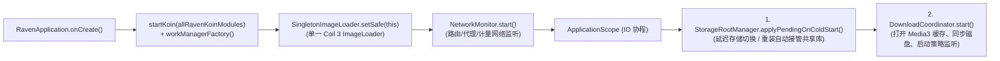
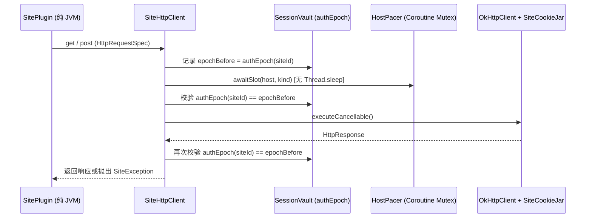
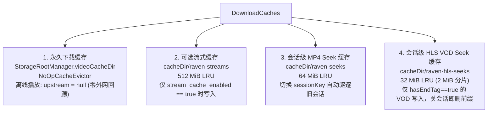
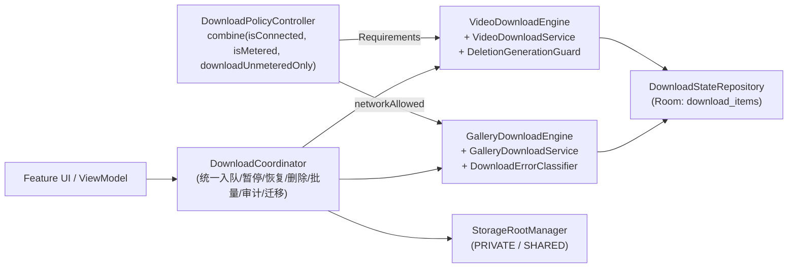
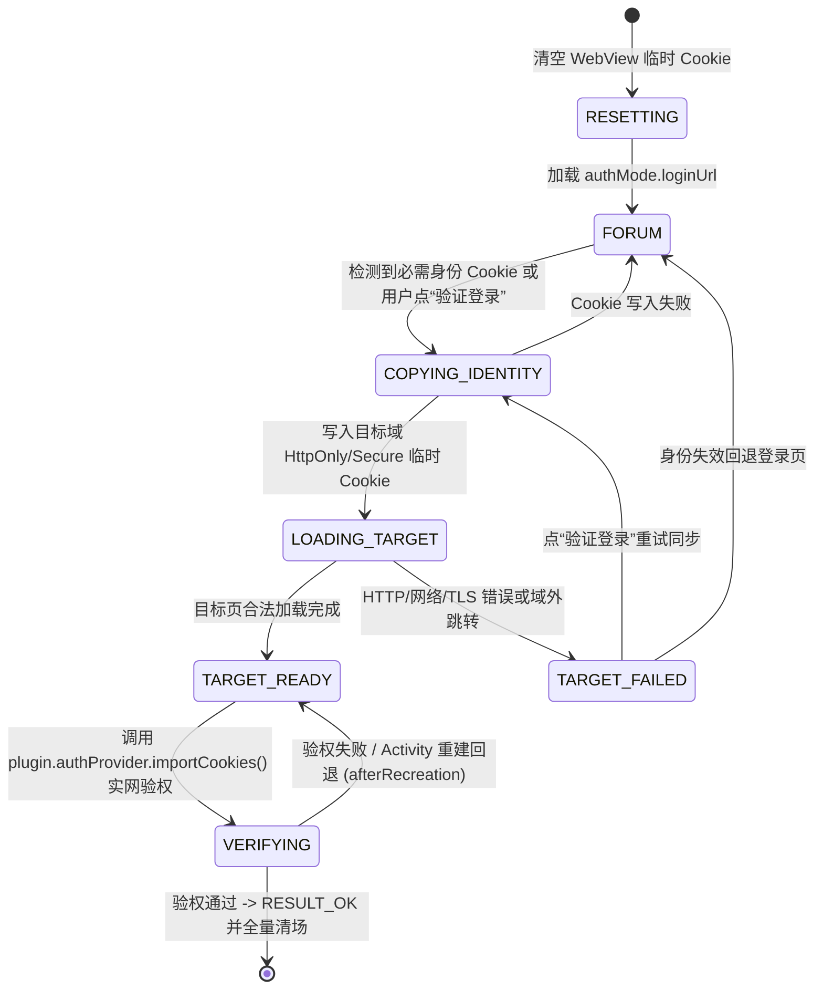

# Raven（渡鸦）数据持久化、媒体内核、下载存储与安全备份手册

> 适用范围：`:core:database`、`:core:network`、`:core:media`、`:core:security`、`:feature:player`、`:feature:reader`、`:feature:settings`、`:app`。  
> 关联文档：[ARCHITECTURE.md](ARCHITECTURE.md) · [ONBOARDING.md](ONBOARDING.md) · [SITE_PLUGIN_GUIDE.md](SITE_PLUGIN_GUIDE.md) · [DESIGN_AND_UI_GUIDE.md](DESIGN_AND_UI_GUIDE.md)

---

## 总览：冷启动编排与核心基础设施依赖

在进入各子系统前，先明确进程启动时的严格初始化顺序（详见 `app/src/main/kotlin/com/raven/app/RavenApplication.kt`）：



- **零主线程阻塞 I/O**：`StorageRootManager` 冷启动切换与 `DownloadCoordinator.start()` 全部在 `ApplicationScope` 的 `dispatchers.io` 上按严格先后顺序执行，保证存储根切完之后才打开 Media3 `SimpleCache` 与磁盘元数据旁车文件。
- **零循环依赖**：`:core:network`、`:core:security`、`:core:media` 在持有 `SiteRegistry` 或跨引擎回调时统一采用延迟提供器 `{ get<SiteRegistry>() }`，彻底规避 Koin 启动环。

---

## 1. 数据持久化层（`:core:database`）

### 1.1 `RavenDatabase` 与全部 18 张表结构

- **实现路径**：`core/database/src/main/kotlin/com/raven/app/core/database/RavenDatabase.kt`
- **关键配置**：`DATABASE_NAME = "raven.db"`、`SCHEMA_VERSION = 1`、`exportSchema = true`、`@TypeConverters(RavenTypeConverters::class)`。
- **建库种子回调**：`watchLaterSeedCallback` 在 `onCreate` 时通过 `INSERT OR IGNORE` 预置内置系统片单 `id = "watch-later"`（`Shelf.WATCH_LATER_ID`，名称 `"稍后看"`，`is_system = 1`）。该片单受业务层保护，禁止重命名或删除。

| # | 表名 (`tableName`) | Entity 类 | 主键 (PK) | 外键 (FK) | 索引 (Indices) | 容量上限 / 语义备注 |
| :-: | :--- | :--- | :--- | :--- | :--- | :--- |
| 1 | `watch_progress` | `WatchProgressEntity` | `(site_id, media_id)` | 无 | `(updated_at DESC)`, `(site_id ASC, updated_at DESC)` | 每站点上限 **500** 条 (`WatchProgressDao.MAX_PER_SITE`) |
| 2 | `reading_progress` | `ReadingProgressEntity` | `(site_id, media_id)` | 无 | `(updated_at DESC)`, `(site_id ASC, updated_at DESC)` | 每站点上限 **500** 条 (`ReadingProgressDao.MAX_PER_SITE`) |
| 3 | `favorites` | `FavoriteEntity` | `(site_id, kind, target_id)` | 无 | `(added_at DESC)`, `(kind ASC, added_at DESC)` | 支持作品/作者/角色/标签等 `FavoriteKind` |
| 4 | `shelves` | `ShelfEntity` | `id` | 无 | `(is_pinned DESC, modified_at DESC)` | 内置 `watch-later` (`is_system = 1`)；名称 `<= 80`，备注 `<= 1000` |
| 5 | `shelf_items` | `ShelfItemEntity` | `(shelf_id, site_id, media_id)` | **`shelf_id -> shelves(id) ON DELETE CASCADE`** | `(shelf_id ASC, position ASC)`, `(shelf_id ASC, added_at DESC)` | **全库唯一外键约束**；批量覆写时须先删子表再删父表、先插父表再插子表 |
| 6 | `smart_shelves` | `SmartShelfEntity` | `id` | 无 | `(is_pinned DESC, created_at DESC)` | 动态规则片单（`UNFINISHED` / `OFFLINE_UNSEEN` / `RECENT`） |
| 7 | `page_bookmarks` | `PageBookmarkEntity` | `id` | 无 | `(site_id, media_id, page)`, `(created_at DESC)` | 漫画/写真页码与滚动偏移书签 |
| 8 | `time_bookmarks` | `TimeBookmarkEntity` | `id` | 无 | `(site_id, media_id, position_ms)`, `(created_at DESC)` | 视频时间点书签；`label <= 500`，`group_name <= 80` |
| 9 | `image_favorites` | `ImageFavoriteEntity` | `id` | 无 | `(site_id, media_id, page_index)`, `(added_at DESC)` | 全局上限 **20,000** 条 (`ImageFavoriteDao.MAX_IMAGE_FAVORITES`) |
| 10 | `tag_subscriptions` | `TagSubscriptionEntity` | `(site_id, slug, scope)` | 无 | `(site_id ASC, sort_order ASC)` | 支持手动拖拽排序 `sort_order` |
| 11 | `saved_searches` | `SavedSearchEntity` | `id` | 无 | `(created_at DESC)` | 跨站/单站保存搜索（含 `AdvancedSearchFilters` JSON） |
| 12 | `update_inbox` | `UpdateInboxEntity` | `id` | 无 | `(is_read ASC, discovered_at DESC)`, `(source_kind, source_id)` | 订阅与保存搜索更新通知；覆盖写入时保留已读态 `is_read = true` |
| 13 | `blocked_terms` | `BlockedTermEntity` | `(site_id, term)` | 无 | `(site_id)` | 写入前统一经 `ContentFilter.normalizeTerm` 归一化 |
| 14 | `search_history` | `SearchHistoryEntity` | `(site_id, query, scope)` | 无 | `(site_id ASC, searched_at DESC)` | 每站点上限 **30** 条 (`SearchHistoryDao.MAX_PER_SITE`) |
| 15 | `download_items` | `DownloadItemEntity` | `id` | 无 | `(status ASC, priority DESC, updated_at DESC)`, `(site_id, media_id)` | 视频与图集统一下载队列投影表 |
| 16 | `playback_preferences` | `PlaybackPreferencesEntity` | `site_id` | 无 | 无 | 2 级覆盖：`site_id = "*"` 为全局默认，具体 `siteId` 为按站覆盖 |
| 17 | `reader_preferences` | `ReaderPreferencesEntity` | `(site_id, media_id)` | 无 | `(site_id)` | 3 级覆盖：`("*", "")` 全局 → `("<site>", "")` 按站 → `("<site>", "<mediaId>")` 按本 |
| 18 | `browse_positions` | `BrowsePositionEntity` | `position_key` | 无 | `(updated_at DESC)` | 全局上限 **32** 条，跨进程恢复列表浏览锚点 |

### 1.2 11 个 Domain Repository 与 Koin 装配

全部由 `coreDatabaseModule`（`core/database/src/main/kotlin/com/raven/app/core/database/CoreDatabaseModule.kt`）注册为单例，通过 `DatabaseTransactionRunner`（生产实现 `RoomTransactionRunner`）抽象事务边界，便于 JVM 单元测试注入假实现。

| Repository | 负责表 / 存储 | 核心业务规则 |
| :--- | :--- | :--- |
| `HistoryRepository` | `watch_progress`, `reading_progress` | 内置 `CompletionPolicy`：短视频（`duration <= 40s`）需播满（`position >= duration`）才算看完、续播阈值 `>= 1s`；长视频（`> 40s`）剩余不足 `20s` 即判定看完、续播阈值 `>= 15s`。每次写入自动裁剪超 500/站的历史记录 |
| `FavoriteRepository` | `favorites` | 跨站/单站收藏切换、存在性流订阅与按 `FavoriteKind` 筛选 |
| `ShelfRepository` | `shelves`, `shelf_items`, `smart_shelves` + 历史/收藏/下载/屏蔽词 DAO | 保护内置 `watch-later` 不可删除改名；支持片单排序、封面绑定校验；内置 `SmartShelfEvaluator` 实时合并 6 张表流计算智能片单 |
| `BookmarkRepository` | `page_bookmarks`, `time_bookmarks`, `image_favorites` | 管理页码/时间戳书签与单图收藏；强制截断/校验长度并维持 `20,000` 单图上限 |
| `SubscriptionRepository` | `tag_subscriptions`, `saved_searches`, `update_inbox` | 管理标签订阅顺序、保存搜索、更新收件箱；收件箱批量 upsert 按 **500 绑定参数分片**避免 SQLite `SQLITE_MAX_VARIABLE_NUMBER` 溢出，且强制保留 `isRead = true` |
| `BlockedTermsRepository` | `blocked_terms` | 按站点隔离管理屏蔽词，写前经 `ContentFilter.normalizeTerm` 标准化 |
| `SearchHistoryRepository` | `search_history` | 按站点维护最近 30 条搜索记录，重复搜索刷新 `searched_at` |
| `DownloadStateRepository` | `download_items` | 为下载引擎与 UI 提供统一 Room 投影（状态、进度、错因、优先级、分组、存储根） |
| `BrowsePositionRepository` | `browse_positions` | 持久化最近 32 个列表滚动位置与页码锚点 |
| `PreferencesRepository` | `SettingsDataStore`, `playback_preferences`, `reader_preferences` | 偏好统一门面：负责解析 2 级播放偏好（全局 → 站点）与 3 级阅读偏好（全局 → 站点 → 单本）合并生效值 |
| `BackupDataRepository` | 除 `download_items`、`browse_positions` 外的全部 16 张表 + `SettingsDataStore` | 单一 Room 事务内导出/合并快照（调用 `BackupMerger`）；严格排除凭证、密钥、本地存储路径与下载队列；导出 `LOCAL` 单图收藏前剥离本地磁盘路径；Room 事务失败时全量回滚且**绝不修改 `SettingsDataStore`** |

### 1.3 `SettingsDataStore` 全部 17 项键值与默认值

- **实现路径**：`core/database/src/main/kotlin/com/raven/app/core/database/datastore/SettingsDataStore.kt`
- **持久化文件**：`raven_settings.preferences_pb`（读取遇 `IOException` 时降级返回 `emptyPreferences()`，不崩进程）。

| # | Key 名称 | 值类型 | 默认值 | 可跨设备备份 (`PORTABLE_BACKUP_KEYS`) | 说明与约束 |
| :-: | :--- | :--- | :--- | :-: | :--- |
| 1 | `active_site_id` | `String` | `"r34v"` | 是 | 当前选中站点 ID |
| 2 | `pinned_site_ids` | `String` (JSON 数组) | `"[]"` | 是 | 置顶站点列表，自动去重 |
| 3 | `cross_search_site_ids` | `String` (JSON 数组) | `"[]"` | 是 | 跨站搜索勾选站点（兼容读取逗号分隔的旧版 `cross_search_sites`） |
| 4 | `site_language_<siteId>` | `String` (动态前缀) | 无（视为 `ComicLanguage.ALL`） | 是（经 `siteLanguages` 字段） | 按站点语言偏好；设为 `ALL` 时移除该键 |
| 5 | `site_explore_filter_<siteId>` | `String` (JSON, 动态前缀) | 无（空筛选） | **否** | 按站点持久化的 `ExploreFilterState`；为空时移除 |
| 6 | `translate_tags` | `Boolean` | `true` | 是 | 是否开启标签中文词典翻译 |
| 7 | `auto_fullscreen` | `Boolean` | **`false`** | 是 | 起播是否自动进全屏（默认关闭，且即便开启也绝不对自动播放/连播生效，见 §3.5） |
| 8 | `preferred_quality` | `String` | `"auto"` | 是 | 首选画质（如 `"auto"`, `"1080p"`, `"720p"`） |
| 9 | `default_playback_speed` | `Float` | `1.0f` | 是 | 默认播放倍速，强制钳制在 `0.25f..3.0f` |
| 10 | `stream_cache_enabled` | `Boolean` | `false` | 是 | 是否启用 512 MiB 在线流式缓存 |
| 11 | `seek_cache_enabled` | `Boolean` | `true` | 是 | 是否启用会话级 MP4/HLS Seek 缓存 |
| 12 | `download_unmetered_only` | `Boolean` | `false` | 是 | 仅在非计量网络（Wi-Fi）下载 |
| 13 | `storage_location` | `String` (`StorageLocation.name`) | `PRIVATE` | **否** | 当前生效的下载存储根（设备相关） |
| 14 | `pending_storage_location` | `String` | `""` (`null`) | **否** | 待下次冷启动生效的存储根，由 `applyPendingStorageLocation()` 原子切换并清空 |
| 15 | `reduce_transparency` | `Boolean` | `false` | 是 | 降低半透明材质/视觉透明度 |
| 16 | `auto_update_check` | `Boolean` | `true` | 是 | 是否启用 12 小时自动检查 GitHub Release 更新 |
| 17 | `site_switch_tutorial_seen` | `Boolean` | `false` | **否** | 站点切换引导是否已展示；通过 `consumeSiteSwitchTutorial()` 保证严格单次消费 |

### 1.4 数据库升版迁移（Schema Migration）标准流程

`core/database/build.gradle.kts` 已启用 `androidx.room` Gradle 插件并配置：

```kotlin
room {
    schemaDirectory("$projectDir/schemas")
}
```

仓库中已有基线快照：`core/database/schemas/com.raven.app.core.database.RavenDatabase/1.json`，且已引入测试依赖 `libs.androidx.room.testing`。

**严禁红线**：生产环境 `RavenDatabase.build()` **严禁调用 `fallbackToDestructiveMigration()`**，任何表结构变更必须走以下 5 步标准迁移流程：

1. **修改 Entity 并递增版本**：修改或新增 `@Entity` 后，将 `RavenDatabase.SCHEMA_VERSION` 从 `1` 递增到 `2`（若新增表，同步加入 `@Database(entities = [...])` 与 DAO 声明，并在 `coreDatabaseModule` 注册 DAO）。
2. **编写显式 `Migration`**：在 `core/database/src/main/kotlin/com/raven/app/core/database/Migrations.kt` 新增确定性 SQL 迁移对象：

```kotlin
package com.raven.app.core.database

import androidx.room.migration.Migration
import androidx.sqlite.db.SupportSQLiteDatabase

val MIGRATION_1_2: Migration = object : Migration(1, 2) {
    override fun migrate(db: SupportSQLiteDatabase) {
        // 示例：为 watch_progress 新增不可空列并赋默认值，避免旧行校验失败
        db.execSQL(
            "ALTER TABLE watch_progress ADD COLUMN audio_track TEXT NOT NULL DEFAULT ''",
        )
    }
}

val ALL_RAVEN_MIGRATIONS: Array<Migration> = arrayOf(
    MIGRATION_1_2,
)
```

3. **在 `RavenDatabase.build()` 挂载迁移**：

```kotlin
fun build(context: Context): RavenDatabase =
    Room.databaseBuilder(
        context.applicationContext,
        RavenDatabase::class.java,
        DATABASE_NAME,
    )
        .addMigrations(*ALL_RAVEN_MIGRATIONS)
        .addCallback(watchLaterSeedCallback)
        .build()
```

4. **导出新 Schema JSON 并提交 Git**：执行 KSP 生成 `core/database/schemas/com.raven.app.core.database.RavenDatabase/2.json`，并与旧版 `1.json` 做 diff 核对列名、类型与索引是否完全一致：

```bash
./gradlew :core:database:kspDebugKotlin
```

5. **编写 `MigrationTestHelper` 迁移验证测试**（放在 `core/database/src/androidTest/`，并在 `android.sourceSets["androidTest"].assets.srcDir("$projectDir/schemas")` 暴露 Schema 资源）：

```kotlin
@RunWith(AndroidJUnit4::class)
class RavenDatabaseMigrationTest {
    @get:Rule
    val helper = MigrationTestHelper(
        InstrumentationRegistry.getInstrumentation(),
        RavenDatabase::class.java,
    )

    @Test
    fun migrate1To2_preservesExistingRows() {
        helper.createDatabase("migration-test.db", 1).apply {
            execSQL(
                """
                INSERT INTO watch_progress
                (site_id, media_id, url, title, cover_url, position_ms, duration_ms, updated_at, completed, quality)
                VALUES ('r34v', '123', 'https://rule34video.com/video/123/', 'Demo', '', 15000, 60000, 1700000000, 0, '720p')
                """.trimIndent(),
            )
            close()
        }

        val migrated = helper.runMigrationsAndValidate(
            "migration-test.db",
            2,
            true,
            MIGRATION_1_2,
        )
        migrated.query("SELECT media_id, audio_track FROM watch_progress WHERE media_id = '123'").use { c ->
            assertTrue(c.moveToFirst())
            assertEquals("123", c.getString(0))
            assertEquals("", c.getString(1))
        }
    }
}
```

---

## 2. 网络与图片层（`:core:network`）

### 2.1 共享连接池与 5 类命名 `OkHttpClient`

- **实现路径**：`core/network/src/main/kotlin/com/raven/app/core/network/RavenOkHttpPool.kt`、`CoreNetworkModule.kt`、`NetworkQualifiers.kt`
- **核心架构约束**：整个应用仅持有 **1 个 `ConnectionPool(12, 5, TimeUnit.MINUTES)`**、**1 个 `Dispatcher()`**、**1 个 `32 MiB` HTTP 磁盘缓存（`cacheDir/http`）**、**1 个 `Ipv4FirstDns`**、**1 个 `SystemProxySelector`** 和 **1 个 `PeerTracker`**。所有 5 类命名客户端（及内部的无重试/无重定向/无 Cookie 变体）均在启动时**预构建一次**，**严禁在热路径按请求调用 `newBuilder().build()`**。

| Koin Qualifier (`NetworkQualifiers`) | 属性名 | Connect / Read / Call 超时 | CookieJar | HTTP 磁盘缓存 | 重定向 / 特殊拦截器 | 典型消费者 |
| :--- | :--- | :--- | :--- | :--- | :--- | :--- |
| `NetworkQualifiers.PAGE` (`"page"`) | `pageClient` | `5s / 12s / 25s` | `SiteCookieJar` | `32 MiB` | 默认跟随重定向 | 站点 HTML 列表/详情页解析 (`SiteHttpClient`) |
| `NetworkQualifiers.API` (`"api"`) | `apiClient` | `5s / 15s / 25s` | `SiteCookieJar` | `32 MiB` | 默认跟随重定向 | 站点 JSON/REST API、`RavenUpdater` Release 元数据查询 |
| `NetworkQualifiers.IMAGE` (`"image"`) | `imageClient` | `5s / 30s / 无限制 (0)` | `SiteCookieJar` | 无 | 无总超时，防止 24 MiB 原图或大 APK 中途截断 | Coil 3 单例 `ImageLoader`、`GalleryPageRepository`、`RavenUpdater` APK 下载 |
| `NetworkQualifiers.MEDIA` (`"media"`) | `mediaClient` | `5s / 30s / 无限制 (0)` | `SiteCookieJar` | 无 | 挂载 `MediaRedirectCache`（应用 + 网络双拦截器） | Media3 `MediaTransportDataSourceFactory`、`MediaBandwidthProber` |
| `NetworkQualifiers.PROBE` (`"probe"`) | `probeClient` | `3s / 4s / 5s` | `CookieJar.NO_COOKIES` | 无 | `followRedirects(false)`、`retryOnConnectionFailure(false)` | `NetworkDiagnostics` 探活、镜像健康检测 |

### 2.2 DNS、代理与网络路由感知

- **`Ipv4FirstDns`**：对 `Dns.SYSTEM.lookup(hostname)` 返回的列表执行稳定排序，把所有 `Inet4Address` 排在 `Inet6Address` 之前。既能规避双栈站点（如 `everia.club`）AAAA 记录超时黑洞，又保留纯 IPv6 环境下的连通能力。
- **`SystemProxySelector`**：委托系统 `ProxySelector.getDefault()`（兼容系统 Wi-Fi 代理与 PAC）；当系统返回代理列表时，仅返回**首个代理**（若无则返回 `Proxy.NO_PROXY`），**代理不可达时不静默降级 `DIRECT`**，避免意外绕过用户代理策略。
- **`NetworkMonitor`**：
  - 同时注册 `ConnectivityManager.registerDefaultNetworkCallback` 与 `Proxy.PROXY_CHANGE_ACTION` 广播接收器。
  - 任意默认网络切换、能力变化或系统代理变化时：立即递增 `routeEpoch: StateFlow<Long>`、调用 `connectionPool.evictAll()` 清理旧路由死连接、通知监听器（如 `LinkSpeedEstimator` 重置带宽估计），并更新 `isMetered` 与 `isConnected`。
  - 提供 `currentRouteKey(urls)` 组合 `(networkHandle, routeEpoch, proxyDescriptions)`，供缓存/探测隔离使用。

### 2.3 协程限速、`MediaRedirectCache`、`SiteCookieJar` 与 `SiteHttpClient`



- **`HostPacer`**（`core/network/.../HostPacer.kt`）：
  - 基于每个 Host 独立的协程 `Mutex` + `delay()` 实现非阻塞节流（**零 `Thread.sleep`**）。
  - 自动放行 `PROBE` / `MEDIA` 请求以及未注册的 CDN 域名；仅对已注册站点请求域名按 `SiteNetworkProfile.pageIntervalMs`（默认 `400ms`）与 `imageIntervalMs`（默认 `150ms`）节流。
- **`MediaRedirectCache`**（`core/network/.../MediaRedirectCache.kt`）：
  - 缓存上限 **256 条**、TTL **30 分钟**的 LRU 缓存，仅对 `SiteRegistry.isRegisteredSiteHost(host)` 的站内源地址生效。
  - **应用拦截器**：命中缓存时直接将请求改写为 CDN 直链；若 CDN 返回 `403 / 404 / 410`，立即失效该条缓存、向 `RateLimitLog` 记一条诊断日志，并在**同一次 OkHttp 调用内**无缝回退源站 URL 重试。
  - **网络拦截器**：响应为 2xx 且发生跨域跳转时自动回填最终直链。
- **`SiteCookieJar`**（`core/network/.../SiteCookieJar.kt`）：
  - **严格域隔离**：仅对 `SiteDescriptor.matchesHost(host)` 匹配的站点主域名读写 Cookie；`mediaDomains`、`apiHosts`、CDN 与 GitHub 更新域名永远不会收到或写入站点 Cookie。
  - **作用域保真编码**：在 `SessionVault` secret `__raven_okhttp_cookie_jar_v1` 中区分 Host-only（`h\u0001<host>\u0001<raw>`）与 Domain Cookie（`d\u0001<raw>`），并与平铺 Cookie Map 及 `authEpoch` 双向同步。
  - **默认 Cookie 自动注入**：每次发包自动合并 `AuthProvider.defaultCookies(host)`（如 E-Hentai 的 `nw=1`）。
- **`SiteHttpClient`**：实现 `:core:site-spi` 的 `HttpClientAdapter`，在上述 **3 个检查点**校验 `authEpoch`（防止登出/换号时旧请求回写污染），并通过 `SiteHttpErrorMapper` 将 HTTP 状态码/TLS/超时异常映射为标准 `SiteException`。

### 2.4 单实例 Coil 3 `ImageLoader` 与 `NetworkDiagnostics`

- **实现路径**：`core/network/src/main/kotlin/com/raven/app/core/network/RavenImageLoaderFactory.kt`
- **单实例设计**：`RavenApplication` 实现 `SingletonImageLoader.Factory` 并注入 Koin 中唯一的 Coil 3 `ImageLoader`（彻底替代旧版 19 个按站重复创建的 ImageLoader Map）：
  - 网络层：复用 `NetworkQualifiers.IMAGE`（无全请求超时）。
  - 缓存预算：内存缓存 **24 MiB**，磁盘缓存 **64 MiB**（`cacheDir/coil-covers`）。
  - 动图解码：API 28+ 自动使用 `AnimatedImageDecoder`，低版本回退 `GifDecoder`。
- **站点分区与安全剥离**：
  - `SiteImageHeadersInterceptor` 读取 `RavenImageExtras.SiteIdKey`，为该站点自动注入 UA / `Referer` / `Sec-Fetch-*` 头，同时**显式剥离 `Authorization` 与 `Cookie`**，并将内存/磁盘缓存 Key 统一改写为 `"<siteId>|<url>"`（配合 `SitePartitionedUriKeyer` / `SitePartitionedStringKeyer`），杜绝跨站防盗链与缓存串图。
  - Compose 侧加载远程封面/缩略图时，必须透传 `siteId`：

```kotlin
import coil3.compose.AsyncImage
import coil3.request.ImageRequest
import com.raven.app.core.network.ravenSiteId

AsyncImage(
    model = ImageRequest.Builder(context)
        .data(item.coverUrl)
        .ravenSiteId(item.siteId)
        .build(),
    contentDescription = item.title,
)
```

- **`NetworkDiagnostics`**（`core/network/.../NetworkDiagnostics.kt`）：
  - `snapshot()`：同步读取当前网络状态、代理描述、`PeerTracker.lastPeer`、`routeEpoch`、`isMetered` 与近期 `RateLimitLog`。
  - `diagnose(targetUrl)`：使用 `probeClient`（无缓存、无 Cookie、短超时）发起实时探活，返回结构化 `NetworkDiagnosticReport` 供设置页网络诊断面板展示。

---

## 3. 视频播放内核（`:core:media/playback` + `:feature:player` + `:app`）

### 3.1 `PlayerSessionController` 核心职责

- **实现路径**：`core/media/src/main/kotlin/com/raven/app/core/media/playback/PlayerSessionController.kt`
- **职责边界**：封装 Media3 `ExoPlayer` 实例生命周期、在线/离线/本地媒体源组装、A-B 循环（`VideoLoopRange`，最小区间 `MIN_RANGE_MS = 1_000L`，用户手动拖出 `[startMs, endMs]` 区间时自动清除循环）、播放倍速（`MIN_SPEED = 0.25f .. MAX_SPEED = 4.0f`）、卡顿追踪与过期直链单次自动刷新（`refreshExpiredStream`）。
- **动态缓冲重建**：仅当 `BufferPlan.signature` 发生变化时才重建底层 `LoadControl` / 播放器实例，避免高频无意义重载。

### 3.2 4 重 `SimpleCache` 严格隔离策略（`DownloadCaches`）

- **实现路径**：`core/media/src/main/kotlin/com/raven/app/core/media/playback/DownloadCaches.kt`、`HlsSeekSession.kt`



| 缓存层 | 目录位置 | 容量 / 驱逐器 | 生效开关与生命周期策略 |
| :--- | :--- | :--- | :--- |
| 1. 永久离线下载缓存 | `StorageRootManager.videoCacheDir`（随存储根切换） | 无容量驱逐 (`NoOpCacheEvictor`) | 专供已下载视频；离线播放构造 `CacheDataSource` 时显式设置 **`upstreamDataSourceFactory = null`**，严格零外网回源 |
| 2. 可选流式缓存 | `cacheDir/raven-streams` | `512 MiB` LRU | 受 `stream_cache_enabled` 控制（默认 **`false`**）；关闭时只读不写 |
| 3. MP4 Seek 缓存 | `cacheDir/raven-seeks` | `64 MiB` LRU | 受 `seek_cache_enabled` 控制（默认 `true`）；绑定 `sessionKey`，切换视频时自动驱逐上一会话全部 Key |
| 4. HLS VOD Seek 缓存 | `cacheDir/raven-hls-seeks` | `32 MiB` LRU（分片 `2 MiB`） | 冷启动清理孤儿 Key；`HlsSeekSession` 仅在解析 `HlsMediaPlaylist.hasEndTag == true` 时缓存 **VOD** 分片（绝不缓存直播/滑动窗口），活跃租约归零后立即按会话 UUID 前缀物理删除 |

### 3.3 带宽估计、探测、选流、缓冲与卡顿降档

| 组件 | 路径 (`core/media/.../playback/`) | 核心参数与决策规则 |
| :--- | :--- | :--- |
| `LinkSpeedEstimator` | `LinkSpeedEstimator.kt` | 封装 `DefaultBandwidthMeter`，**纯进程内、不落盘**；`NetworkMonitor.routeEpoch` 变化或超过 `ESTIMATE_TTL_MS = 5 分钟` 自动失效；自动忽略 `.m3u8` 播放列表与 `< 16 KiB` 小样本 |
| `MediaBandwidthProber` | `MediaBandwidthProber.kt` | 基于 `NetworkQualifiers.MEDIA` 发起短预算测速：`BUDGETED` 首播探测（上限 `128 KiB` / `2s`）与 `BASELINE` 基准探测（`1 MiB`） |
| `StreamSelector` | `StreamSelection.kt` | `HEADROOM = 0.7`、`DEFAULT_CEILING_HEIGHT = 720`、参考码率阶梯 `144p = 200 kbps .. 2160p = 18000 kbps`。自动选流或降档**仅作用于当前会话**，绝不篡改用户持久化的 `preferred_quality` |
| `BufferPlanner` | `StreamSelection.kt` | 3 档预定义缓冲方案：<br>• `HIGH_BITRATE_PLAN`（`>= 4200 kbps`）：min `8s` / max `40s` / play `500ms` / rebuffer `800ms`<br>• `STANDARD_720P_PLAN`（`>= 2000 kbps`）：min `4s` / max `15s` / play `500ms` / rebuffer `1s`<br>• `LOW_NET_PLAN`（`< 2000 kbps` 或弱网受压）：min `2.5s` / max `12s` / play `500ms` / rebuffer `1s` |
| `StallPolicy` / `StallTracker` | `StreamSelection.kt` | 触发自动降档条件（满足任一）：① 起播阶段（`pos < 5s`）卡顿 `>= 6s`；② 播放中卡顿 `>= 8s`；③ `30s` 滚动窗口内累计 `>= 3` 次卡顿。单视频上限降档 **2 次**，每次冷却 **20s** |

### 3.4 协议无感传输桥与本地 Seek 缩略图

- **`MediaTransportDataSourceFactory` & `UnwrappingMediaDataSource`**：
  - 将 `SitePlugin.mediaTransportHook` 与 `NetworkQualifiers.MEDIA` 桥接到 Media3 `DataSource.Factory`，全程**零 `when (siteId)`**，并在发包前强制剥离 `Cookie` / `Authorization`。
  - 若站点返回包装流（如 `rou.video` 的 PNG `roUd` 壳），`UnwrappingMediaDataSource` 自动缓冲并就地脱壳（PNG `roUd` 缓冲上限 **64 MiB**，其他钩子上限 **8 MiB**）；普通 MP4/HLS 则零额外内存拷贝直接流式透传。
- **`LocalSeekPreviewDecoder`**（`core/media/.../playback/LocalSeekPreviewDecoder.kt`）：
  - 使用 `Mutex` 串行保护的 `MediaMetadataRetriever`，**仅支持本地视频与完整离线 MP4**（通过 `DownloadCaches.openOfflineMp4MediaDataSource` 读取，绝不访问网络）。
  - 缩略图尺寸 `160 × 90`，时间轴按 **500ms 量化步进**，内置 **12 帧 LRU 缓存**，`close()` 时释放底层 Native 资源。

### 3.5 自动播放不自动全屏规则与 PiP 生命周期约定

- **自动播放绝不自动全屏**：
  - `PlaybackPreferences.autoFullscreen`、`AppSettings.autoFullscreen`、`SettingsDataStore` 默认值均为 **`false`**。
  - 在 `feature/player/src/main/kotlin/com/raven/app/feature/player/PlayerViewModel.kt`（`observeEngineEvents()`）中，自动全屏的触发条件被严格限定为：
    ```kotlin
    !target.autoplay && engine.isInitialized && engine.isPlaying && ... && prefs.autoFullscreen
    ```
  - 因此无论用户是否开启了“自动全屏”，**自动连播 / `autoplay = true` 的视频绝不会自动劫持切入横屏全屏**；手动点击全屏按钮与屏幕中央双击切换全屏始终正常工作。
- **`PlayerActivity` 与画中画（PiP）生命周期**（`app/src/main/kotlin/com/raven/app/PlayerActivity.kt`、`AndroidManifest.xml`）：
  - Manifest 声明 `android:launchMode="singleTop"`、`android:exported="false"`、`android:supportsPictureInPicture="true"` 与完整 `configChanges`。
  - 播放相关推荐或队列下一集时，通过 `onNewIntent -> playerViewModel.open(nextArgs)` **原地切换视频**，不反复重建 Activity。
  - 播放态自动维护 `WindowManager.LayoutParams.FLAG_KEEP_SCREEN_ON`。
  - `onUserLeaveHint()` 仅在**正在播放且 `!suppressAutoPipOnce`** 时自动进入 PiP；点击返回主界面或打开外部链接前会置位 `suppressAutoPipOnce` 防止误入 PiP。
  - PiP 宽高比经 `clampPipDimensions` 钳制在 `0.42f..2.38f`（`PlayerSessionController.computePipAspectRatio` 为 `[1/2.39, 2.39]`），满足 Android `Rational` 硬约束；退出 PiP 若仍处于全屏态则自动重新隐藏系统栏。

---

## 4. 漫画 / 写真阅读内核（`:core:media/reader` + `:feature:reader`）

### 4.1 `ReaderBuffer`：预读窗口、并发与内存预算

- **实现路径**：`core/media/src/main/kotlin/com/raven/app/core/media/reader/ReaderBuffer.kt`
- **生命周期解耦**：页面解码与缓存完全独立于 Compose `LazyColumn`/`HorizontalPager` item 生命周期，快速滑动或重组不会打断正在解码的邻近页。
- **核心参数**：
  - **预读窗口**：`[anchor - 1 .. anchor + 3]`（前 1 页 + 后 3 页）并集当前 `visiblePages`。
  - **解码并发限制**：`Semaphore(2)`，避免多张大图并行解码引发主线程卡顿与峰值 OOM。
  - **屏外内存预算**：**`24 MiB`**；超出预算时按距当前锚点距离由远及近驱逐屏外 `Bitmap`。
  - **绝对禁令：严禁调用 `Bitmap.recycle()`**——Android 硬件加速管线（RenderThread）可能仍在异步提交上一帧的绘制命令，直接 `recycle()` 会触发致命 Native 崩溃；仅从内存 Map 解除引用交由 GC 安全回收。

### 4.2 几何变换与双页跨页（`ReaderGeometry` & `SpreadNavigator`）

- **`ReaderGeometry`**（`core/media/.../reader/ReaderGeometry.kt`）：纯 Kotlin 可单测几何运算，缩放区间 `1.0f..5.0f`（双击放大 `2.0f`）、裁边 `0..20%`，并针对 `ReaderFit.WIDTH` / `HEIGHT` / `ORIGINAL` 提供精确对称的 `computePanLimit`，防止放大拖拽越界或边缘抖动。
- **`SpreadNavigator`**（`core/media/.../reader/SpreadNavigator.kt`）：`computeSpreadPairs(pages, spread, combineCover)` 负责跨页编排；双页模式（`spread == 2`）默认将第 1 页封面单独成页，仅当 `combineCover == true` 时才与第 2 页合并。

### 4.3 `GalleryPageRepository`：256 MiB LRU、容器校验与 `?nl=` 自愈

- **实现路径**：`core/media/src/main/kotlin/com/raven/app/core/media/reader/GalleryPageRepository.kt`、`ImageStructureValidator.kt`
- **磁盘缓存**：目录 `filesDir/gallery-cache/<siteId>`，总容量 **`256 MiB` LRU**（`READING_CACHE_MAX_BYTES`），单图下载上限 **`24 MiB`**，全部先写 `.part` 临时文件校验通过后再原子重命名。
- **4MP 安全解码**：根据图片原始宽高按 2 的幂次计算 `inSampleSize`，将像素总量控制在 4MP 安全阈值内，规避韩漫/条漫超高图内存暴涨。
- **`ImageStructureValidator` 容器完整性校验**（防止半截残图写入缓存）：
  - **JPEG**：必须包含 SOS 段且其后存在完整 EOI (`0xFFD9`)。
  - **PNG**：必须包含 `IDAT` 与 `IEND` 块且末尾校验匹配 CRC `0xAE426082`。
  - **GIF**：校验文件尾 `0x3B` Trailer。
  - **WebP / BMP / ISO BMFF (AVIF/HEIF/HEIC)**：校验 RIFF 长度或 box 结构完整性。
- **链路自愈**：
  1. 缓存图片链接过期时，自动 `forgetCachedPageLink` 并重新解析单页直链 1 次。
  2. 遵守 `GallerySource.rejectCrossHostImageRedirect`，发现恶意/劫持跨站重定向直接拒收。
  3. 下载或容器校验失败时，若插件实现了 `GallerySource.reloadUrlOnError`（如 E-Hentai 的 `?nl=` 切节点机制），自动获取新节点 URL 重试 1 次。

### 4.4 条带重组与图集导出（`JmcomicBitmapUnscrambler` & `GalleryExporter`）

- **`JmcomicBitmapUnscrambler`**（`core/media/.../reader/JmcomicBitmapUnscrambler.kt`）：
  - 由站点插件提供的 `ImageUnscrambler`（如 `JmcomicStripMath`）驱动，使用 `BitmapRegionDecoder` + `Canvas` 逐条拼回正确顺序并重编码输出（JPEG 质量 `96%` / PNG 无损）。
  - 另提供 `decodeUnscrambledThumbnail()`，先降采样再拼图，供书架/目录缩略图低内存渲染。
- **`GalleryExporter`**（`core/media/.../reader/GalleryExporter.kt`）：
  - 暂存目录 `cacheDir/raven-exports`（启动导出前自动清理超过 2 天的旧临时目录）。
  - 支持 3 种 `ExportMode`，出错或协程取消时自动清理本次新建的全部 SAF 文档，保持目录干净：

| `ExportMode` | 交付机制 | 页数 / 体积硬上限 |
| :--- | :--- | :--- |
| `SAVE_IMAGES` | SAF 单图 / 目录（`DocumentFile`） | `<= 2,000` 页、总计 `<= 1 GiB`、单页 `<= 50 MiB` |
| `SHARE_IMAGES` | `FileProvider` (`${applicationId}.fileprovider`) 系统分享 | `<= 100` 页 |
| `CBZ` | SAF 输出标准 `application/vnd.comicbook+zip` 压缩包 | `<= 2,000` 页、总计 `<= 1 GiB` |

---

## 5. 统一下载、双存储根与本地库（`:core:media/download` & `storage`）

### 5.1 统一下载编排与网络门禁

- **实现路径**：`core/media/src/main/kotlin/com/raven/app/core/media/download/DownloadCoordinator.kt`、`DownloadPolicyController.kt`



- **`DownloadCoordinator`**：统一对外暴露单条入队、可取消批量入队（`enqueueBatch`）、暂停/恢复/重试/删除、优先级与分组管理、完整性审计与修复、重装后扫描恢复 `syncFromDisk()`、`findOfflineHandle` 以及协同迁移 `migrateToSharedStorage`（先暂停视频下载，并通过 `withWritersStopped` 排空图集写入器后再拷贝文件）。
- **`DownloadPolicyController`**：响应式组合 `NetworkMonitor.isConnected`、`isMetered` 与 `SettingsDataStore.downloadUnmeteredOnly`，动态下发 Media3 `Requirements(NETWORK_UNMETERED / NETWORK)` 与图集下载网络门禁；**仅在自动等待态与恢复态之间切换，绝不覆盖用户手动暂停的任务**。

### 5.2 视频下载引擎与“防僵尸复活”（`VideoDownloadEngine` & `VideoDownloadService`）

- **实现路径**：`core/media/src/main/kotlin/com/raven/app/core/media/download/VideoDownloadEngine.kt`、`DeletionGenerationGuard.kt`、`VideoDownloadService.kt`
- **Media3 下载器参数**：`maxParallelDownloads = 2`、`minRetryCount = 3`、`PlatformScheduler`（Job ID `41`）、通知 ID `40`（渠道 `"raven-video-downloads"`）；`core/media/src/main/AndroidManifest.xml` 中声明 `android:exported="false"` 与 `android:foregroundServiceType="dataSync"`。
- **`DeletionGenerationGuard` 防复活机制**：
  - 视频因直链过期触发 `STATE_FAILED` 时，引擎会自动发起 1 次异步直链刷新并重新入队。
  - 若用户在异步刷链期间删除了该任务，普通异步回调容易把旧任务重新入队造成“删不掉/僵尸复活”。
  - `DeletionGenerationGuard` 为每个 `downloadId` 维护单调递增的**删除代次（generation）**与 `inFlightRemovals` `CompletableDeferred`：刷链前记录代次，刷链返回准备重新入队前必须校验代次未递增且无在途删除，否则直接丢弃；若删除在刷链期间发生，后续重下还会等待物理删除完成。
- **API 35 `dataSync` 超时与旁车落盘**：`VideoDownloadService.onTimeout()` 立即调用 `pauseAllForTimeout()` + `stopSelf()` 避免系统抛 `ForegroundServiceDidNotStopInTimeException`；下载完成后写入 `DiskSidecarRecord` 元数据文件，使卸载重装后仍可从共享目录重建 Room 索引。

### 5.3 图集下载引擎、错因分类与审计修复（`GalleryDownloadEngine` & `DownloadErrorClassifier`）

- **实现路径**：`core/media/src/main/kotlin/com/raven/app/core/media/download/GalleryDownloadEngine.kt`、`DownloadErrorClassifier.kt`、`GalleryDownloadService.kt`
- **按页续传与选页**：单本串行按页下载（避免并发冲爆站方限流），支持 `selectedPages` 局部选页与任务优先级队列。
- **`DownloadErrorClassifier` 重试与 `Retry-After` 策略**：
  - `MAX_ATTEMPTS = 3`，线性/指数退避：`1s -> 2s -> 4s`。
  - `MAX_AUTO_WAIT_MS = 30_000L`（30 秒），`MAX_RETRY_AFTER_MS = 7 天`。
  - 当源站返回 `429 / 503` 且携带 `Retry-After`（支持秒数与 3 种 HTTP Date 格式）：若等待 `<= 30s` 则在 Worker 内直接协程等待重试；若 `> 30s` 则转入 **`RETRY_WAIT`** 状态并挂起定时唤醒（唤醒时执行条件状态转移，**绝不覆写用户的手动暂停或删除操作**）。
  - **TLS 精确区分**：连接重置/读超时等瞬态 TLS 中断归为可重试的 `NETWORK`；真实证书链/主机名校验失败归为不可重试的 `TLS`，**严禁关闭证书校验**。
- **完整性审计与定向修复**：
  - `inspect()` 扫描已落盘页文件与容器完整性，产出缺失/损坏页清单。
  - `repair()` **仅重下缺失或损坏页**；若全页完好但缺少完成标记则直接补写 `complete` 标记，无需整本重下。
- **`GalleryDownloadService`**：`foregroundServiceType="dataSync"`、`exported="false"`、有上限保护的 `PARTIAL_WAKE_LOCK`、200ms 通知刷新防抖、API 35 `onTimeout -> pauseForTimeout()`。

### 5.4 顺序播放队列（`PlaybackQueueStore`）

- **实现路径**：`core/media/src/main/kotlin/com/raven/app/core/media/download/PlaybackQueueStore.kt`
- **设计目的**：以轻量 UUID Token 代替在 `Intent` 中传递大列表，彻底避免 Android `TransactionTooLargeException`（1 MiB Binder 限制）。
- **持久化约束**：原子写入 `filesDir/playback-queue.json`，上限 **`50,000` 项** / **`16 MiB`** JSON；支持 `startOfflineFiltered()`（离线模式自动过滤未下载项）与失败回滚 `restore()`。

### 5.5 双存储根与 SHA-256 迁移（`StorageRootManager`）

- **实现路径**：`core/media/src/main/kotlin/com/raven/app/core/media/storage/StorageRootManager.kt`

| 存储根 (`StorageLocation`) | 根目录 | 视频缓存 | 视频元数据 | 图集 / 漫画目录 | 本地导入库 | 权限要求 |
| :--- | :--- | :--- | :--- | :--- | :--- | :--- |
| `PRIVATE`（默认） | `context.filesDir` | `downloads/` | `download-meta/` | `gallery-downloads/` | `local-library/` | 无（应用私有沙盒，卸载随清） |
| `SHARED`（跨重装留存） | `/storage/emulated/0/Raven`（自动创建 `.nomedia`） | `videos/cache/` | `videos/meta/` | `comics/` | 仍位于私有 `local-library/` | API 30+：`MANAGE_EXTERNAL_STORAGE`；API 24–29：`WRITE_EXTERNAL_STORAGE` |

- **冷启动切换与重装自动接管**：`applyPendingOnColdStart()` 在 `RavenApplication` 中优先于 `DownloadCoordinator.start()` 执行：
  1. 若 `pending_storage_location` 非空且对应权限就绪，将其原子切换为 `storage_location` 并清空 pending。
  2. 若全新重装后私有目录为空且用户已授予共享目录权限、`/storage/emulated/0/Raven` 中已有历史离线库，则自动接管并重建索引。
- **`migratePrivateToShared()` 安全迁移保障**：
  - 由 `DownloadCoordinator.migrateToSharedStorage()` 编排，先停止所有视频与图集写入器。
  - 逐文件复制并比对源/目标 **SHA-256** 校验和，确保 0 字节损坏。
  - 严格将每本漫画的 **`complete` 标记文件留到最后写入**（中途中断不会产生假完成本子）。
  - **绝不删除私有目录源文件**（零数据丢失风险）。
  - 全部拷贝校验完成后写入 `pending_storage_location = SHARED`，提示用户重启应用生效。

### 5.6 本地库导入（Zip-Bomb 防护）与重复本扫描（F41）

- **`LocalLibraryImporter`**（`core/media/src/main/kotlin/com/raven/app/core/media/storage/LocalLibraryImporter.kt`）：
  - 支持导入 CBZ/ZIP 压缩包、SAF 图片目录与本地视频到 `filesDir/local-library/<sha256>/`，生成规范化本地 URI `ravenlocal://<sha256>`（同时向下兼容读取旧版 `r34local://<sha256>`）。
  - **Zip-Slip 免疫**：输出文件名一律按 `NaturalSortComparator` 自然排序后的页号重新生成（两阶段重命名），**绝不拼接压缩包 Entry 的相对路径**；自动跳过 `__MACOSX` 与点文件，按整本内容 SHA-256 去重。
  - **Zip-Bomb 与磁盘空间硬限参数**：

| 防护常量 | 阈值 | 说明 |
| :--- | :--- | :--- |
| `MAX_ARCHIVE_ENTRIES` | `10,000` | 单个 ZIP/CBZ 最大条目数 |
| `MAX_PAGES` | `2,000` | 单本漫画最大页数 |
| `MAX_SINGLE_IMAGE_BYTES` | `50 MiB` | 单张图片解压/复制上限 |
| `MAX_BOOK_BYTES` | `1 GiB` | 单本漫画总大小上限（且需磁盘剩余 `> 16 MiB`） |
| `MAX_DIRECTORY_DEPTH` | `8` | SAF 目录递归最大深度 |
| `MAX_VIDEO_BYTES` | `8 GiB` | 单个本地视频导入上限（且需磁盘剩余 `> 1 GiB`） |

- **`DuplicateScanner`（F41）**（`core/media/src/main/kotlin/com/raven/app/core/media/storage/DuplicateScanner.kt`）：
  - 联合扫描完整已下载图集与本地导入漫画。
  - **两阶段零浪费扫描**：先按 `(pageCount, totalBytes)` 预分桶，跳过唯一桶；仅对 `size >= 2` 的候选桶按自然页序逐页流式计算 SHA-256 再汇总成整本 SHA-256，并在哈希前后核验文件大小与 `lastModified` 稳定性防止扫描期间文件变动。
  - **只读报告原则**：仅输出 `DuplicateScanReport`（含重复组与 `totalReclaimableBytes`），**绝不自动删除任何文件**；删除操作必须在设置页经用户显式勾选后由 `DuplicateCopyDeleter` 执行。

---

## 6. 安全、隔离认证、加密备份与更新验签（`:core:security` + `:feature:settings` + `:app`）

### 6.1 凭证金库（`SessionVault` & `VaultCipher`）

- **实现路径**：`core/security/src/main/kotlin/com/raven/app/core/security/SessionVault.kt`、`VaultCipher.kt`、`CoreSecurityModule.kt`
- **加密算法与零明文降级**：
  - 生产实现 `AndroidKeyStoreVaultCipher` 使用系统硬件/OS 托管的 `AndroidKeyStore` 密钥（Alias：`raven_session_vault_aes256_v1`），参数：AES-256-GCM（`AES/GCM/NoPadding`）、12 字节随机 IV（`setRandomizedEncryptionRequired(true)`）、128-bit 认证标签。
  - 密文存储结构：`Base64(iv[12] || aesGcmCiphertext || gcmTag[16])`，落在 `SharedPreferences`（`raven_session_vault_v1`, `MODE_PRIVATE`），键名 `vault:v1:<siteId>`。
  - **每站独立 AAD**：`raven-session-vault:v1:<siteId>`，防止跨站密文拷贝重放。
  - **零明文降级**：任何 KeyStore 不可用、密文截断、Tag 篡改或 AAD 不匹配均直接抛出 `SessionVaultException`（`SecurityException` 子类），绝不回退明文落盘；加解密结束在 `finally` 中 `fill(0)` 擦零临时明文字节数组。
- **保护范围与测试双替身**：保护全部 5 个认证站点（`r34v`、`hanime1`、`iwara`、`ehentai`、`exhentai`）及未来新站点的 Cookie、Bearer JWT、用户名与扩展 Secret；纯 JVM 单元测试可直接注入真实 JCA 加密的 `SoftwareAesGcmVaultCipher` + `InMemoryVaultStorage` 验证篡改拦截。

### 6.2 隔离 WebView 登录安全红线与 7 状态机（`SiteAuthActivity` & `SiteAuthFsm`）

- **实现路径**：`feature/settings/src/main/kotlin/com/raven/app/feature/settings/auth/SiteAuthActivity.kt`、`SiteAuthFsm.kt`、`feature/settings/src/main/AndroidManifest.xml`



**6 条 WebView 安全硬红线（禁止任何 PR 放宽）**：

1. **防截屏与私有导出**：`window.addFlags(WindowManager.LayoutParams.FLAG_SECURE)` 必须在 `super.onCreate` / `setContent` 之前调用；Manifest 中 `SiteAuthActivity` 必须保持 `android:exported="false"`。
2. **零站点分支**：状态机与安全策略完全由插件声明的 `AuthMode.WebViewCookie`（`loginUrl`、`targetUrl`、`allowedHosts`、`requiredCookies`、`optionalCookies`）驱动，严禁 `when (siteId)`。
3. **最小化 WebView 权限**：虽开启 `javaScriptEnabled = true` 与 `domStorageEnabled = true` 以兼容官方论坛表单，但**零 `addJavascriptInterface` 桥接**，且强制关闭：
   - `allowFileAccess = false`、`allowContentAccess = false`
   - `allowFileAccessFromFileURLs = false`、`allowUniversalAccessFromFileURLs = false`
   - `CookieManager.setAcceptThirdPartyCookies(web, false)`
   - `mixedContentMode = MIXED_CONTENT_NEVER_ALLOW`、`cacheMode = LOAD_NO_CACHE`
   - `javaScriptCanOpenWindowsAutomatically = false`、`setSupportMultipleWindows(false)`
4. **严格 HTTPS 主机白名单**：`SiteAuthPolicy.isAllowedUrl()` 仅放行 `https://` 且 Host 属于 `allowedHosts` 的主框架导航，一切明文 HTTP、`javascript:`、`file:`、`data:`、`content:` 或域外重定向均被阻断或直接转 `TARGET_FAILED`。
5. **TLS 错零容忍**：`onReceivedSslError` 无条件执行 `handler.cancel()`，永不弹“继续访问”。
6. **先验权再落库 + 退出全清场**：仅提取白名单内且无控制字符的安全 Cookie（含 `ipb_member_id > 0`、`ipb_pass_hash` 正则校验），且必须通过 `plugin.authProvider.importCookies(values)` 实网验权才写入 `SessionVault`；`onDestroy()` 退出时执行 `clearCache(true)`、`clearHistory()`、`clearFormData()`、`WebStorage.deleteAllData()` 与 `CookieManager.removeAllCookies()`。

### 6.3 传输层安全与系统备份隔离

- **`app/src/main/res/xml/network_security_config.xml`**：
  ```xml
  <network-security-config>
      <base-config cleartextTrafficPermitted="false">
          <trust-anchors>
              <certificates src="system" />
              <certificates src="@raw/isrg_root_x1" />
          </trust-anchors>
      </base-config>
  </network-security-config>
  ```
  - 全局禁止明文 HTTP（`cleartextTrafficPermitted="false"`）。
  - 随包附带 `app/src/main/res/raw/isrg_root_x1.pem`（Let's Encrypt ISRG Root X1 根证书），确保 Android 7.0–7.1.1（API 24–25）旧设备无需降级 TLS 即可正常校验现代 Let's Encrypt 证书。
- **阻断系统自动备份与换机抓取**：
  - `app/src/main/AndroidManifest.xml` 设置 `android:allowBackup="false"`。
  - `backup_rules.xml` 与 `data_extraction_rules.xml` 均显式配置 `<exclude domain="root" path="." />`，防止云备份与设备传输导出本地数据库与加密金库文件。
  - 唯一合法的用户数据迁移通道是下方密码保护的 `BackupCodec` 加密备份。

### 6.4 加密备份报文格式、校验与事务合并

- **实现路径**：`core/security/src/main/kotlin/com/raven/app/core/security/BackupCodec.kt`、`BackupValidator.kt`、`LegacyR34vBackupAdapter.kt`；合并执行位于 `core/database/.../domain/BackupMerger.kt` 与 `BackupDataRepository.kt`。

#### 二进制线格式（原生 `RVNBK01\0` 与兼容 `R34VBK01`）

```text
+-----------------------+-------------------+--------------+----------------------------------------+--------------------+
|      magic (8 B)      |    salt (16 B)    |   iv (12 B)  |       AES-256-GCM Ciphertext (N B)     |  GCM Auth Tag (16B)|
+-----------------------+-------------------+--------------+----------------------------------------+--------------------+
|<------------- 36-byte Header (整块作为 GCM AAD) ------------>|<---------- 加密明文 JSON (<= 16 MiB) + 认证标签 ---------->|
```

| 参数 | 精确规范 |
| :--- | :--- |
| 原生导出魔数 (`RAVEN_V1`) | `"RVNBK01\u0000"`（Hex：`52 56 4E 42 4B 30 31 00`） |
| 兼容导入魔数 (`LEGACY_R34V_V1`) | `"R34VBK01"`（Hex：`52 33 34 56 42 4B 30 31`） |
| 密钥派生（KDF） | `PBKDF2WithHmacSHA1(password, salt, iterations = 600_000, keyBits = 256)` |
| 密码最低长度 | `MIN_PASSWORD_LENGTH = 8`（派生完成后立即 `clearPassword()` + `derived.fill(0)`） |
| 对称加密与认证 | `AES/GCM/NoPadding`，256-bit Key，128-bit Tag；整块 36 字节头作为 GCM AAD（防篡改魔数/盐值/IV） |
| 明文上限 | `RavenBackupPayload.MAX_PLAINTEXT_BYTES = 16 MiB`（超出直接拒收/拒导出） |

#### 兼容解码、纵深校验与原子合并策略

1. **旧版无损适配（`LegacyR34vBackupAdapter`）**：自动识别 `R34VBK01` 并转换为 `RavenBackupPayload`——将旧版秒级观看进度转为毫秒级、无损保留 `watch-later` 与自定义片单、保留已退役站点（`kbj`、`netflav`）历史及 `r34local://<sha256>` 本地 URI、将旧版设置键（如 `auto_update -> auto_update_check`、`quality -> preferred_quality`）映射到新键。
2. **纵深前置校验（`BackupValidator`）**：在触碰数据库前完成全量校验并输出 `BackupSummary` 预览：
   - 校验 `schemaVersion == CURRENT_SCHEMA_VERSION` 与全部集合/字段上限（`500` 历史/站、`50,000` 收藏/站、`1,000` 片单、`50,000` 条目/片单、`20,000` 单图收藏、`30` 搜索历史/站、URL `<= 16,384`、名称 `<= 80`、备注 `<= 1,000`）。
   - 校验每条记录的域名归属（必须匹配 `SiteRegistry` 对应站点 `matchesRequestHost` 或 `SiteId.RETIRED_HOSTS`）及 HTTPS 约束；校验 `LOCAL` 单图收藏必须为 64 位 SHA-256 且**禁止携带本地文件路径**。
   - **设置白名单**：仅放行 `ALLOWED_SETTINGS_KEYS` 与 `legacy_subscription_order_*`，彻底阻断 Cookie、Token、密钥、密码或本地存储路径混入备份。
3. **单一事务合并（`BackupDataRepository.applyBackup` + `BackupMerger`）**：
   - Room 快照读取 → `BackupMerger.merge(local, incoming)` 确定性合并 → 全表覆写全部包裹在**单个 Room 事务**内（且严格遵循先删 `shelf_items` 再删 `shelves`，先插 `shelves` 再插 `shelf_items` 以满足外键）。
   - 事务内任意异常自动全量回滚，且 **`SettingsDataStore` 保持原封不动**；仅当 Room 事务提交成功后才写入便携 DataStore 配置。
   - **冲突解决规则**：
     - 观看/阅读历史：按 `updatedAt` 较新者胜出，按站截断 500 条。
     - 片单条目：取最早正值 `addedAt`，`completed` 状态按父片单最新 `modifiedAt`（平局按 `addedAt` 再按逻辑 OR）合并；清理悬空 `coverCompositeKey`。
     - 更新收件箱：同一条目合并时强制保留已读态（`isRead = prev.isRead || entry.isRead`）。
     - 收藏/书签/单图收藏/订阅/保存搜索/屏蔽词：按复合主键确定性并集去重。

### 6.5 应用内更新与签名链路核验（`RavenUpdater` & `AndroidApkSignatureVerifier`）

- **实现路径**：`feature/settings/src/main/kotlin/com/raven/app/feature/settings/RavenUpdater.kt`、`SettingsFeatureModule.kt`
- **网络复用与隔离**：在 `settingsFeatureModule` 中装配，`/releases/latest` 元数据请求复用 `NetworkQualifiers.API`，APK 流式下载复用 `NetworkQualifiers.IMAGE`（无总超时 + 30s 读卡死超时）。因 `api.github.com` 不是已注册站点域名，`SiteCookieJar` **绝不会外泄任何站点 Cookie 或 Token**。
- **端到端校验与安装流水线**：
  1. **防误触与节流**：Debug 构建直接返回 `UpdateCheckOutcome.DebugBuildSkipped`；自动检查执行 **12 小时节流**（`AUTO_CHECK_INTERVAL_MS`），状态通过临时文件原子重命名持久到 `cacheDir/updates/updater-state.json`。
  2. **版本与 ABI 选包**：`isRemoteVersionNewer()` 按语义化版本比较（同版本号正式版 > 预发布版）；`selectReleaseAsset()` 剔除 `debug` 与非 `.apk` 资产，按设备 `Build.SUPPORTED_ABIS` 优先级与旧签名 `-compat` 兼容标识（`needsCompatibilityPackage()`）选择最匹配资产。
  3. **字节与 SHA-256 校验**：流式下载到 `cacheDir/updates/apk/<releaseId>-<assetId>/download-*.apk`，边读边校验累计字节数（超过 Release 声明的 `sizeBytes` 立即抛出 `UpdateVerificationException` 中止），完成后核对精确长度与 GitHub Asset `digest`（`sha256:...`）。
  4. **安装包签名谱系核验（`AndroidApkSignatureVerifier.verify`）**：
     - 校验候选 APK `packageName == appInfo.packageName`。
     - 校验版本号单调非降级：`candidateVersionCode >= appInfo.versionCode`（防止降级攻击）。
     - **API 28+（Android 9+）**：要求当前已安装应用的所有活跃签名者（`installed.signingInfo.apkContentsSigners`）**全部**出现在候选 APK 的 `signingCertificateHistory + apkContentsSigners` 中，既防伪造包又合法支持 APK Signature Scheme v3 证书轮换。
     - **API 24–27**：要求候选 APK 与当前已安装应用的签名 SHA-256 列表完全一致。
  5. **原子发布与安装拉起**：验签全部通过后才原子重命名为 `<sha256>.apk` 并清理历史缓存 APK；交由 `RavenUpdateInstaller` 检查 Android 8+ 未知来源安装权限（`canRequestPackageInstalls()`），再通过 `FileProvider`（`${applicationId}.fileprovider`）生成 `FLAG_GRANT_READ_URI_PERMISSION` 只读 URI 拉起系统安装器。
