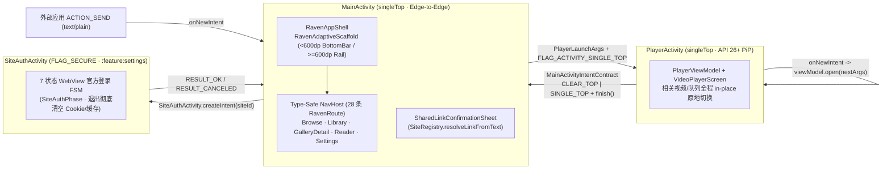

# Raven（渡鸦）设计系统与 UI 架构手册 (`DESIGN_AND_UI_GUIDE.md`)

> **适用范围**：`:core:designsystem`、`com.raven.app` 壳层（`MainActivity` / `PlayerActivity` / `RavenNavHost`）以及全部 5 个 `:feature:*` 模块的视觉规范、组件调用与导航开发  
> **单一事实来源**：`core/designsystem/src/main/kotlin/com/raven/app/core/designsystem/**` · `core/model/.../RavenRoute.kt` · `app/src/main/kotlin/com/raven/app/**`

---

## 1. 品牌定位、自适应图标与三大视觉原则

### 1.1 应用品牌与构建身份

| 维度 | Release | Debug | 资源位置 |
|---|---|---|---|
| **英文名称** | `Raven` | `Raven Debug` | `app/src/main/res/values/strings.xml` / `app/src/debug/res/values/strings.xml` |
| **中文名称** | `渡鸦` | `渡鸦 开发版` | `app/src/main/res/values-zh/strings.xml` / `app/src/debug/res/values-zh/strings.xml` |
| **Application ID** | `com.raven.app` | `com.raven.app.debug` | `app/build.gradle.kts` (`applicationIdSuffix = ".debug"`) |
| **品牌字标** | `RAVEN.`（绯红点缀 `.`） | 同左 | `RavenBrandWordmark`（`RavenAdaptiveScaffold.kt`） |

### 1.2 自适应启动图标矢量规范

Raven 的启动图标采用 **01 高马尾头像** 设计体系（源稿与 Play 商店图标位于 `docs/icon-concepts/01-raven-portrait-android/`），自适应图标入口配置在 `app/src/main/res/mipmap-anydpi-v26/ic_launcher.xml`（及 `ic_launcher_round.xml`），同时附带 `mdpi`–`xxxhdpi`（48×48px–192×192px）传统圆角方形（`ic_launcher.png`）及圆形（`ic_launcher_round.png`）PNG 兼容 API 24–25：

| 图层 | 文件路径 | 画布与安全区参数 | 视觉定义 |
|---|---|---|---|
| **背景层** | `app/src/main/res/drawable/ic_launcher_background.xml` | `108dp × 108dp`（`viewport 108×108`） | 纯黑曜石 `#09090B` 背景铺满画布 |
| **前景层** | `app/src/main/res/drawable/ic_launcher_foreground.xml`（包裹 `app/src/main/res/drawable-xxxhdpi/raven_portrait_foreground.png`） | `108dp × 108dp` 位图包装（源图 `432×432px` 透明 PNG，主体占 `66dp × 66dp` 安全区） | 保留原画黑发、豆豆眼与 **Raven Crimson `#FF4D58`** 绯红羽饰的高马尾头像，通过 `<bitmap android:gravity="fill" android:filter="true" />` 居中对齐安全区 |
| **单色层** | `app/src/main/res/drawable/ic_launcher_monochrome.xml` | `108dp × 108dp`（`viewport 108×108`） | 纯白 `#FFFFFF` `evenOdd` 镂空轮廓剪影（保留羽饰、豆豆眼与笑脸），适配 Android 13+ 系统主题图标着色 |

### 1.3 三大视觉原则：**Dark Obsidian × Apple HIG Precision × Netflix Cinema**

1. **Dark Obsidian（纯黑曜石 OLED）**
   - 以纯黑曜石 `#09090B` 为画布底座，配合三级暗色表面阶梯（`Surface1 #121216` → `Surface2 #1B1B22` → `Surface3 #24242D`）表达层级。
   - `RavenDarkColorScheme` 强制设定 `surfaceTint = Color.Transparent`，彻底消除 Material 3 tonal elevation 叠加导致的 OLED 灰雾发污。
   - **唯一品牌点缀色**：**Raven Crimson `#FF4D58`** 严格限定于当前激活导航项、播放/阅读进度条、未读角标与渡鸦之眼，**严禁**铺满大面积背景；彻底废弃旧版 R34V 粉红主题 `#FF8DB4`（由 `RavenDesignTokensTest` 单元测试锁定回归防线）。
2. **Apple HIG Precision（苹果级克制与精致）**
   - 优先使用 `0.5dp` 半透明白线 `Hairline`（`#FFFFFF @ 8%`）与 `RimHighlight`（`#FFFFFF @ 12%`）勾勒边界，而非厚重阴影。
   - 字距采用 HarmonyOS 可读性策略：正文与标题为 `0.sp`，仅 `displayLarge` 为 `-0.1.sp`，小标签为 `0.05..0.1.sp`；所有数字指标强制开启等宽数字 `tnum` 防止跳动。
   - 设置项、高级筛选、播放偏好与阅读器配置统一采用 **Apple 风格分组内嵌卡片（`RavenGroupedSection`）+ 单屏 `RavenBottomSheet`**，彻底禁止套娃 `AlertDialog`。
   - 交互元素附带物理弹簧按压微缩（默认 `scale = 0.968f`），并原生兼容系统减弱动效与降低透明度开关。
3. **Netflix Cinema（流媒体影院氛围）**
   - **视频站点首页（`MediaKind.VIDEO`）**：全出血 Hero Banner 轮播（`430dp`）+ 顶部状态栏暗角与受限环境光（`alpha <= 0.18f`）+ 底部多段渐隐融黑 + 纯白高对比主 CTA「播放」与毛玻璃次 CTA「+ 稍后看」+「继续观看」横向货架（`2.5dp` 绯红底条）+ Top 10 超大排行货架 + 分类横向片单。
   - **漫画 / 写真站点首页（`MediaKind.COMIC` / `MediaKind.PHOTO`）**：无边框原生宽高比瀑布流 `LazyVerticalStaggeredGrid`（按宽度自动 `2–6` 列）+ 置顶紧凑续读卡 + 多本未完成作品“继续阅读”横排 + 随滚动自动收起的单行语言筛选栏（`RavenLanguageBar`）。
   - **资料库统一呈现**：订阅更新、下载与收藏默认瀑布流，并共用 `LibraryCollectionLayoutButton` 切换为列表；标签与作者长按打开操作 Sheet（复制、订阅、编辑译名、屏蔽、单站/跨站搜索），作品详情末尾展示相似推荐。

---

## 2. 完整 Design Token 参考

所有视觉令牌集中在 `:core:designsystem` 的 `com.raven.app.core.designsystem.theme` 包中。业务代码通过 `RavenTheme.colors`（等价于 `LocalRavenColors.current`）与 `MaterialTheme.typography` / `RavenShapes` 消费，**严禁硬编码 `Color(0x...)`**。

### 2.1 `RavenTheme` 与 `CompositionLocal` 体系（`RavenTheme.kt`）

```kotlin
RavenTheme(reduceTransparency = appSettings.reduceTransparency) {
    CompositionLocalProvider(
        LocalRavenImageRequestDecorator provides ::ravenImageRequestDecorator,
    ) {
        // 应用内容
    }
}
```

| 提供器 / 访问器 | 类型 | 默认值 / 来源 | 说明 |
|---|---|---|---|
| `LocalRavenColors` / `RavenTheme.colors` | `RavenExtendedColors` | `RavenColors` 语义色板 | 扩展 OLED 色板（含 `canvas` / `surface1..3` / `hairline` / `crimson` 等） |
| `LocalReduceTransparency` / `RavenTheme.reduceTransparency` | `Boolean` | `false`（来自 DataStore `reduce_transparency`） | 为 `true` 时将 API 31+ 模糊毛玻璃降级为 `#121216 @ 92%` 暗色遮罩 |
| `LocalMotionReduced` / `RavenTheme.motionReduced` | `Boolean` | 读取系统 `Settings.Global.ANIMATOR_DURATION_SCALE == 0f` | 为 `true` 时弹簧退化为 `snap()`、关闭 Shimmer 动画/Hero 自动轮播/图片 Crossfade |
| `RavenTheme.shapes` | `RavenShapes` | `RavenShapes` | 圆角常量与 `RoundedCornerShape` 单例 |

### 2.2 色板令牌（`RavenColors.kt`）

| `RavenColors` 常量 | `RavenExtendedColors` 字段 | 十六进制 / ARGB | 角色与使用约束 |
|---|---|---|---|
| `Canvas` / `Background` | `canvas` | `#FF09090B` | 纯黑曜石 OLED 画布背景 |
| `Surface1` | `surface1` | `#FF121216` | 一级容器：卡片底色、分组内嵌列表容器、未选 Chip、底部导航栏/侧栏 |
| `Surface2` | `surface2` | `#FF1B1B22` | 二级容器：`ModalBottomSheet`、搜索框、图标徽章底、次按钮 |
| `Surface3` | `surface3` | `#FF24242D` | 三级高亮：已选容器、滑块未激活轨道、按压态/顶层浮层 |
| `Hairline` | `hairline` | `#14FFFFFF`（`#FFFFFF @ 8%`） | Apple HIG `0.5dp`–`1dp` 半透明发丝分割线与卡片描边 |
| `RimHighlight` | `rimHighlight` | `#1FFFFFFF`（`#FFFFFF @ 12%`） | 毛玻璃表面顶部高光描边 |
| `OutlineSubtle` | `outlineSubtle` | `#FF2A2A33` | 控件不透明描边回退（如 `OutlinedButton`、`Switch` 边框） |
| `InkPrimary` | `inkPrimary` | `#FFF5F5F7` | 主标题、主正文、激活图标（苹果柔白，减轻 OLED 炫光） |
| `InkSecondary` | `inkSecondary` | `#FF9E9EA8` | 副标题、元数据、未选中导航项 |
| `InkTertiary` | `inkTertiary` | `#FF6E6E78` | 时间戳、占位提示、禁用文字、拖拽把手 |
| `Crimson` | `crimson` | `#FFFF4D58` | **Raven Crimson** 品牌绯红（激活导航/进度条/未读徽标/焦点光标/开关轨道） |
| `PrimaryCtaContainer` | `primaryCtaContainer` | `#FFF5F5F7` | Netflix 风格高对比主按钮背景（播放/重试/选中 Chip） |
| `PrimaryCtaInk` | `primaryCtaInk` | `#FF09090B` | 主按钮纯黑文字/图标 |
| `SecondaryCtaContainer` | `secondaryCtaContainer` | `#FF1B1B22 @ 78%` | Hero 次按钮（稍后看）半透底色，配合 `RimHighlight` 描边 |
| `SecondaryCtaInk` | `secondaryCtaInk` | `#FFF5F5F7` | 次按钮文字 |
| `FrostedSurfaceOverlay` | `frostedSurfaceOverlay` | `#FF121216 @ 78%` | 毛玻璃覆盖层参考色 |
| `FrostedFallbackScrim` | `frostedFallbackScrim` | `#FF121216 @ 92%` | API 24–30 或 `reduceTransparency = true` 时的毛玻璃降级底色 |
| `ScrimTop` | `scrimTop` | `#0009090B` | 顶部全透明渐隐起点 |
| `ScrimBottom` | `scrimBottom` | `#FF09090B` | 底部与画布无缝融合的暗角终点 |
| `BadgeBackdrop` | `badgeBackdrop` | `#CC09090B`（`80%`） | 海报角标（时长、页数、元数据胶囊）底色 |
| `Success` | `success` | `#FF30D158` | 成功状态（下载完成、已登录、校验通过） |
| `Warning` | `warning` | `#FFFFD60A` | 警告状态（计费网络暂停、限速、待迁移） |
| `Error` | `error` | `#FFFF453A` | 错误状态与破坏性操作（删除、登出、清空） |
| `ShimmerBase` / `ShimmerHighlight` | `shimmerBase` / `shimmerHighlight` | `#FF16161C` / `#FF262630` | 暗色骨架屏微光渐变起止色 |
| `LightRimTop` / `LightRimBottom` | `lightRimTop` / `lightRimBottom` | `#2EFFFFFF` / `#0AFFFFFF` | 顶部/底部光学折射边（白色 18% / 4%） |
| `InteractiveGlow` / `AccentGlow` | `interactiveGlow` / `accentGlow` | `#26FFFFFF` / `#38FF4D58` | 指针互动光（白色 15%）与绯红焦点光晕（22%） |
| `FloatingBarScrim` | `floatingBarScrim` | `#E0121216` | 浮动导航/Sheet 半透明背景 |
| `AMBIENT_GLOW_MAX_ALPHA` | —（常量） | **`0.18f`** | Hero/详情页顶部环境光不透明度硬上限 |

> **Material 3 映射要点（`RavenDarkColorScheme`）**：`primary = Crimson`、`secondary = PrimaryCtaContainer`、`onSecondary = PrimaryCtaInk`、`background = Canvas`、`surface = Surface1`、`surfaceVariant = Surface2`、`surfaceTint = Color.Transparent`、`outline = OutlineSubtle`、`outlineVariant = Hairline`、`errorContainer = #3B1517`、`onErrorContainer = #FFB4AB`。

### 2.3 排版字阶与等宽数字（`RavenTypography.kt`）

全站使用系统默认无衬线字体 `FontFamily.SansSerif`（不打包额外字体文件），采用 **HarmonyOS 可读性字距策略**（去强负字距压缩，正文与标题均为 `0.sp`，仅超大 `displayLarge` 为 `-0.1.sp`，小标签 `0.05..0.1.sp`），并针对 200% 系统字体缩放预留合理行高：

| Material 3 样式 | `FontWeight` | `fontSize` | `lineHeight` | `letterSpacing` | 典型场景 |
|---|---|---:|---:|---:|---|
| `displayLarge` | `Bold` | `40.sp` | `46.sp` | `-0.1.sp` | Top 10 排行大号数字基座 |
| `displayMedium` | `Bold` | `32.sp` | `38.sp` | `0.sp` | 大屏展示标题 |
| `displaySmall` | `Bold` | `28.sp` | `34.sp` | `0.sp` | 引导/总览主标 |
| `headlineLarge` | `Bold` | `26.sp` | `32.sp` | `0.sp` | 详情页主标题 |
| `headlineMedium` | `Bold` | `22.sp` | `28.sp` | `0.sp` | Hero Banner 标题 |
| `headlineSmall` | `SemiBold` | `19.sp` | `25.sp` | `0.sp` | 次级页主标 |
| `titleLarge` | `SemiBold` | `18.sp` | `24.sp` | `0.sp` | `RavenTopBar`、`RavenSectionHeader`、`RavenBottomSheet` / `RavenDialog` 标题 |
| `titleMedium` | `SemiBold` | `15.sp` | `20.sp` | `0.sp` | `RavenVideoCard` 标题 |
| `titleSmall` | `SemiBold` | `13.sp` | `18.sp` | `0.sp` | `RavenGalleryCard`、`RavenCompactMediaRow` 标题 |
| `bodyLarge` | `Normal` | `16.sp` | `23.sp` | `0.sp` | `RavenGroupedRow` 主文案、正文段落 |
| `bodyMedium` | `Normal` | `14.sp` | `20.sp` | `0.sp` | 搜索框输入、空态/错误说明、弹窗正文 |
| `bodySmall` | `Normal` | `12.sp` | `17.sp` | `0.sp` | 卡片元数据、分组副标题、脚注 |
| `labelLarge` | `SemiBold` | `14.sp` | `18.sp` | `0.sp` | `RavenButton`、站点切换胶囊、筛选 Chip、滑块数值 |
| `labelMedium` | `Medium` | `12.sp` | `16.sp` | `0.05.sp` | 分组节标题、查看全部按钮、`RavenTabularTextStyle` 基础样式 |
| `labelSmall` | `Medium` | `11.sp` | `14.sp` | `0.1.sp` | 底部导航栏 / `NavigationRail` / `NavigationDrawer` 标签 |

**等宽数字强制规范（`RAVEN_TABULAR_FONT_FEATURE = "tnum"`）**：
- 凡涉及动态刷新或纵向对齐的数字——**视频时长（`12:34`）、阅读页码（`14 / 120`）、观看/收藏数、字节大小（`1.5 MB`）、下载进度、倍速/音量/亮度 HUD、未读角标、Top 10 排名**——**必须**使用 `RavenTabularTextStyle` 或对任意样式调用 `.tabular()`（即 `copy(fontFeatureSettings = "tnum")`）。

### 2.4 形状几何（`RavenShapes.kt`）

采用 HarmonyOS Design Z 轴分层圆角体系：

| 常量 | 半径 / 形状 | 映射至 `MaterialShapes` | 适用组件 |
|---|---|---|---|
| `MicroRadius` / `MicroShape` | `4.dp` | — | 微小角标/分割装饰 |
| `BadgeRadius` / `BadgeShape` | `6.dp` | `extraSmall` | 封面角标（时长 / `42P` 页数） |
| `SmallRadius` / `SmallShape` | `8.dp` | — | 紧凑徽章/次级标签 |
| `ControlRadius` / `ControlShape` | `12.dp` | `small` | 列表缩略图、分组图标底框、输入框、骨架屏条块 |
| `CardRadius` / `CardShape` | `16.dp` | `medium` | 视频/图集卡片、`RavenCompactMediaRow`、`RavenGroupedSection` |
| `ButtonRadius` / `ButtonShape` | `20.dp` | — | `RavenPrimaryButton` / `RavenSecondaryButton` / `RavenDangerButton` / `RavenTextButton` |
| `DialogRadius` / `DialogShape` | `28.dp` | `large` | `RavenDialog` 家族、宽屏居中 `RavenBottomSheet` |
| `SheetRadius` / `SheetShape` | `32.dp`（仅 `topStart` / `topEnd`） | `extraLarge` | 底部锚定 `RavenBottomSheet`（`BindSheet`） |
| `PillShape` | `CircleShape` | — | 站点切换胶囊、搜索框、筛选 Chip、`RavenIconButton`、`RavenVisualHud`、`RavenStatusPill` |

### 2.5 动效、磨砂与环境光（`RavenMotion.kt`）

| API | 关键参数与行为 | 兼容与降级规则 |
|---|---|---|
| `RavenMotion.HarmonyDecelerationEasing` | HarmonyOS 官方 Friction 曲线 `CubicBezierEasing(0.2f, 0.0f, 0.1f, 1.0f)`，用于页面 push/pop、Tab、Sheet/Dialog 转场（旧别名 `AppleDecelerationEasing` 已 `@Deprecated` 并委托至此） | `LocalMotionReduced.current == true` 时统一 `snap()` |
| `responsiveSpringSpec` / `interactiveSpringSpec` / `gentleSpatialSpringSpec` | 三组物理重力弹簧，用于手势跟手、按压回弹与可中断切换 | 减弱动效时退化为 `snap()` |
| `Modifier.ravenSpringPress(interactionSource, pressedScale = 0.968f, enabled)` | 弹簧按压缩放 `1.0f -> 0.968f`，传 `interactionSource` 时与 `clickable` 联动 | `LocalMotionReduced.current == true` 时降级为 `snap()`；Disabled 无缩放 |
| `Modifier.ravenInteractiveLight(interactionSource, shape, enabled, glowColor)` | HarmonyOS 指针起源径向互动光 + 顶部高光描边，同时响应 **Press / Mouse Hover / Keyboard Focus** | Disabled 无光效；`LocalMotionReduced` 时直接切换 |
| `Modifier.ravenFrostedSurface` / `RavenFrostedBox` | 五档光学毛玻璃（`ULTRA_THIN` -> `ULTRA_THICK`）+ 顶部高光折射边，不模糊前景文字与图标 | `API < 31` 或 `reduceTransparency = true` 时降级为 `FrostedFallbackScrim`（`#121216 @ 92%`）+ `Hairline` |
| `Modifier.ambientHeroGlow(tint = Crimson, alpha = 0.14f)` | 在 Hero/详情顶栏绘制偏右上角 `(0.68w, 0.18h)` 径向微光 | 经 `RavenMotion.clampAmbientGlowAlpha(alpha)` **强制钳制在 `0f..0.18f`**，绝不污染全局主题色 |

### 2.6 纯 Kotlin 格式化工具（`RavenFormatters.kt`）

与 `tnum` 搭配使用，全部区域无关、可纯 JVM 单测：
- 宽高比常量：`VIDEO_ASPECT_RATIO = 16f / 9f`、`DEFAULT_GALLERY_ASPECT_RATIO = 0.72f`、`MIN_ASPECT_RATIO = 0.45f`、`MAX_ASPECT_RATIO = 2.2f`。
- `formatDuration(seconds: Int?)` / `formatDurationMs(durationMs: Long)`：`MM:SS` 或 `H:MM:SS`（负数/`null` 返回 `""`）。
- `formatCount(count: Long?)`：紧凑计数（`999`、`1K`、`1.2K`、`12.5K`、`1.5M`、`2.3B`）。
- `formatByteSize(bytes: Long)`：1024 进制字节格式化（`0 B`、`512 B`、`1.5 MB`、`2.4 GB`）。
- `clampAspectRatio(aspectRatio, defaultRatio, minRatio, maxRatio)`：防异常封面比例撑爆瀑布流。
- `formatPageCount(pageCount: Int?)`（如 `"42P"`）与 `formatPageProgress(currentPage, totalPages)`（如 `"14 / 120"`）。

---

## 3. `:core:designsystem` 组件速查目录

全部位于 `package com.raven.app.core.designsystem.component`，所有卡片与展示组件均保持**纯无状态（Stateless）**——零内部 `StateFlow`、零内嵌弹窗宿主。

### 3.1 导航与顶栏壳组件（`RavenAdaptiveScaffold.kt`）

| Composable / 符号 | 核心签名与默认参数 | 内置 `testTag` / 关键细节 |
|---|---|---|
| `RavenAdaptiveScaffold` | `(currentDestination: RavenTopDestination, onDestinationSelected, modifier, showNavigation = true, badges: Map<RavenTopDestination, Int> = emptyMap(), content)` | `raven_adaptive_scaffold`；`< 600dp` 渲染 `NavigationBar`，`>= 600dp` 切换 `NavigationRail`；`showNavigation = false` 设为 `NavigationSuiteType.None`；自动补 `0.5dp Hairline` 分割线；徽标超过 99 显示 `99+` |
| `RavenTopDestination` | 枚举 5 项：`HOME` (`首页`/`nav_home`)、`EXPLORE` (`发现`/`nav_explore`)、`SEARCH` (`搜索`/`nav_search`)、`LIBRARY` (`鸦巢`/`nav_library`)、`PROFILE` (`我的`/`nav_profile`) | 每项携带 `route`、`selectedIcon`、`unselectedIcon`、`testTag` 及 `matchesRoute(current)` |
| `RavenTopBar` | `(modifier, title = null, subtitle = null, frosted = false, showBottomHairline = true, navigationIcon = null, titleContent = null, actions = {})` | 自带 `statusBarsPadding()` 与 `heightIn(min = 56.dp)`；`frosted = true` 自动包 `RavenFrostedBox`；标题带 `semantics { heading() }` |
| `RavenSiteSwitcherPill` | 重载 1：`(site: SiteDescriptor, onClick, modifier, frosted = false)`<br>重载 2：`(shortName: String, mediaKind: MediaKind, onClick, modifier, frosted = false)` | `raven_site_switcher_pill`；强制 `>= 48dp` 触控区 + `ravenSpringPress`；按 `MediaKind` 区分指示点色（视频绯红/漫画柔白/写真次灰）与图标 |
| `RavenBrandWordmark` | `(modifier, title = "RAVEN")` | 粗黑紧字距 `RAVEN.`（末尾绯红圆点） |

### 3.2 影院展示、媒体卡片与货架组件

| Composable | 所在文件 | 核心参数与默认行为 | 内置 `testTag` |
|---|---|---|---|
| `RavenHeroBanner` | `RavenHeroBanner.kt` | `(items, onPlayClick, onWatchLaterClick, onItemClick, modifier, isInWatchLater = { false }, primaryActionLabel = "播放", watchLaterLabel = "稍后看", inWatchLaterLabel = "已加入", bannerHeight = 430.dp, ambientTint = Crimson, ambientGlowAlpha = 0.15f, autoAdvanceMillis = 6_000L)` | `raven_hero_banner`, `hero_play_cta`, `hero_watch_later_cta`, `hero_page_indicators`, `hero_pause_toggle` |
| `RavenVideoCard` | `RavenMediaCard.kt` | `(item: MediaItem, onClick, modifier, onLongClick = null, progressFraction = null, badgeText = null, subtitleOverride = null, showMetadata = true)` — 固定 16:9，右下等宽时长角标，底部可选 `2.5dp` 绯红进度条 | `raven_video_card_${item.id}` |
| `RavenRankedVideoCard` | `RavenMediaCard.kt` | `(rank: Int, item: MediaItem, onClick, modifier, onLongClick = null, cardWidth = 204.dp, progressFraction = null, badgeText = null)` — 左侧 `54.sp` 超大等宽排行数字 + 右侧 `RavenVideoCard` | `raven_ranked_card_$rank` |
| `RavenGalleryCard` | `RavenMediaCard.kt` | `(item: MediaItem, onClick, modifier, onLongClick = null, aspectRatioOverride = null, onAspectRatioResolved = null, progressFraction = null, badgeText = null, showCaption = true)` — 原生宽高比（经 `clampAspectRatio` 钳制），图片解码后回传真实比例防跳动，右下角显示 `42P` 页数胶囊 | `raven_gallery_card_${item.id}` |
| `RavenCompactMediaRow` | `RavenMediaCard.kt` | `(item: MediaItem, onClick, modifier, onLongClick = null, subtitle = null, progressFraction = null, badgeText = null, statusContent = null, trailingContent = null)` — 横向列表行（视频缩略图 `118×68dp`，图集 `68×90dp`），用于搜索结果、历史、收藏、片单与下载列表 | `raven_compact_row_${item.id}` |
| `RavenCrimsonProgressBar` | `RavenMediaCard.kt` | `(fraction: Float, modifier, trackHeight = 2.5.dp)` — 续播/续读底条 | — |
| `RavenSectionHeader` | `RavenSectionHeader.kt` | `(title, modifier, subtitle = null, actionLabel = null, onActionClick = null)` — 右侧可选 `>= 48dp`「查看全部」箭头按钮 | — |
| `RavenHorizontalShelf` | `RavenSectionHeader.kt` | `(modifier, title = null, subtitle = null, actionLabel = null, onActionClick = null, state = rememberLazyListState(), contentPadding = horizontal(16.dp), itemSpacing = 12.dp, content: LazyListScope.() -> Unit)` | — |

### 3.3 搜索、筛选、分组列表与底部表单组件

| Composable | 所在文件 | 核心参数与典型用法 | 内置 `testTag` |
|---|---|---|---|
| `RavenSearchField` | `RavenSearchField.kt` | `(query, onQueryChange, modifier, placeholder = "搜索作品、标签、作者…", onSearch = null, onClear = null, enabled = true, readOnly = false, trailingContent = null)` — 全应用**唯一**搜索胶囊（`Surface2`、`heightIn(min = 48.dp)`、聚焦绯红描边与光标、一键清空） | `raven_search_field`, `raven_search_clear` |
| `RavenFilterChip` / `RavenFilterChipRow` | `RavenFilterChipRow.kt` | 胶囊筛选条（选中态纯白高对比 `PrimaryCtaContainer/Ink`，未选 `Surface1 + Hairline`，保证 `>= 48dp` 触控区与 `ravenSpringPress`） | — |
| `RavenLanguageBar` | `RavenLanguageBar.kt` | `(selected: ComicLanguage, onSelected, modifier, visible = true, languages = ComicLanguage.entries, showBottomHairline = true)` — 带 `AnimatedVisibility` 垂直折叠的单行语言条（`全部 / 中文 / 日文 / 中＋日`），用于声明 `SiteCapability.LANGUAGE_FILTER` 的漫画站 | `raven_language_bar`, `lang_pill_${language.name.lowercase()}` |
| `RavenGroupedSection` | `RavenGroupedList.kt` | `(modifier, title = null, footer = null, content: ColumnScope.() -> Unit)` — 圆角内嵌分组卡（`Surface1`、`RavenShapes.CardRadius = 16dp`、`0.5dp Hairline`） | — |
| `RavenGroupedDivider` | `RavenGroupedList.kt` | `(modifier, insetWithIcon = false)` — 分组行间 `0.5dp` 细线（带图标时缩进 `60.dp`，否则 `16.dp`） | — |
| `RavenGroupedRow` | `RavenGroupedList.kt` | `(title, modifier, subtitle = null, value = null, icon = null, iconTint, iconContainerColor, showChevron = false, destructive = false, enabled = true, onClick = null, trailingContent = null)` — 最小高度 `52.dp`，右侧 `value` 自动 `.tabular()` | — |
| `RavenGroupedSwitchRow` | `RavenGroupedList.kt` | `(title, checked, onCheckedChange, modifier, subtitle = null, icon = null, ...)` — 整行可点 `Role.Switch`，激活轨道为 `Crimson` | — |
| `RavenGroupedSliderRow` | `RavenGroupedList.kt` | `(title, value, onValueChange, valueLabel, modifier, subtitle = null, icon = null, valueRange = 0f..1f, steps = 0, enabled = true, onValueChangeFinished = null)` — 右上角实时等宽读数 + 绯红轨道滑块 | — |
| `RavenBottomSheet` / `RavenSheetSurface` | `RavenBottomSheet.kt` | `(onDismissRequest, modifier, sheetState, presentation = Bottom/Center/Auto, detent = Auto/Medium/Large/Fixed(dp), title, subtitle, trailingAction, contentPadding, dismissOnScrimClick = true, confirmValueChange, content)` — `Surface2`、`32dp` 顶圆角（宽屏居中 `28dp` / 最大宽 `480dp`）、支持 Esc 关闭、自带 `navigationBarsPadding()` + `imePadding()` | `raven_bottom_sheet` |
| `RavenButton` 家族 + `RavenButtonRow` | `RavenButton.kt` | `RavenPrimaryButton`（Crimson / Cta）、`RavenSecondaryButton`、`RavenTextButton`、`RavenIconButton`、`RavenDangerButton`；三档高度 `Small(40dp)/Medium(48dp)/Large(52dp)`、单按钮最大 `448dp`、双按钮等宽 `12dp` 间距、三按钮及以上纵向 `12dp` 排列、内置 Loading/Success/Hover/Focus 与触感反馈 | — |
| `RavenDialog` 家族 | `RavenDialog.kt` | `RavenDialog`、`RavenAlertDialog`、`RavenConfirmDialog`、`RavenInputDialog`、`RavenLoadingDialog`；宽度 `min(屏宽-32dp, 400dp)`、最大高度 `90%`、圆角 `28dp`、Esc 关闭、高风险 `destructive = true` 默认禁用点击遮罩误关 | `raven_dialog` |

#### Sheet vs Dialog 选型表（强制约束）

| 场景类型 | 选用组件 | 规则 |
|---|---|---|
| 高风险确认（删除、清空、登出、覆盖、重置） | `RavenConfirmDialog` / `RavenAlertDialog(destructive = true)` | 强打断模态，默认禁用 scrim 误关，主操作用 `RavenDangerButton` |
| 单字段轻量输入（重命名、新建片单） | `RavenInputDialog` | 自动请求键盘焦点，支持回车确认与 Esc 取消 |
| 筛选、排序、片单选择、轻量操作菜单 | `RavenBottomSheet(presentation = Bottom, detent = Medium/Auto)` | 手机底部弹出，支持拖拽与点击遮罩关闭 |
| 登录/Cookie 导入、PIN 设置、网络诊断、更新详情 | `RavenBottomSheet(presentation = Center)` | 手机端底部弹出；折叠屏/平板/桌面（`>= 600dp`）自动居中为 `480dp` 面板 |
| 多窗口自适应断点（`RavenWindowClass`） | `RavenLayout.kt` / `rememberRavenWindowClass()` | `COMPACT(<600dp)` 底栏、`MEDIUM(600-839dp)` Rail、`EXPANDED(840-1199dp)` Rail/双栏、`LARGE(>=1200dp)` Permanent Drawer |

### 3.4 媒体浮层、分站图片与状态反馈组件

| Composable | 所在文件 | 核心参数与关键设计 | 内置 `testTag` |
|---|---|---|---|
| `RavenVisualHud` | `RavenVisualHud.kt` | `(visible: Boolean, icon: ImageVector, label: String, modifier, progress: Float? = null, accentColor = InkPrimary)` — 播放器亮度/音量/快进/倍速、阅读器亮度/缩放的居中毛玻璃胶囊 HUD，进度条 `108×4dp`，文案强制 `tnum` | `raven_visual_hud` |
| `RavenImage` + `LocalRavenImageRequestDecorator` | `RavenImage.kt` | `RavenImage(url, modifier, siteId = null, contentDescription = null, contentScale = Crop, crossfadeMillis = 180, placeholderTopColor = surface2, placeholderBottomColor = surface1, showErrorIcon = true, onAspectRatioResolved = null)` — 通过 `LocalRavenImageRequestDecorator` 注入 `:core:network` 的 `::ravenImageRequestDecorator`（附加 `RavenImageExtras.SiteIdKey`、站点 Referer/UA 与分站缓存键），彻底避免 `:core:designsystem -> :core:network` 循环依赖 | `raven_image_ready`, `raven_image_error` |
| `RavenStatusPill` | `RavenStates.kt` | `(text, modifier, tone: RavenStatusTone = NEUTRAL, icon = null, tabular = true)` — 支持 `NEUTRAL` / `ACCENT` / `SUCCESS` / `WARNING` / `ERROR` 五种语义胶囊 | — |
| `RavenEmptyState` | `RavenStates.kt` | `(title, message, modifier, icon = Icons.Outlined.Inbox, actionLabel = null, onActionClick = null)` | `raven_empty_state` |
| `RavenErrorState` | `RavenStates.kt` | `(message, onRetry, modifier, title = "加载失败", retryLabel = "重试", secondaryActionLabel = null, onSecondaryActionClick = null)` — 支持第二操作按钮（如「前往登录」） | `raven_error_state`, `raven_error_retry` |
| `RavenLoadingSkeleton` 家族 | `RavenStates.kt` | `rememberRavenShimmerBrush()`、`RavenSkeletonBox`、`RavenVideoCardSkeleton`、`RavenGalleryCardSkeleton`、`RavenCompactRowSkeleton`、`RavenLoadingSkeleton(rowCount = 5)` | `raven_loading_skeleton` |

### 3.5 典型用法片段（Apple HIG 分组 Sheet + 分站图片）

```kotlin
// 1. 单屏分组 BottomSheet（替代递归 AlertDialog）
RavenBottomSheet(
    onDismissRequest = onDismiss,
    title = "播放偏好",
    subtitle = activeSite.displayName,
) {
    RavenGroupedSection(title = "播放行为") {
        RavenGroupedSwitchRow(
            title = "手动播放自动全屏",
            subtitle = "仅手动点击播放时按视频方向全屏（自动播放不触发）",
            checked = prefs.autoFullscreen,
            onCheckedChange = onToggleAutoFullscreen,
        )
        RavenGroupedDivider()
        RavenGroupedSliderRow(
            title = "默认倍速",
            value = prefs.defaultSpeed,
            valueRange = 0.5f..2.5f,
            steps = 7,
            valueLabel = "${prefs.defaultSpeed}x",
            onValueChange = onSpeedChange,
        )
    }
}

// 2. 分站图片加载（务必传 siteId，确保同域名不同站点缓存隔离与正确 Referer）
RavenImage(
    url = item.coverUrl,
    siteId = item.siteId,
    contentDescription = item.title,
    modifier = Modifier.fillMaxSize(),
)
```

### 3.6 响应式媒体网格列数公式（`BrowseFormatters.kt`）

| 屏幕可用宽度 (`maxWidth`) | 漫画/写真瀑布流 `computeGalleryGridColumns` | 16:9 视频网格 `computeVideoGridColumns` |
|---|---:|---:|
| `< 600dp`（手机竖屏） | **2 列** | **2 列** |
| `600dp .. 839dp`（折叠屏展开 / 小平板） | **3 列** | **3 列** |
| `840dp .. 959dp` | **4 列** | **3 列** |
| `960dp .. 1023dp` | **4 列** | **4 列** |
| `1024dp .. 1279dp`（横屏平板） | **5 列** | **4 列** |
| `>= 1280dp`（大屏平板 / 桌面窗口） | **6 列** | **5 列** |

---

## 4. 导航架构与 3-Activity 拓扑规范

### 4.1 3-Activity 零堆栈泄漏拓扑

Raven 用清晰的 **3-Activity 边界** 彻底消除了旧版多 Activity 无限堆叠的问题：



#### 三个 Activity 的硬性职责与安全不变量

1. **`MainActivity`**（`app/src/main/kotlin/com/raven/app/MainActivity.kt`，`launchMode="singleTop"`、`windowSoftInputMode="adjustResize"`）：
   - `onCreate` 首行启用 `enableEdgeToEdge` 透明暗色状态栏与导航栏，根部挂载 `RavenTheme(reduceTransparency)` + `LocalRavenImageRequestDecorator provides ::ravenImageRequestDecorator`。
   - 托管 `RavenAppShell`（28 条 Type-Safe `NavHost`）与实现 `MainActivityHostActions`：启动 `PlayerActivity` / `SiteAuthActivity`、SAF 文件创建/打开/目录授权（`ACTION_CREATE_DOCUMENT` / `OpenDocument` / `OpenDocumentTree`）、`FileProvider` 分享、`RavenUpdateInstaller` 未知来源权限与 APK 安装、以及阅读器窗口控制（沉浸系统栏、独立屏幕亮度、`FLAG_KEEP_SCREEN_ON`、硬件音量键短按/长按翻页）。
   - `onNewIntent` 按优先级消费：（1）来自 `PlayerActivity` 的 `EXTRA_NAVIGATE_ROUTE`（经 `MainActivityIntentContract` JSON 反序列化后导航至标签/作者/图集/账号）；（2）外部 `ACTION_SEND` `text/plain`，调用 `siteRegistry.resolveLinkFromText` 弹出 `SharedLinkConfirmationSheet` 确认后跳转，绝不堆叠重复 `MainActivity`。

2. **`PlayerActivity`**（`app/src/main/kotlin/com/raven/app/PlayerActivity.kt`，`launchMode="singleTop"`、`supportsPictureInPicture="true"`、`resizeableActivity="true"`、`configChanges="screenSize|smallestScreenSize|screenLayout|orientation|keyboardHidden"`）：
   - 通过 `PlayerLaunchArgs` 传递轻量播放目标（播放队列仅传 UUID `queueToken` 指向 `PlaybackQueueStore`，避免 Android Binder Intent 超限）。
   - 点击相关视频或队列下一条时，通过 `onNewIntent` -> `playerViewModel.open(nextArgs)` 或 ViewModel 内部 **in-place** 原地切源并调用 `onActiveMediaChanged` 同步 Intent，**零 Activity 堆栈增长**。
   - 播放队列通过统一 Sheet 展示完整条目，可原地选择/移除；自动连播默认关闭，仅在播放器前台以可取消倒计时推进，禁止后台轮询或重复切源。
   - **PiP 生命周期**：`onUserLeaveHint()` 在 `uiState.isPlaying == true` 且非主动跳出（`!suppressAutoPipOnce`）时自动调用 `enterPipMode`，宽高比由 `clampPipDimensions` 严格钳制在 **`0.42f .. 2.38f`**（避开 Android 系统 `1:2.39 ~ 2.39:1` 越界异常）。
   - 全屏切换按视频方向设置 `SCREEN_ORIENTATION_SENSOR_LANDSCAPE` / `SCREEN_ORIENTATION_SENSOR_PORTRAIT` 与 `BEHAVIOR_SHOW_TRANSIENT_BARS_BY_SWIPE`；回跳标签/作者/图集/站点账号时置 `suppressAutoPipOnce = true` 并以 `FLAG_ACTIVITY_CLEAR_TOP or FLAG_ACTIVITY_SINGLE_TOP` 返回 `MainActivity` 后 `finish()`。

3. **`SiteAuthActivity`**（`feature/settings/src/main/kotlin/com/raven/app/feature/settings/auth/SiteAuthActivity.kt`，声明于 `feature/settings/src/main/AndroidManifest.xml`）：
   - `onCreate` 在 `super.onCreate` / `setContent` 之前硬性设置 **`WindowManager.LayoutParams.FLAG_SECURE`**（防截屏/录屏/最近任务缩略图泄露）。
   - 仅服务声明 `AuthMode.WebViewCookie` 的站点（E-Hentai / ExHentai），由 7 状态有限状态机 `SiteAuthPhase`（`RESETTING` → `FORUM` → `COPYING_IDENTITY` → `LOADING_TARGET` → `TARGET_READY` / `TARGET_FAILED` → `VERIFYING`）驱动。
   - 严格安全隔离：零 JS 桥接、`allowFileAccess = false`、`allowContentAccess = false`、`acceptThirdPartyCookies = false`、`MIXED_CONTENT_NEVER_ALLOW`、`LOAD_NO_CACHE`、`allowedHosts` HTTPS 白名单、所有 `onReceivedSslError` 无条件 `handler.cancel()`；退出时彻底清除 `WebStorage`、全部 WebView `CookieManager` 缓存、历史与表单数据。

### 4.2 全部 28 条 Type-Safe `RavenRoute` 清单（`RavenRoute.kt`）

所有路由定义于 `:core:model` 的 `@Serializable sealed interface RavenRoute`，由 `RavenNavHost.kt` 统一注册，并在 `AppDiGraphTest` 中验证全部 28 条路由的 `kotlinx.serialization` 双向编解码：

| 组别 | # | 路由类型 (`RavenRoute.*`) | 参数签名 | 目标 Screen（所属模块） | 显示主导航壳 |
|---|---:|---|---|---|---|
| **5 顶级入口** | 1 | `Home` | `data object` | `HomeScreen` (`:feature:browse`) | 是 |
| | 2 | `Explore` | `data object` | `ExploreScreen` (`:feature:browse`) | 是 |
| | 3 | `Search` | `initialQuery: String? = null, crossSite: Boolean = false` | `SearchScreen` (`:feature:browse`) | 是 |
| | 4 | `Library` | `data object` | `LibraryHubScreen` (`:feature:library`) | 是 |
| | 5 | `Profile` | `data object` | `ProfileScreen` (`:feature:library`) | 是（带未读收件箱角标） |
| **3 浏览子页** | 6 | `SiteFeed` | `siteId: String, section: String? = null, category: String? = null, query: String? = null, scope: String = "ALL", title: String? = null` | `SiteFeedScreen` (`:feature:browse`) | 否 |
| | 7 | `SiteDirectory` | `siteId: String, section: String` | `SiteDirectoryScreen` (`:feature:browse`) | 否 |
| | 8 | `SiteFunctions` | `siteId: String` | `SiteFunctionsScreen` (`:feature:browse`) | 否 |
| **2 图集/阅读** | 9 | `GalleryDetail` | `siteId: String, mediaId: String, url: String` | `GalleryDetailScreen` (`:feature:reader`) | 否 |
| | 10 | `Reader` | `siteId: String, mediaId: String, url: String, startPage: Int = 1, offlineOnly: Boolean = false, queueToken: String? = null` | `ReaderScreen` (`:feature:reader`) | 否（连读下一本时 `popUpTo<Reader>(inclusive = true)` 原地替换防栈堆积） |
| **10 资料库子页** | 11 | `Downloads` | `data class(siteId: String? = null, initialTab: String = "downloads")` | `DownloadsScreen` (`:feature:library`) | 否 |
| | 12 | `ShelfDetail` | `shelfId: String` | `ShelfDetailScreen` (`:feature:library`) | 否 |
| | 13 | `SmartShelfDetail` | `smartShelfId: String` | `SmartShelfDetailScreen` (`:feature:library`) | 否 |
| | 14 | `Favorites` | `data class(siteId: String? = null)` | `FavoritesScreen` (`:feature:library`) | 否 |
| | 15 | `History` | `data object` | `HistoryScreen` (`:feature:library`) | 否 |
| | 16 | `ImageFavorites` | `data object` | `ImageFavoritesScreen` (`:feature:library`) | 否 |
| | 17 | `Subscriptions` | `siteId: String? = null` | `SubscriptionsScreen` (`:feature:library`) | 否 |
| | 18 | `GlobalInbox` | `data object` | `GlobalInboxScreen` (`:feature:library`) | 否 |
| | 19 | `LocalLibrary` | `data object` | `LocalLibraryScreen` (`:feature:library`) | 否 |
| | 20 | `Stats` | `data object` | `StatsScreen` (`:feature:library`) | 否 |
| **8 设置子页** | 21 | `Settings` | `data object` | `SettingsScreen` (`:feature:settings`) | 否 |
| | 22 | `SiteAccount` | `siteId: String` | `SiteAccountScreen` (`:feature:settings`) | 否 |
| | 23 | `BlockedTerms` | `siteId: String` | `BlockedTermsScreen` (`:feature:settings`) | 否 |
| | 24 | `TagDictionary` | `data object` | `TagDictionaryScreen` (`:feature:settings`) | 否 |
| | 25 | `BackupRestore` | `data object` | `BackupRestoreScreen` (`:feature:settings`) | 否 |
| | 26 | `Feedback` | `data object` | `FeedbackScreen` (`:feature:settings`) | 否 |
| | 27 | `StorageMigration` | `data object` | `StorageMigrationScreen` (`:feature:settings`) | 否 |
| | 28 | `DuplicateScanner` | `data object` | `DuplicateScannerScreen` (`:feature:settings`) | 否 |

> **主导航壳自适应与状态保留（`RavenNavHost.kt`）**：
> - `RavenAdaptiveScaffold` 根据 `currentWindowAdaptiveInfo().windowSizeClass.isWidthAtLeastBreakpoint(WindowSizeClass.WIDTH_DP_MEDIUM_LOWER_BOUND)`（即 **`600dp`**）在底部导航栏与左侧持久 `NavigationRail` 之间自动切换。
> - 仅当 `currentDestination` 命中上述 5 条顶级路由时 `showNavigation = true`；进入任意子路由后自动隐藏主导航栏，释放全屏空间。
> - 切换顶级 Tab 时统一执行 `popUpTo(graph.findStartDestination().id) { saveState = true } + launchSingleTop = true + restoreState = true`，保证各 Tab 滚动位置与筛选态不丢失。

### 4.3 Feature Navigator 解耦模式

Raven 严禁 Feature 模块互相依赖，也严禁向 Feature Screen 传递 `NavHostController` 或 `Activity`。5 个 Feature 模块各自声明面向业务的 Navigator 接口，统一在 `:app` 接线：

| Feature 模块 | Navigator 接口 | 接线位置 | 特色能力 |
|---|---|---|---|
| `:feature:browse` | `BrowseNavigator` | `RavenNavHost.kt` | 内置 `openMedia` / `openResolvedLink` / `openDirectoryEntry` / `openSearchResultItem` 默认分发扩展（按 `MediaItem.kind` 支持双媒体站点，零 `when(siteId)`） |
| `:feature:library` | `LibraryNavigator` | `RavenNavHost.kt` | 内置 `openMedia`（支持 `offlineOnly`、`queueToken`、`SiteId.LOCAL`）、`openFavorite`、`openWatchProgress`、`openReadingProgress` |
| `:feature:player` | `PlayerNavigator` | `PlayerActivity.kt` | 抽象 PiP、横竖屏全屏、窗口亮度、外部链接、原位切源同步及回跳 `MainActivity` |
| `:feature:reader` | `ReaderNavigator` | `RavenNavHost.kt` | 抽象沉浸系统栏、独立亮度、常亮、SAF 导出/选目录、`FileProvider` 分享与连续队列切换 `openQueueItem` |
| `:feature:settings` | `SettingsNavigator` | `RavenNavHost.kt` | 抽象 `SiteAuthActivity` 启动、SAF 备份创建/导入、APK 安装器拉起 |

---

## 5. 无障碍、大字体（200%）与 `testTag` 约定

### 5.1 无障碍与 200% 大字体强制规范

1. **最小触控面积 `>= 48dp`**：所有按钮、Chip、站点切换胶囊、顶栏图标、轮播暂停按钮与分组行均需附加 `minimumInteractiveComponentSize()`、`defaultMinSize(48.dp, 48.dp)` 或 `heightIn(min = 48.dp)`（分组行最小 `52.dp`）。
2. **语义标注**：
   - 所有页面顶栏标题、Sheet 标题、货架节标题、分组标题必须标注 `Modifier.semantics { heading() }`。
   - 关键状态变更提示（如 `SiteAuthActivity` 登录阶段状态文本）标注 `Modifier.semantics { liveRegion = LiveRegionMode.Polite }`。
   - 纯图标按钮必须提供清晰中文 `contentDescription`；装饰性图标传 `contentDescription = null` 避免 TalkBack 冗余播报。
3. **大字体弹性排版**：
   - 顶栏、搜索框、按钮、卡片行一律使用 `heightIn(min = ...)` 替代固定 `height(...)`，防止 200% 字体缩放截断文字。
   - 文本明确设置 `maxLines` + `TextOverflow.Ellipsis`；多标签行使用 `FlowRow` 自动折行。
4. **减弱动效与降低透明度**：
   - 新增任何动画/轮播/交叉淡入必须检查 `LocalMotionReduced.current`；
   - 新增任何毛玻璃容器必须走 `RavenFrostedBox` / `ravenFrostedSurface` 自动响应 `LocalReduceTransparency.current`。

### 5.2 稳定 `testTag` 命名约定

- **命名风格**：全小写蛇形 `snake_case`，按 `<模块或组件前缀>_<语义角色>[_<动态id>]` 组织；复杂模块（如播放器、阅读器）集中收敛到 `object *TestTags` 常量类，避免测试与 UI 漂移。
- **核心已锁定 `testTag` 索引**（部分已由 `app/src/androidTest/kotlin/com/raven/app/RavenSmokeAndroidTest.kt` 强断言，**修改需同步更新测试**）：
  - **导航壳与公共组件**：`raven_adaptive_scaffold`、`nav_home` / `nav_explore` / `nav_search` / `nav_library` / `nav_profile`、`raven_site_switcher_pill`、`raven_hero_banner`、`hero_play_cta`、`hero_watch_later_cta`、`raven_language_bar`、`lang_pill_<lang>`、`raven_search_field`、`raven_search_clear`、`raven_bottom_sheet`、`raven_visual_hud`、`raven_empty_state`、`raven_error_state`、`raven_error_retry`、`raven_loading_skeleton`、`raven_image_ready` / `raven_image_error`。
  - **浏览 / 资料库 / 设置核心屏幕**：`browse_home_screen`、`browse_explore_screen`、`browse_search_screen`、`site_switcher_sheet`、`site_switcher_content`、`site_tile_<siteId>`、`library_hub_screen`、`profile_screen`、`profile_settings_button`、`settings_screen`、`settings_list`、`settings_reduce_transparency`、`settings_backup_restore_row`、`settings_back_button`、`site_auth_activity_root`。
  - **集中常量对象**：
    - `PlayerTestTags`（`feature/player/.../PlayerContracts.kt`）：36 个稳定常量（`player_screen`、`player_surface`、`player_gesture_layer`、`player_scrubber`、`player_*_sheet` 等）。
    - `ReaderTestTags`（`feature/reader/.../ReaderTestTags.kt`）：23 个稳定常量（`gallery_detail_screen`、`reader_screen`、`reader_top_bar`、`reader_chapter_picker`、`reader_open_detail`、`reader_*_sheet` 等）。
