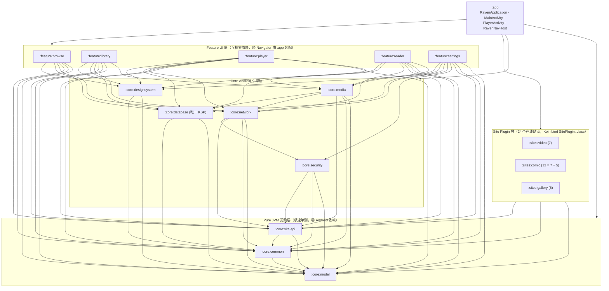

# Raven（渡鸦）新开发者接手与日常开发指南 (`ONBOARDING.md`)

> **适用读者**：首次接手、日常维护、评审 PR 或为 Raven 扩展新功能模块/页面的 Android 工程师  
> **代码基准**：`d:\Raven` · Application ID `com.raven.app`（Debug：`com.raven.app.debug`）· 当前版本见 [release.properties](../release.properties)· 17 模块 Clean Architecture
> **关联手册**：仓库与发布红线见 [AGENTS.md](../AGENTS.md) · 签名与发布指南见 [SIGNING.md](SIGNING.md) · 架构总览见 [ARCHITECTURE.md](ARCHITECTURE.md) · 站点插件见 [SITE_PLUGIN_GUIDE.md](SITE_PLUGIN_GUIDE.md) · 设计与 UI 见 [DESIGN_AND_UI_GUIDE.md](DESIGN_AND_UI_GUIDE.md) · 数据/媒体/安全见 [DATA_MEDIA_SECURITY.md](DATA_MEDIA_SECURITY.md)

---

## 1. 5 分钟上手环境配置

### 1.1 工具链与 SDK 基线（已实测锁定）

| 组件 | 锁定版本 / 要求 | 验证来源 |
|---|---|---|
| **JDK** | **JDK 17**（本机实测 Microsoft OpenJDK `17.0.19+10-LTS`） | `JavaVersion.VERSION_17` / `JvmTarget.JVM_17`（无需 JDK 21） |
| **Gradle Wrapper** | **`9.1.0`** (`gradle-9.1.0-all.zip`) | `gradle/wrapper/gradle-wrapper.properties` |
| **AGP** | **`9.0.1`**（内置 Kotlin，禁用 `kotlin-android` / `kapt`） | `gradle/libs.versions.toml` |
| **Kotlin** | **`2.3.21`**（覆盖 AGP 内置 `2.2.10`） | 根 `build.gradle.kts` `buildscript { classpath(libs.kotlin.gradle.plugin) }` |
| **KSP** | **`2.3.14`**（**仅**在 `:core:database` 启用 Room 注解处理） | `core/database/build.gradle.kts` |
| **Android SDK** | `compileSdk = 36` · `targetSdk = 36` · `minSdk = 24` · `buildTools = 36.0.0` | `app/build.gradle.kts` |
| **核心框架** | Compose BOM `2026.06.01`（Material3 `1.4.0`）· Navigation `2.9.8` · Koin `4.2.2` · Room `2.8.5` · DataStore `1.3.0` · Media3 `1.11.1` · Coil 3 `3.4.0` · OkHttp `4.12.0` | `gradle/libs.versions.toml` |

### 1.2 本地初始化步骤

1. **确认 JDK 17 与仓库状态**：
   ```powershell
   java -version
   git status
   ```
2. **创建 `local.properties`（严禁提交至 Git）**：
   在项目根目录 `d:\Raven\local.properties` 写入本机 Android SDK 路径（已加入 `.gitignore`）：
   ```properties
   sdk.dir=D\:/Android/Sdk
   ```
3. **在 PowerShell 会话中注入 SDK 工具路径**（若系统未全局配置 `ANDROID_HOME` / `PATH`）：
   ```powershell
   $env:ANDROID_HOME = "D:\Android\Sdk"
   $env:PATH = "D:\Android\Sdk\platform-tools;D:\Android\Sdk\emulator;D:\Android\Sdk\cmdline-tools\latest\bin;$env:PATH"
   ```
4. **确认 `gradle.properties` 配置原则**：
   仓库内置 `d:\Raven\gradle.properties` 已配置：
   ```properties
   org.gradle.jvmargs=-Xmx4g -XX:MaxMetaspaceSize=1g -Dfile.encoding=UTF-8
   org.gradle.parallel=true
   org.gradle.caching=true
   android.useAndroidX=true
   kotlin.code.style=official
   ```
   - **严禁**在项目 `gradle.properties` 中硬编码任何本机代理端口（如 `127.0.0.1:7897`）。如需在命令行临时指定代理，追加：
     ```powershell
     .\gradlew.bat :app:assembleDebug --no-daemon -Dhttp.proxyHost=127.0.0.1 -Dhttp.proxyPort=7897 -Dhttps.proxyHost=127.0.0.1 -Dhttps.proxyPort=7897
     ```
5. **首次跑通冒烟验证**：
   ```powershell
   # 1. 验证 Kotlin Gradle Plugin 已解析为 2.3.21
   .\gradlew.bat buildEnvironment --no-daemon | Select-String "kotlin-gradle-plugin"

   # 2. 运行全部 17 模块 JVM 单元测试（当前源码静态计数 694 处 @Test）
   .\gradlew.bat :core:model:test :core:common:test :core:site-spi:test :sites:video:test :sites:comic:test :sites:gallery:test testDebugUnitTest --no-daemon

   # 3. 构建 Debug APK
   .\gradlew.bat :app:assembleDebug --no-daemon
   ```

### 1.3 四大环境与工具链避坑红线

#### 避坑 1：Windows 全局 `kotlin.incremental=false` 背景与加速策略
- **背景**：Windows 上 Kotlin 增量编译器的 `caches-jvm` 文件句柄偶发无法释放，会导致构建报 `"Could not close incremental caches"`。部分开发机在 `%USERPROFILE%\.gradle\gradle.properties` 中全局设置了 `kotlin.incremental=false`（见 [audit-env.md](audit-env.md) §5.2）。
- **影响**：在该环境下，改动任一模块的 Kotlin 源码会触发**该模块内全量 Kotlin 重编**。
- **应对策略**：
  1. Raven 已拆分为 17 个细粒度模块，且选用 **Koin `4.2.2`**（零全局 KSP/字节码插桩，仅 `:core:database` 使用 KSP）。
  2. 日常迭代**务必只跑受影响的单模块测试**（例如 `.\gradlew.bat :feature:browse:testDebugUnitTest --no-daemon`），仅在提交前执行全量测试。
  3. 命令行优先附加 `--no-daemon`，避免 Windows 下残留后台 Daemon 锁定 `build/` 目录。

#### 避坑 2：AGP `9.0.1` 内置 Kotlin —— 严禁 `kotlin-android` 与 `kapt`
- AGP `9.0.1` 默认开启 **built-in Kotlin**，其自带依赖为 `kotlin-gradle-plugin:2.2.10`。
- 根 `build.gradle.kts` 通过 `buildscript { dependencies { classpath(libs.kotlin.gradle.plugin) } }` 将内置 KGP 统一升级至 **`2.3.21`**，与 KSP `2.3.14`、Koin `4.2.2`、Coil 3 `3.4.0`、Serialization `1.10.0` 完全对齐。
- **硬规则**：
  - 所有 Android 模块（`:app` / Android Library）**严禁**应用 `org.jetbrains.kotlin.android` 插件，也**严禁**应用 `kotlin-kapt`。
  - 仅 3 个纯 JVM 模块（`:core:model`、`:core:common`、`:core:site-spi`）使用 `id("org.jetbrains.kotlin.jvm")`。
  - 所有模块的字节码目标必须使用新 DSL `kotlin { compilerOptions { jvmTarget.set(JvmTarget.JVM_17) } }`，禁止使用已废弃的 `kotlinOptions {}`。

#### 避坑 3：API 37 `minCompileSdk` 依赖上限红线
当前锁定 `compileSdk = 36` + `AGP 9.0.1` + `Kotlin 2.3.21`。在未安装 `platforms;android-37` 且未升级 AGP `>= 9.1.0` 之前，**严禁将以下依赖越过 API 36 / Kotlin 2.3 兼容上限**（否则 AAR 元数据检查会直接阻断构建）：

| 依赖 | 当前锁定版本 | 禁止越过的版本 | 失败原因 |
|---|---|---|---|
| `androidx.compose:compose-bom` | `2026.06.01` | `>= 2026.08.00` | `ui:1.12+` / `material3:1.5+` 要求 `minCompileSdk = 37` + `AGP >= 9.1.0` |
| `androidx.core:core-ktx` | `1.18.0` | `>= 1.19.0` | 要求 `minCompileSdk = 37` + `AGP >= 9.1.0` |
| `androidx.lifecycle:*` | `2.10.0` | `>= 2.11.0` | 要求 `minCompileSdk = 37` |
| `androidx.navigation:navigation-compose` | `2.9.8` | `>= 2.10.0` | 要求 `minCompileSdk = 37` |
| `io.coil-kt.coil3:*` | `3.4.0` | `3.5.x` / `>= 3.6.0` | `3.5.0` 为 Kotlin 2.4 元数据；`3.6.x` 要求 `minCompileSdk = 37` |
| `kotlinx-serialization-json` | `1.10.0` | `>= 1.13.0` | 基于 Kotlin `2.4.x` 编译，触发元数据不兼容 |
| `com.squareup.okhttp3:okhttp` | `4.12.0` | `5.x` | 与 `media3-datasource-okhttp:1.11.1` 及 `coil-network-okhttp:3.4.0` 保持单一版本一致 |

#### 避坑 4：Pure JVM 模块的 `minSdk = 24` API 边界
`:core:model`、`:core:common`、`:core:site-spi` 虽然以 JVM 17 编译，但会在 Android API 24 设备上运行。因此**禁止在纯 JVM 模块中使用 Android API 26+ 才引入的 JDK API**（如 `java.time.*`、`java.util.Base64`、`java.nio.file.*`）。请复用项目内置跨版本工具：`TimestampParser`（`:core:common`）与 `Base64Codec`（`:core:security`）。

---

## 2. 17 模块全景地图

### 2.1 模块层级与依赖方向



三个 `:sites:*` 均为 **Pure JVM**；其项目依赖仅含 `:core:model`、`:core:site-spi`、`:core:common`，不直接依赖 `:core:network`，生产 HTTP/Session 实现由 App 边界通过 SPI 注入。

### 2.2 全部 17 模块清册

> 截至当前源码静态计数，全部 `src/test` 共有 **694 处 JVM `@Test`**，`src/androidTest` 共有 **27 处 `@Test`**（`:app` 20 处、`:core:database` 迁移 7 处）。这些数字仅是注解静态计数，不表示测试已执行或通过；一次性核对全部基线请运行 `pwsh -File .\scripts\audit-stats.ps1`，复算测试数量见 §3.1。13 个业务/引擎模块导出 Koin `Module`；`:core:model`、`:core:common`、`:core:site-spi` 与 `:core:designsystem` 不持有 Koin 模块。

| # | 模块 | 类型 | 包名 / Namespace | Koin 模块 | 核心源码入口文件 | 单模块测试命令 |
|---|---|---|---|---|---|---|
| 1 | `:core:model` | Pure JVM | `com.raven.app.core.model` | — | `SiteModels.kt`, `MediaModels.kt`, `FeedModels.kt`, `PersonalModels.kt`, `RavenRoute.kt`, `SiteException.kt` | `.\gradlew.bat :core:model:test --no-daemon` |
| 2 | `:core:common` | Pure JVM | `com.raven.app.core.common` | — | `AppDispatchers.kt`, `TagDictionary.kt`, `ContentFilter.kt`, `NaturalSortComparator.kt`, `UrlSanitizer.kt`, `TimestampParser.kt` | `.\gradlew.bat :core:common:test --no-daemon` |
| 3 | `:core:site-spi` | Pure JVM | `com.raven.app.core.sitespi` | — | `SitePlugin.kt`, `SiteCapabilities.kt`, `SiteRegistry.kt`, `SiteHttp.kt`, `SiteSessionStore.kt`, 9 个协议工具 (`Base62Packer`, `RouPngProtocol`, `CossoraAesProtocol`, `JmcomicStripMath` 等) | `.\gradlew.bat :core:site-spi:test --no-daemon` |
| 4 | `:core:security` | Android Lib | `com.raven.app.core.security` | `coreSecurityModule` | `CoreSecurityModule.kt`, `SessionVault.kt`, `VaultCipher.kt`, `BackupCodec.kt`, `BackupValidator.kt`, `LegacyR34vBackupAdapter.kt` | `.\gradlew.bat :core:security:testDebugUnitTest --no-daemon` |
| 5 | `:core:network` | Android Lib | `com.raven.app.core.network` | `coreNetworkModule` | `CoreNetworkModule.kt`, `RavenOkHttpPool.kt`, `SiteHttpClient.kt`, `HostPacer.kt`, `SiteCookieJar.kt`, `Ipv4FirstDns.kt`, `SystemProxySelector.kt`, `NetworkMonitor.kt`, `RavenImageLoaderFactory.kt` | `.\gradlew.bat :core:network:testDebugUnitTest --no-daemon` |
| 6 | `:core:database` | Android Lib (KSP) | `com.raven.app.core.database` | `coreDatabaseModule` | `CoreDatabaseModule.kt`, `RavenDatabase.kt` (24 表 / Schema v8), `SettingsDataStore.kt` (43 固定 Key + 2 类动态站点 Key), `entity/*`, `dao/*`, `repository/*` (14 仓储) | `.\gradlew.bat :core:database:testDebugUnitTest --no-daemon` |
| 7 | `:core:designsystem` | Android Lib (Compose) | `com.raven.app.core.designsystem` | — | `theme/RavenTheme.kt`, `RavenColors.kt`, `RavenTypography.kt`, `RavenShapes.kt`, `RavenMotion.kt`, `component/*` | `.\gradlew.bat :core:designsystem:testDebugUnitTest --no-daemon` |
| 8 | `:core:media` | Android Lib | `com.raven.app.core.media` | `coreMediaModule` | `CoreMediaModule.kt`, `playback/PlayerSessionController.kt`, `reader/GalleryPageRepository.kt`, `reader/ReaderBuffer.kt`, `download/DownloadCoordinator.kt`, `storage/StorageRootManager.kt`, `LocalLibraryImporter.kt`, `DuplicateScanner.kt` | `.\gradlew.bat :core:media:testDebugUnitTest --no-daemon` |
| 9 | `:sites:video` | Pure JVM | `com.raven.app.sites.video` | `videoSitesModule` | `VideoSitesModule.kt`, `VideoSiteSupport.kt`, 7 个视频插件 (`R34v`, `Hanime`, `Iwara`, `Missav`, `Jable`, `Rouvideo`, `Pornhub`) | `.\gradlew.bat :sites:video:test --no-daemon` |
| 10 | `:sites:comic` | Pure JVM | `com.raven.app.sites.comic` | `comicSitesModule` | `ComicSitesModule.kt`, `EhSharedEngine.kt`, 12 个漫画插件（普通漫画 7 + 连载漫画 5） | `.\gradlew.bat :sites:comic:test --no-daemon` |
| 11 | `:sites:gallery` | Pure JVM | `com.raven.app.sites.gallery` | `gallerySitesModule` | `GallerySitesModule.kt`, `WordPressPhotoEngine.kt`, 5 个写真插件 (`FourKhd`, `Everia`, `FourKup`, `GalleryEpic`, `Cosplaytele`) | `.\gradlew.bat :sites:gallery:test --no-daemon` |
| 12 | `:feature:browse` | Android Lib (Compose) | `com.raven.app.feature.browse` | `browseFeatureModule` | `BrowseFeatureModule.kt`, `BrowseNavigator.kt`, `HomeScreen.kt`, `ExploreScreen.kt`, `SearchScreen.kt`, `SiteFeedScreen.kt`, `SiteDirectoryScreen.kt`, `SiteFunctionsScreen.kt`, `SiteSwitcherSheet.kt` | `.\gradlew.bat :feature:browse:testDebugUnitTest --no-daemon` |
| 13 | `:feature:library` | Android Lib (Compose) | `com.raven.app.feature.library` | `libraryFeatureModule` | `LibraryFeatureModule.kt`, `LibraryNavigator.kt`, `ProfileScreen.kt`, `LibraryHubScreen.kt`, `ShelfDetailScreen.kt`, `FavoritesScreen.kt`, `HistoryScreen.kt`, `ImageFavoritesScreen.kt`, `DownloadsScreen.kt`, `SubscriptionsScreen.kt`, `GlobalInboxScreen.kt`, `LocalLibraryScreen.kt` | `.\gradlew.bat :feature:library:testDebugUnitTest --no-daemon` |
| 14 | `:feature:player` | Android Lib (Compose) | `com.raven.app.feature.player` | `playerFeatureModule` | `PlayerFeatureModule.kt`, `PlayerContracts.kt`, `PlayerViewModel.kt`, `VideoPlayerScreen.kt`, `PlayerControlsOverlay.kt`, `PlayerGestures.kt`, `PlayerSheets.kt`, `PlayerDetailPane.kt` | `.\gradlew.bat :feature:player:testDebugUnitTest --no-daemon` |
| 15 | `:feature:reader` | Android Lib (Compose) | `com.raven.app.feature.reader` | `readerFeatureModule` | `ReaderFeatureModule.kt`, `ReaderNavigator.kt`, `GalleryDetailScreen.kt`, `GalleryDetailViewModel.kt`, `ReaderScreen.kt`, `ReaderViewModel.kt`, `ReaderSheets.kt`, `ReaderTestTags.kt` | `.\gradlew.bat :feature:reader:testDebugUnitTest --no-daemon` |
| 16 | `:feature:settings` | Android Lib (Compose) | `com.raven.app.feature.settings` | `settingsFeatureModule` | `SettingsFeatureModule.kt`, `SettingsNavigator.kt`, `SettingsScreen.kt`, `SiteAccountScreen.kt`, `auth/SiteAuthActivity.kt`, `BlockedTermsScreen.kt`, `BackupRestoreScreen.kt`, `StorageMigrationScreen.kt`, `DuplicateScannerScreen.kt`, `RavenUpdater.kt` | `.\gradlew.bat :feature:settings:testDebugUnitTest --no-daemon` |
| 17 | `:app` | Android App (Compose) | `com.raven.app` | `appModule` (`allRavenKoinModules`) | `RavenApplication.kt`, `AppModule.kt`, `MainActivity.kt`, `PlayerActivity.kt`, `RavenNavHost.kt`, `MainActivityIntentContract.kt` | `.\gradlew.bat :app:testDebugUnitTest --no-daemon` |

### 2.3 应用启动装配顺序（`RavenApplication.kt`）

`RavenApplication.onCreate()` 严格保证**零主线程阻塞 I/O**：
1. 初始化 Koin，挂载 `workManagerFactory()` 与 `allRavenKoinModules`（全部 13 个 Koin 模块；`AppModule.kt` 自动将 24 个多绑定 `SitePlugin` 按 `SiteId.ALL_LIVE` 顺序组装为不可变 `SiteRegistry`）。
2. 通过 `SingletonImageLoader.setSafe(this)` 挂载 Koin 管理的单例分站 Coil 3 `ImageLoader`。
3. 启动 `NetworkMonitor.start()` 监听网络切换、计费网络状态与代理变化（触发 `routeEpoch` 递增与连接池刷新）。
4. 在 `ApplicationScope` 的 `dispatchers.io` 协程中，**严格按序**先执行 `StorageRootManager.applyPendingOnColdStart()`（应用冷启动待切换存储根与重装接管），再执行 `DownloadCoordinator.start()`，确保 Media3 缓存与离线侧车在正确存储根上打开。

---

## 3. 常用命令速查表

> 所有命令默认在 `d:\Raven` 根目录下的 PowerShell 中运行。

### 3.1 测试命令

```powershell
# 1. 运行全部 17 模块 JVM 单元测试（6 个 Pure JVM 模块 + 11 个 Android 模块）
# 截至当前源码静态计数为 694 处 @Test；计数不代表已执行或通过
# 注意：仅跑 testDebugUnitTest 会跳过 6 个 Pure JVM 模块！
.\gradlew.bat :core:model:test :core:common:test :core:site-spi:test :sites:video:test :sites:comic:test :sites:gallery:test testDebugUnitTest --no-daemon

# 2. 运行单个 Pure JVM 模块单测（极速，数秒完成）
.\gradlew.bat :core:site-spi:test --no-daemon

# 3. 运行单个 Android 模块单测
.\gradlew.bat :feature:player:testDebugUnitTest --no-daemon

# 4. 运行指定测试类或单个测试方法
.\gradlew.bat :app:testDebugUnitTest --tests "com.raven.app.AppDiGraphTest" --no-daemon
.\gradlew.bat :feature:player:testDebugUnitTest --tests "com.raven.app.feature.player.PlayerViewModelTest.*" --no-daemon

# 5. 源码静态计数（不会执行测试）
(rg -o --no-filename '@Test\b' -g '**/src/test/**/*.kt' . | Measure-Object).Count
(rg -o --no-filename '@Test\b' -g '**/src/androidTest/**/*.kt' . | Measure-Object).Count
```

### 3.2 静态检查与打包

```powershell
# Android Lint 静态检查（主应用）
.\gradlew.bat :app:lintDebug --no-daemon

# 全模块 Lint 检查
.\gradlew.bat lintDebug --no-daemon

# 构建 Debug APK（输出：app/build/outputs/apk/debug/app-debug.apk）
.\gradlew.bat :app:assembleDebug --no-daemon

# 构建 Release APK（启用 R8 混淆与资源裁剪，强校验外部签名，详见 §6.2 与 docs/SIGNING.md）
.\gradlew.bat :app:validateReleaseSigning :app:assembleRelease --no-daemon
```

### 3.3 真机 / 模拟器安装、冒烟测试与 Logcat 排错

```powershell
# 列出在线设备与模拟器
adb devices -l

# 安装并覆盖 Debug 包（包名 com.raven.app.debug，可与 Release 共存）
adb install -r .\app\build\outputs\apk\debug\app-debug.apk

# 冷启动主页面
adb shell am start -n com.raven.app.debug/com.raven.app.MainActivity

# 运行 androidTest（当前源码静态计数 6 处：app Compose 冒烟 4 + database 迁移 2）
.\gradlew.bat :app:connectedDebugAndroidTest :core:database:connectedDebugAndroidTest --no-daemon

# 只看 Raven Debug 进程实时日志（最推荐）
$pidRaven = (adb shell pidof com.raven.app.debug).Trim()
adb logcat --pid=$pidRaven -v time

# 按关键 Tag 过滤崩溃与核心子系统日志
adb logcat -v time AndroidRuntime:E RavenApplication:D PlayerSession:D DownloadCoord:D SiteAuth:D *:S

# 清空日志缓冲并导出最近崩溃栈
adb logcat -c
adb logcat -d -b crash
```

---

## 4. 代码红线与评审清单（PR Checklist）

合入任何提交前，作者与评审者必须逐项核对以下 **8 条架构与运行时红线**：

| # | 红线规则 | 正确做法 / 验证方式 |
|---|---|---|
| 1 | **严禁全局可变站点状态（无 `SiteRegistry.current`）** | `SiteRegistry` 严格不可变；所有 Model、Room Entity、DAO、ViewModel、Route 均显式传递 `SiteId`。 |
| 2 | **严禁 `:sites:*` 之外出现跨模块 `when (siteId)`** | 站点差异全部收敛进 `SiteDescriptor` 与 10 个 SPI 能力接口；站点间禁止互相 import，共用协议工具必须抽入 `:core:site-spi`。 |
| 3 | **严禁 `Thread.sleep` 与每请求重建 `OkHttpClient`** | 限速必须在 `suspend` 层通过 `HostPacer`（`Mutex + delay`）执行；禁止在 OkHttp `Interceptor` 阻塞线程或调用 `OkHttpClient.newBuilder().build()`，统一注入 `:core:network` 的 5 类命名客户端（`page` / `api` / `image` / `media` / `probe`）。 |
| 4 | **严禁硬编码 `Color(0x...)` 或私造主题分支** | `:feature:*` 与 `:app` 必须消费 `LocalRavenColors.current` / `RavenTheme.colors` / `MaterialTheme.colorScheme`；绝不允许引入旧版 R34V 粉红 `#FF8DB4`（由 `RavenDesignTokensTest` 守护）。 |
| 5 | **严禁套娃 `AlertDialog` 与 `revision++` 强刷** | 复杂筛选/设置/表单一律使用单屏 `RavenBottomSheet` 或独立子路由 + `RavenGroupedSection`；所有界面通过 Room/DataStore `Flow` -> `StateFlow<UiState>` 响应式驱动。 |
| 6 | **Android ART ICU `PatternNative` 正则 `}` / `]` 必须显式转义** | 详见下方 **§4.1** 专题警示（真实线上坑位，提交 `8d4a7b3`）。 |
| 7 | **视频自动播放绝不自动全屏** | 详见下方 **§4.2** 专题规则（提交 `2210c8d`）。 |
| 8 | **凭据零明文降级、零外泄** | 所有站点登录态统一由 `SessionVault`（AndroidKeyStore AES-256-GCM）加密；严禁向媒体 CDN 或更新服务器附加 Cookie / Bearer Token；严禁将 Cookie / Token / 密钥写入备份。 |

### 4.1 必读警示：Android ART ICU `PatternNative` 正则转义规则

> **血泪教训（Commit `8d4a7b3`）**：桌面 HotSpot JVM 的 `java.util.regex.Pattern` 容忍正则中未转义的字面量右花括号 `}` 和右方括号 `]`，因此 **纯 JVM 单元测试会全部绿灯通过**；但一旦部署到 Android 真机/模拟器，ART 底层调用 **ICU `PatternNative`** 引擎，编译时会立即抛出 `java.util.regex.PatternSyntaxException` 导致页面崩溃！

**真实踩坑对比（摘自 `JsExtractor.kt`、`RouPngProtocol.kt`、`WordPressPhotoEngine.kt`）**：

```kotlin
// ❌ 错误：JVM 单测能过，Android ART ICU 直接抛 PatternSyntaxException
private val badArrayRegex = Regex(""""images"\s*:\s*\[(.*?)]""")
private val badObjRegex   = Regex("""\{d:"([^"]+)",k:(\d+)}""")

// ✅ 正确：所有表示字面量的 { } [ ] 一律显式加反斜杠转义 \{ \} \[ \]
private val goodArrayRegex = Regex(""""images"\s*:\s*\[(.*?)\]""")
private val goodObjRegex   = Regex("""\{d:"([^"]+)",k:(\d+)\}""")
```

**提交前自检命令**：
```powershell
# 扫描新增或修改的 Regex(...) 中是否遗漏转义右括号 } 或 ]（量词 {m,n} 与字符类 [...] 除外）
rg -n 'Regex\(' core/ sites/ feature/ app/
```

### 4.2 必读规则：视频自动播放不自动全屏（Commit `2210c8d`）

- 全局设置 `auto_fullscreen`（`SettingsDataStore`）与分站 `PlaybackPreferences.autoFullscreen` 默认值均为 **`false`**。
- 在 `PlayerViewModel.kt`（L909–L930）中，自动全屏条件**强约束 `!target.autoplay`**：
  ```kotlin
  // 即使全局与单站均开启 autoFullscreen = true，只要是 autoplay = true 进入播放，也绝不自动跳全屏
  if (!target.autoplay &&
      engine.isInitialized &&
      engine.isPlaying &&
      engine.videoWidth > 0 &&
      engine.videoHeight > 0 &&
      !local.isFullscreen &&
      local.autoFullscreenTriggeredForKey != target.compositeKey &&
      effectivePlaybackPrefs.value.autoFullscreen
  ) {
      // 仅在手动点击播放时单次触发，按视频实际宽高比决定横/竖屏全屏
      _sideEffects.tryEmit(
          PlayerSideEffect.RequestAutoFullscreen(
              landscape = engine.videoWidth >= engine.videoHeight,
          ),
      )
  }
  ```
- 修改播放器或设置项时，务必保持 `PlayerViewModelTest` 与 `SettingsViewModelTest` 中关于默认关闭及“自动播放不自动全屏”的断言全部通过。

---

## 5. 标准操作手册（SOP）：新增页面或新增 Feature 模块

### 5.1 为现有 Feature 新增一个页面（7 步标准流）

假设在 `:feature:library` 中新增一个「片单统计页 `LibraryStats`」：

#### Step 1：在 `:core:model` 定义 Type-Safe 路由
编辑 `core/model/src/main/kotlin/com/raven/app/core/model/RavenRoute.kt`：
```kotlin
@Serializable
data class LibraryStats(
    val siteId: String? = null, // 显式传 SiteId.value，严禁读全局状态
) : RavenRoute
```
> 同步在 `app/src/test/kotlin/com/raven/app/AppDiGraphTest.kt` 的 `allCurrentRavenRoutesRoundTripThroughSerializationAndIntentContract` 中补充新路由的 JSON 往返测试并更新总数断言（当前为 28 条路由）。

#### Step 2：编写响应式 ViewModel 与不可变 UiState
在目标 Feature 模块内新建 `LibraryStatsViewModel.kt`（不依赖 Android `Context`/`Activity`）：
```kotlin
data class LibraryStatsUiState(
    val isLoading: Boolean = true,
    val totalCount: Int = 0,
    val errorMessage: String? = null,
)

class LibraryStatsViewModel(
    private val route: RavenRoute.LibraryStats,
    private val historyRepository: HistoryRepository,
    private val dispatchers: AppDispatchers,
) : ViewModel() {
    val uiState: StateFlow<LibraryStatsUiState> = historyRepository
        .observeRecentWatches(limit = 200)
        .map { list -> LibraryStatsUiState(isLoading = false, totalCount = list.size) }
        .stateIn(viewModelScope, SharingStarted.WhileSubscribed(5_000), LibraryStatsUiState())
}
```

#### Step 3：编写无状态 Screen + Koin 入口 Screen
遵循“**外层注入 ViewModel，内层纯状态 Content**”模式，使用 `:core:designsystem` 组件并标注稳定 `testTag`：
```kotlin
@Composable
fun LibraryStatsScreen(
    route: RavenRoute.LibraryStats,
    navigator: LibraryNavigator,
    modifier: Modifier = Modifier,
    viewModel: LibraryStatsViewModel = koinViewModel(parameters = { parametersOf(route) }),
) {
    val uiState by viewModel.uiState.collectAsStateWithLifecycle()
    LibraryStatsScreenContent(
        uiState = uiState,
        onBack = navigator::navigateBack,
        modifier = modifier,
    )
}

@Composable
fun LibraryStatsScreenContent(
    uiState: LibraryStatsUiState,
    onBack: () -> Unit,
    modifier: Modifier = Modifier,
) {
    Column(
        modifier = modifier
            .fillMaxSize()
            .background(LocalRavenColors.current.canvas)
            .testTag("library_stats_screen"),
    ) {
        RavenTopBar(
            title = "资料库统计",
            navigationIcon = { /* IconButton(onClick = onBack) */ },
        )
        // 使用 RavenGroupedSection / RavenEmptyState / RavenLoadingSkeleton 等标准组件
    }
}
```

#### Step 4：扩展对应 Feature 的 Navigator 接口
编辑 `feature/library/src/main/kotlin/com/raven/app/feature/library/LibraryNavigator.kt`：
```kotlin
interface LibraryNavigator {
    // ... 现有方法
    fun openLibraryStats(siteId: SiteId? = null)
}
```

#### Step 5：在对应 `*FeatureModule.kt` 注册 Koin `viewModel`
编辑 `feature/library/src/main/kotlin/com/raven/app/feature/library/LibraryFeatureModule.kt`：
```kotlin
viewModel { params ->
    LibraryStatsViewModel(
        route = params.get<RavenRoute.LibraryStats>(),
        historyRepository = get(),
        dispatchers = get(),
    )
}
```

#### Step 6：在 `:app` 的 `RavenNavHost.kt` 接线路由与 Navigator
编辑 `app/src/main/kotlin/com/raven/app/RavenNavHost.kt`：
1. 在 `libraryNavigator` 匿名对象中实现 `openLibraryStats`：
   ```kotlin
   override fun openLibraryStats(siteId: SiteId?) {
       navController.navigate(RavenRoute.LibraryStats(siteId = siteId?.value)) {
           launchSingleTop = true
       }
   }
   ```
2. 在 `NavHost { ... }` 中注册目标页：
   ```kotlin
   composable<RavenRoute.LibraryStats> { backStackEntry ->
       val route = backStackEntry.toRoute<RavenRoute.LibraryStats>()
       LibraryStatsScreen(route = route, navigator = libraryNavigator)
   }
   ```
   > 若该路由不是 5 个顶级入口之一，`RavenAppShell` 会自动设置 `showNavigation = false` 隐藏底部/侧边导航栏。

#### Step 7：补齐纯 JVM 单元测试与 DI 校验
- 在 `feature/library/src/test/...` 使用 `JUnit4` + `kotlinx-coroutines-test` + `Turbine` 验证 `LibraryStatsViewModel` 状态流转。
- 运行单测并验证全应用 DI 装配：
  ```powershell
  .\gradlew.bat :feature:library:testDebugUnitTest :app:testDebugUnitTest --no-daemon
  ```

### 5.2 新增独立 `:feature:<name>` 模块的额外 4 步

若需求足够独立、需要新增第 6 个 Feature 模块：
1. 在 `settings.gradle.kts` 的 `include(...)` 追加 `":feature:<name>"`。
2. 复制 `feature/browse/build.gradle.kts` 作为模板：
   - 仅启用 `alias(libs.plugins.android.library)`、`alias(libs.plugins.kotlin.compose)`、`alias(libs.plugins.kotlin.serialization)`（**严禁** `kotlin-android` / `kapt`）；
   - 设置 `namespace = "com.raven.app.feature.<name>"`、`compileSdk = 36`、`minSdk = 24`、`JvmTarget.JVM_17`；
   - 只允许依赖 `:core:*`，**禁止依赖其他 `:feature:*` 或 `:sites:*`**。
3. 在 `app/build.gradle.kts` 添加 `implementation(project(":feature:<name>"))`，并在 `app/src/main/kotlin/com/raven/app/AppModule.kt` 的 `allRavenKoinModules` 中注册 `<name>FeatureModule`。
4. 更新 `app/src/test/kotlin/com/raven/app/AppDiGraphTest.kt` 中的模块数断言（当前为 `13`）并跑通全量测试。

---

## 6. Git 提交规范与 Release 签名安全须知

### 6.1 Git 提交规范

本仓库采用 **Conventional Commits**，保持单次提交职责单一、测试通过后再提交：

```text
<type>(<scope>): <concise imperative summary>
```

| Type | 适用场景 | 仓库真实示例 |
|---|---|---|
| `feat` | 新功能、新模块或新站点接入 | `feat(app): integrate Raven application shell, icons, navigation, and tests` |
| `fix` | Bug 修复、兼容性修复 | `fix(regex): escape literal braces and brackets for Android ICU PatternNative` |
| `docs` | 文档新增与维护 | `docs: add comprehensive developer handoff and maintenance guides` |
| `refactor` | 不改变行为的结构重构 | `refactor(media): extract shared cache eviction helper` |
| `test` | 补充或修复自动化测试 | `test(player): add auto-fullscreen regression tests` |
| `chore` | 构建脚本、脚手架、依赖维护 | `chore(foundation): initialize 17-module Raven scaffold, core contracts, and architecture spec` |

### 6.2 Release 混淆与签名安全须知

- **R8 混淆与资源裁剪**：`app/build.gradle.kts` 的 `release` buildType 已开启 `isMinifyEnabled = true` 与 `isShrinkResources = true`，并使用 `app/proguard-rules.pro` 保护 `kotlinx.serialization`（`com.raven.app.core.model.**`、`Companion`、`KSerializer`）及 Koin `ViewModel` 构造函数。新增反射或序列化边界类时，务必检查是否需要补充 keep 规则并在 Release 包上实测。
- **签名密钥严禁入库**：
  - `.gitignore` 已明确忽略 `local.properties`、`*.keystore`、`*.jks`、`signing.properties`。
  - 正式发布密钥库（`raven-release.jks`）与 `signing.properties` 必须存放在仓库目录外部的单一配置目录（`RAVEN_SIGNING_HOME`，默认 `%USERPROFILE%\.raven\signing\` / `~/.raven/signing/`），**绝不可**写入 `gradle.properties`、`app/build.gradle.kts` 或任何已跟踪文件。
- **保持签名证书一致性（双重防线）**：
  - 构建期：`app/build.gradle.kts` 已将 `:app:validateReleaseSigning` 强绑定到 `assembleRelease` / `bundleRelease` / `packageRelease`，强制核对外部密钥与根目录 `release.properties` 中锁定的 `releaseCertificate` SHA-256 一致。
  - 运行期：应用内更新器 `RavenUpdater`（位于 `:feature:settings`）通过 `AndroidApkSignatureVerifier` 与 `BuildConfig.RELEASE_CERT_SHA256` 强校验待安装 APK 的包名、非降级版本号及签名摘要。
  - 完整配置模板、密钥备份清单、CI Secrets 注入与 `apksigner` 验签命令请参阅 **[SIGNING.md](SIGNING.md)** 及 **[AGENTS.md](../AGENTS.md)**。
