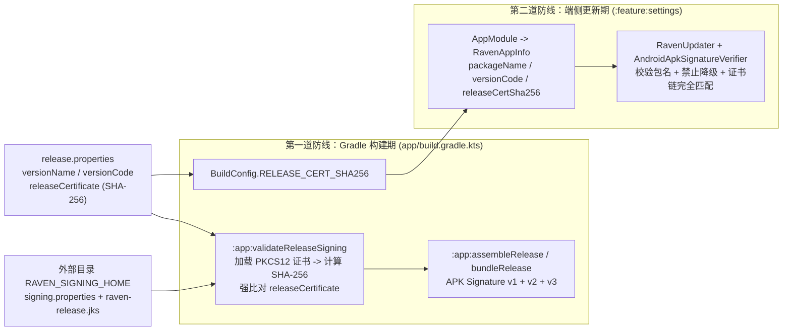

# Raven（渡鸦）签名一致性与正式发布指南 (`SIGNING.md`)

> **适用读者**：负责打包正式版、维护多机环境、配置 CI/CD 或评审发布流程的开发者与自动化 Agent  
> **配套规则**：仓库最高红线见 [AGENTS.md](../AGENTS.md) · 日常开发与工具链见 [ONBOARDING.md](ONBOARDING.md) · 安全与更新器实现见 [DATA_MEDIA_SECURITY.md](DATA_MEDIA_SECURITY.md)

---

## 1. 为什么必须保证签名一致性（覆盖安装与零数据丢失）

Android 包管理器（`PackageManager`）在执行覆盖安装时，强制校验以下三项：

1. **包名完全一致**：正式版固定为 `com.raven.app`。
2. **版本号不得降级**：新包 `versionCode` 必须大于或等于已安装版本（正式发布要求严格递增）。
3. **签名证书链完全一致**：新包证书必须与设备上已安装版本一致。

一旦 Release 签名证书发生变化：
- 系统会直接拒绝覆盖安装并报错 `INSTALL_FAILED_UPDATE_INCOMPATIBLE`；
- 应用内更新器 `RavenUpdater` 也会在调起系统安装器前直接拦截该安装包；
- 用户被迫卸载旧版重装，导致应用私有沙盒数据全部清空（Room 20 表历史/收藏/片单、`SessionVault` 加密站点登录态、DataStore 偏好设置及私有下载索引）。

因此，**从 v0.1.0 起，Raven 全生命周期所有正式版本必须永久使用同一份发布密钥签名**。

---

## 2. 官方发布证书与版本元数据基线

仓库根目录 [release.properties](../release.properties) 是正式版版本号与公钥指纹的**唯一受控源**。当前源码版本为 `0.9.2` / `versionCode = 15`；下面的 `0.1.0` / `1` **仅用于展示文件结构，不是当前版本或发布指令**，实际值必须直接读取 `release.properties`：

```properties
versionName=0.1.0
versionCode=1
releaseCertificate=1F9407377D2D3AB5C04527CF6E587F0B789BA8B971D60AD8F99360D05CA52F3A
```

官方 Release 证书公开属性（仅公开指纹，不包含任何私密信息）：

| 属性 | 锁定值 |
|---|---|
| **Official Application ID** | `com.raven.app` |
| **Certificate SHA-256** | `1F9407377D2D3AB5C04527CF6E587F0B789BA8B971D60AD8F99360D05CA52F3A` |
| **Subject DN** | `CN=Raven` |
| **密钥算法 / 容器** | RSA 4096-bit / PKCS12（`raven-release.jks`） |
| **APK Signature Schemes** | `v1` + `v2` + `v3`（在 `app/build.gradle.kts` 中全部启用） |

> 每次准备新正式版本时，**只更新 `versionName` 与递增 `versionCode`**，**严禁修改 `releaseCertificate`**。

---

## 3. 外部签名目录与 `signing.properties` 模板

### 3.1 目录解析规则（与 `app/build.gradle.kts` 保持完全一致）

Gradle 按以下优先级查找外部签名配置文件：

1. 若设置了非空环境变量 `RAVEN_SIGNING_HOME`，读取 `${RAVEN_SIGNING_HOME}/signing.properties`。
2. 否则回退到当前用户主目录下的 `.raven/signing/signing.properties`：
   - **Windows 默认路径**：`%USERPROFILE%\.raven\signing\signing.properties`（当前主开发机目录：`C:\Users\ywclg\.raven\signing`）
   - **Linux / macOS 默认路径**：`~/.raven/signing/signing.properties`

### 3.2 标准模板（仅占位符，严禁填写真实口令入库）

在外部签名目录下放置密钥库文件 `raven-release.jks` 与配置文件 `signing.properties`：

```properties
# 位于仓库外部：%USERPROFILE%\.raven\signing\signing.properties
# 或 ~/.raven/signing/signing.properties（也可由 RAVEN_SIGNING_HOME 指定目录）
#
# KEYSTORE_PATH 支持相对路径（相对本文件所在目录）或绝对路径：
KEYSTORE_PATH=raven-release.jks
KEYSTORE_PASSWORD=<YOUR_KEYSTORE_PASSWORD>
KEY_ALIAS=<YOUR_KEY_ALIAS>
KEY_PASSWORD=<YOUR_KEY_PASSWORD>
```

说明：
- `app/build.gradle.kts` 要求四个键（`KEYSTORE_PATH`、`KEYSTORE_PASSWORD`、`KEY_ALIAS`、`KEY_PASSWORD`）全部非空。
- 当 `KEYSTORE_PATH` 使用相对路径（例如 `raven-release.jks`）时，Gradle 会以 `signing.properties` 所在目录为基准解析，跨 Windows / Linux / macOS 迁移最为省心。
- 建议收紧本地目录权限：
  - Linux / macOS：`chmod 700 ~/.raven/signing && chmod 600 ~/.raven/signing/signing.properties ~/.raven/signing/raven-release.jks`
  - Windows：确保该目录仅归当前系统用户所有，且不位于 OneDrive / 网盘同步目录或 Git 仓库内。

---

## 4. `raven-release.jks` 密钥备份检查清单

丢失 `raven-release.jks` 或其口令意味着**永久失去覆盖升级既有用户安装包的能力**。建议在首次建库及每次换机前完成以下检查：

- [ ] **双份以上离线异地加密备份**：至少保留 2 份独立介质备份（例如：受主密码保护的密码管理器附件 + 加密 U 盘/离线硬盘），同时保存 `raven-release.jks`、Keystore 密码、`KEY_ALIAS` 与 Key 密码。
- [ ] **禁止明文进入任何云同步与代码库**：绝不提交到 Git（`.gitignore` 已屏蔽 `*.jks`、`*.keystore`、`signing.properties`），绝不粘贴到聊天窗口、Issue、PR 或构建日志。
- [ ] **验证备份可恢复性**：在干净目录用 `RAVEN_SIGNING_HOME` 指向备份副本，运行 `.\gradlew.bat :app:validateReleaseSigning --no-daemon`，确认输出 `validateReleaseSigning PASSED` 且 SHA-256 与 `1F9407377D2D3AB5C04527CF6E587F0B789BA8B971D60AD8F99360D05CA52F3A` 完全一致。
- [ ] **禁止以“重新生成”代替恢复**：任何情况下（包括换新电脑、重装系统、配置新 CI Runner），都必须恢复既有密钥库，绝不可运行 `keytool -genkeypair` 生成替代密钥。

---

## 5. 多机协作与 GitHub Actions CI 密钥注入

### 5.1 新开发机复用已有发布签名

1. 通过加密离线渠道将既有 `raven-release.jks` 拷贝到新机的 `%USERPROFILE%\.raven\signing\`（Linux/macOS：`~/.raven/signing/`）。
2. 按 §3.2 模板在同目录创建 `signing.properties` 并填入真实口令与别名。
3. 在仓库根目录执行校验任务确认指纹一致：
   ```powershell
   .\gradlew.bat :app:validateReleaseSigning --no-daemon
   ```
   如需临时指定其他目录，可在当前终端会话中设置 `RAVEN_SIGNING_HOME`（无需改动仓库文件）：
   ```powershell
   $env:RAVEN_SIGNING_HOME = "E:\secure\raven-signing"
   .\gradlew.bat :app:validateReleaseSigning :app:assembleRelease --no-daemon
   ```

### 5.2 GitHub Actions CI 通过 `RAVEN_SIGNING_HOME` 注入 Secrets

在仓库 **Settings -> Secrets and variables -> Actions** 中配置 4 个加密 Secret：

| Secret 名称 | 内容说明 |
|---|---|
| `RAVEN_KEYSTORE_BASE64` | `raven-release.jks` 的单行 Base64 编码 |
| `RAVEN_KEYSTORE_PASSWORD` | Keystore 密码 |
| `RAVEN_KEY_ALIAS` | 签名密钥别名 |
| `RAVEN_KEY_PASSWORD` | Key 密码 |

Workflow 关键步骤示例（在 `$RUNNER_TEMP` 中短暂落盘并在 `always()` 阶段清理，全程不回显密码）：

```yaml
- name: Prepare external release signing
  env:
    RAVEN_KEYSTORE_BASE64: ${{ secrets.RAVEN_KEYSTORE_BASE64 }}
    RAVEN_KEYSTORE_PASSWORD: ${{ secrets.RAVEN_KEYSTORE_PASSWORD }}
    RAVEN_KEY_ALIAS: ${{ secrets.RAVEN_KEY_ALIAS }}
    RAVEN_KEY_PASSWORD: ${{ secrets.RAVEN_KEY_PASSWORD }}
  run: |
    SIGNING_DIR="${RUNNER_TEMP}/raven-signing"
    mkdir -p "${SIGNING_DIR}"
    chmod 700 "${SIGNING_DIR}"
    printf '%s' "${RAVEN_KEYSTORE_BASE64}" | base64 --decode > "${SIGNING_DIR}/raven-release.jks"
    cat > "${SIGNING_DIR}/signing.properties" <<EOF
    KEYSTORE_PATH=raven-release.jks
    KEYSTORE_PASSWORD=${RAVEN_KEYSTORE_PASSWORD}
    KEY_ALIAS=${RAVEN_KEY_ALIAS}
    KEY_PASSWORD=${RAVEN_KEY_PASSWORD}
    EOF
    chmod 600 "${SIGNING_DIR}/raven-release.jks" "${SIGNING_DIR}/signing.properties"
    echo "RAVEN_SIGNING_HOME=${SIGNING_DIR}" >> "${GITHUB_ENV}"

- name: Validate signing & build Release APK
  run: ./gradlew :app:validateReleaseSigning :app:assembleRelease --no-daemon

- name: Clean up temporary signing files
  if: always()
  run: rm -rf "${RUNNER_TEMP}/raven-signing"
```

仓库提供 [.github/workflows/release-verify.yml](../.github/workflows/release-verify.yml) 作为完整手动验证入口：仅在 Actions 中显式触发 `workflow_dispatch`，完成外部签名注入、Gradle Release 构建、`apksigner` v1/v2/v3 验签、证书指纹和包名／版本元数据核对。该工作流不上传 APK、不推送 Git、不创建 Tag 或 GitHub Release。

---

## 6. 构建期 + 运行期双重签名防线

Raven 在 **构建期** 与 **运行期** 均对 Release 签名实施硬校验，防止错误签名包流出或误装：



1. **构建期防线（`app/build.gradle.kts`）**：
   - `assembleRelease`、`bundleRelease`、`packageRelease` 均通过 `dependsOn(validateReleaseSigningTask)` 强绑定 `:app:validateReleaseSigning`。
   - 任务校验 `signing.properties` 存在且四键齐全、Keystore 文件存在、PKCS12 可加载、指定 `KEY_ALIAS` 的证书 SHA-256 精确等于 `release.properties` 中的 `releaseCertificate`。任何不匹配都会立即以 `GradleException` 中断构建。
2. **运行期防线（`AppModule.kt` + `RavenUpdater.kt`）**：
   - 构建脚本将 `releaseCertificate` 注入 `BuildConfig.RELEASE_CERT_SHA256`，经 `AppModule` 封装进 `RavenAppInfo`。
   - 用户触发应用内更新时，`AndroidApkSignatureVerifier.verify(apkFile)` 会解析已下载 APK，强制校验：
     - 包名与当前已安装应用（`com.raven.app`）一致；
     - `versionCode` 不低于当前已安装版本（防止版本降级）；
     - 签名证书完全匹配（API 28+ 校验 `signingInfo.apkContentsSigners` / `signingCertificateHistory`；API 24–27 校验 `signatures` SHA-256 摘要，并借助 `releaseCertSha256` 判断兼容包策略）。

---

## 7. 标准发布打包与 `apksigner` 验签步骤

### Step 1：递增版本元数据
编辑根目录 [release.properties](../release.properties)，更新 `versionName` 并严格递增 `versionCode`（保持 `releaseCertificate` 不变）。以下 `0.2.0` / `2` **仅是版本递增示例**；当前值与本次发布目标均以 `release.properties` 和发布计划为准，不要照抄示例覆盖实际元数据：

```properties
versionName=0.2.0
versionCode=2
releaseCertificate=1F9407377D2D3AB5C04527CF6E587F0B789BA8B971D60AD8F99360D05CA52F3A
```

### Step 2：通过 Gradle Wrapper 校验并构建 Release APK

```powershell
# Windows PowerShell（默认输出：app\build\outputs\apk\release\app-release.apk）
.\gradlew.bat :app:validateReleaseSigning :app:assembleRelease --no-daemon
```

```bash
# Linux / macOS
./gradlew :app:validateReleaseSigning :app:assembleRelease --no-daemon
```

### Step 3：交付前执行 `apksigner` 与包信息强制核验

> `apksigner` 与 `aapt2` 位于 Android SDK 的 `build-tools/36.0.0/` 目录（如 `D:\Android\Sdk\build-tools\36.0.0\apksigner.bat`）。

```powershell
# 1. 默认范围：验签并打印证书，确认 v2 / v3
& "$env:ANDROID_HOME\build-tools\36.0.0\apksigner.bat" verify --verbose --print-certs .\app\build\outputs\apk\release\app-release.apk

# 2. 强制 API 23 范围：单独确认 JAR v1
& "$env:ANDROID_HOME\build-tools\36.0.0\apksigner.bat" verify --verbose --print-certs --min-sdk-version 23 --max-sdk-version 23 .\app\build\outputs\apk\release\app-release.apk

# 3. 核对包名、versionCode 与 versionName
& "$env:ANDROID_HOME\build-tools\36.0.0\aapt2.exe" dump badging .\app\build\outputs\apk\release\app-release.apk | Select-String "^package:"
```

Linux / macOS 等价命令：

```bash
"$ANDROID_HOME/build-tools/36.0.0/apksigner" verify --verbose --print-certs app/build/outputs/apk/release/app-release.apk
"$ANDROID_HOME/build-tools/36.0.0/apksigner" verify --verbose --print-certs --min-sdk-version 23 --max-sdk-version 23 app/build/outputs/apk/release/app-release.apk
"$ANDROID_HOME/build-tools/36.0.0/aapt2" dump badging app/build/outputs/apk/release/app-release.apk | grep "^package:"
```

**通过标准（缺一不可）**：
- 两次 `Verifies` 均成功退出（返回码 `0`）；
- 默认范围输出 `Verified using v2 scheme (APK Signature Scheme v2): true`、`v3 scheme (APK Signature Scheme v3): true`；强制 API 23 范围输出 `Verified using v1 scheme (JAR signing): true`；
- 两次输出的 `Signer #1 certificate DN:` 均包含 `CN=Raven`；
- 两次输出的 `Signer #1 certificate SHA-256 digest:` 均精确等于 `1f9407377d2d3ab5c04527cf6e587f0b789ba8b971d60ad8f99360d05ca52f3a`（与 `release.properties` 大写形式一致）；
- `package: name='com.raven.app'` 且 `versionCode` / `versionName` 与本次发布完全一致。

> `apksigner` 在 `minSdk >= 24` 且存在 APK Signing Block（v2/v3）时，默认会跳过 JAR v1 验证并输出 `v1=false`；这不等于缺少 v1 签名。验收必须使用上述第二条命令强制覆盖 API 23 范围单独验证，不能只看默认输出。具体条件见 [AOSP `ApkVerifier`](https://android.googlesource.com/platform/tools/apksig/+/master/src/main/java/com/android/apksig/ApkVerifier.java)。

---

## 8. Release 与 Debug 构建边界

下表中的 `0.1.0` 仅为版本字符串格式示例；当前版本及每次发布值以 [release.properties](../release.properties) 为准。

| 对比维度 | Release 正式版 | Debug 开发版 |
|---|---|---|
| **Gradle 命令** | `.\gradlew.bat :app:validateReleaseSigning :app:assembleRelease --no-daemon` | `.\gradlew.bat :app:assembleDebug --no-daemon` |
| **Application ID** | `com.raven.app` | `com.raven.app.debug` |
| **Version Suffix** | 无（如 `0.1.0`） | `-debug`（如 `0.1.0-debug`） |
| **代码混淆与裁剪** | `isMinifyEnabled = true`、`isShrinkResources = true` | 关闭 |
| **签名来源** | 外部唯一 `raven-release.jks`（强锁定 SHA-256） | 本机默认 `~/.android/debug.keystore` |
| **与另一变体并存** | 可与 Debug 同机并存 | 可与 Release 同机并存 |
| **用途与交付边界** | GitHub Release / 正式覆盖升级 / `RavenUpdater` 校验目标 | **仅限本地开发、单元测试与联调，严禁作为正式更新分发** |

> **跨机 Debug 覆盖提示**：不同开发机默认生成的 `~/.android/debug.keystore` 指纹互不相同。若团队在多台机器间需要对同一部测试机互相覆盖安装 `com.raven.app.debug`，请显式共享同一份测试用 `debug.keystore`，切勿动用 Release 密钥签名 Debug 包。

---

## 9. 常见报错与排障速查

| 报错现象 | 根因 | 正确处理方式 |
|---|---|---|
| `Release signing properties not found at ...` | 本机尚未配置 `%USERPROFILE%\.raven\signing\signing.properties` 或未设置 `RAVEN_SIGNING_HOME` | 从离线备份恢复既有 `raven-release.jks` 并按 §3.2 创建 `signing.properties`；**严禁重新生成密钥** |
| `Incomplete signing.properties ... Required keys: KEYSTORE_PATH, KEYSTORE_PASSWORD, KEY_ALIAS, KEY_PASSWORD` | `signing.properties` 缺少字段或存在空值 | 补全全部 4 个非空键后重试 `:app:validateReleaseSigning` |
| `Release keystore SHA-256 (...) does not match release.properties releaseCertificate (...)` | 当前指向了错误的 `.jks` 文件或错误的 `KEY_ALIAS` | 检查 `KEYSTORE_PATH` 与 `KEY_ALIAS` 是否指向官方备份库；**严禁修改 `releaseCertificate` 绕过检查** |
| `INSTALL_FAILED_UPDATE_INCOMPATIBLE` | 设备已安装的包与新包签名不一致（或混用了 Debug/非官方包） | 先用 `apksigner verify --print-certs` 核对新包 SHA-256；若设备原装的是非官方签名包，需先用应用内加密备份导出数据后再卸载安装官方 Release |
| `安装包签名校验未通过，无法覆盖当前版本，已停止安装` | `RavenUpdater` 端侧拦截了与当前已安装签名不一致或版本降级的 APK | 检查发布的 APK 是否按 §7 验签通过且 `versionCode` 严格递增 |
