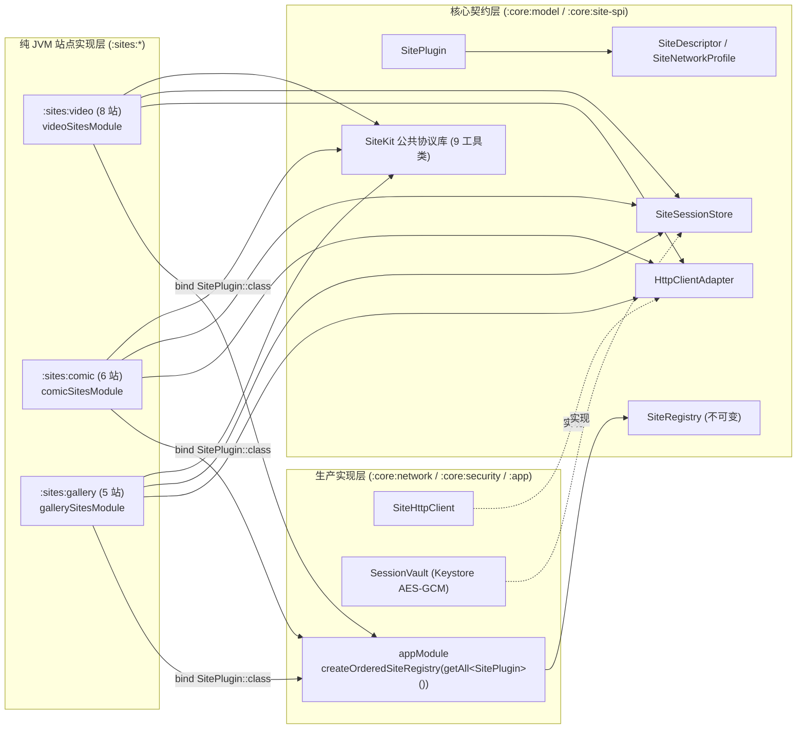
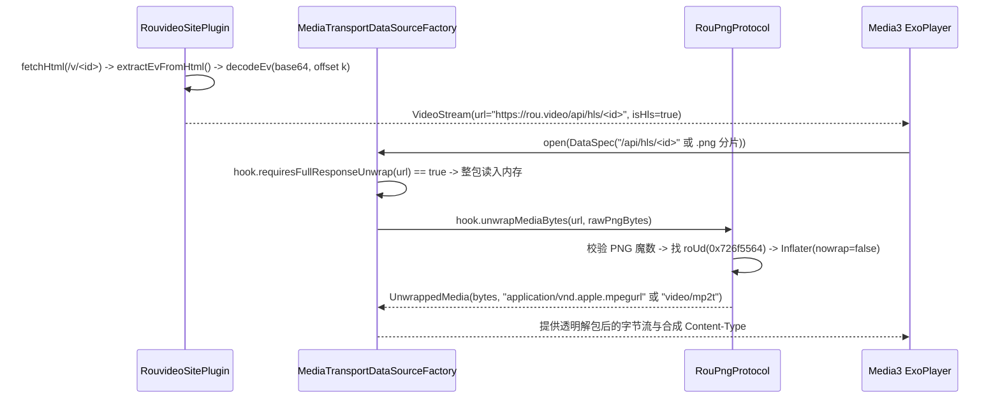

# Raven（渡鸦）站点插件架构、19 站维护手册与新站接入指南

> 适用范围：`:core:model`、`:core:site-spi`、`:sites:video`、`:sites:comic`、`:sites:gallery`、`:app`（Koin 装配）。  
> 关联文档：[ARCHITECTURE.md](ARCHITECTURE.md) · [ONBOARDING.md](ONBOARDING.md) · [DATA_MEDIA_SECURITY.md](DATA_MEDIA_SECURITY.md) · [DESIGN_AND_UI_GUIDE.md](DESIGN_AND_UI_GUIDE.md)

---

## 1. 插件化 SPI 架构详解

Raven 的站点层采用**组合式能力接口（Composable Capability SPI）**设计：核心业务模块（`:feature:*`、`:core:media`、`:core:network`）只依赖 `:core:model` 与 `:core:site-spi`，严禁出现跨模块的 `when (siteId)` 硬编码或可变全局单例（如 `SiteRegistry.current`）。



### 1.1 核心入口：`SitePlugin` 与 `SiteDescriptor`

- **`SitePlugin`**（`core/site-spi/src/main/kotlin/com/raven/app/core/sitespi/SitePlugin.kt`）  
  每个站点实现一个 `SitePlugin`，声明不可变的 `descriptor: SiteDescriptor`，并按需暴露 10 个能力属性。**未实现的能力在类型层面返回 `null` 或 `None` 空对象**：
  ```kotlin
  interface SitePlugin {
      val descriptor: SiteDescriptor
      val id: SiteId get() = descriptor.id

      val feedSource: FeedSource? get() = null
      val videoSource: VideoSource? get() = null
      val gallerySource: GallerySource? get() = null
      val searchSource: SearchSource? get() = null
      val directorySource: DirectorySource? get() = null
      val authProvider: AuthProvider get() = AuthProvider.None
      val linkResolver: LinkResolver? get() = null
      val hostRouter: HostRouter get() = HostRouter.Standard(descriptor.allHosts)
      val mediaTransportHook: MediaTransportHook get() = MediaTransportHook.None
      val imageUnscrambler: ImageUnscrambler get() = ImageUnscrambler.None
  }
  ```

- **`SiteDescriptor` 与 `SiteNetworkProfile`**（`core/model/src/main/kotlin/com/raven/app/core/model/SiteModels.kt`）  
  声明式描述一个站点的全部静态元信息，驱动站点切换器、探索分区、搜索过滤、网络限速与域名隔离：
  - `id: SiteId`：`@JvmInline value class`，内置 19 个在线常量（`VIDEO_SITES` 8 个 + `COMIC_SITES` 6 个 + `PHOTO_SITES` 5 个 = `ALL_LIVE`）、本地库 `SiteId.LOCAL`，以及 2 个历史退役占位（`RETIRED_KBJ = "kbj"` / `RETIRED_NETFLAV = "netflav"`，仅保留用于旧备份和历史记录识别）。
  - `primaryKind: MediaKind` & `supportedKinds: Set<MediaKind>`：支持单媒（`VIDEO` / `COMIC` / `PHOTO`）或双媒（如 `iwara` 与 `cosplaytele` 同时支持 `VIDEO` 和 `PHOTO`）。
  - `defaultHost` / `mirrorHosts` / `allHosts`：主域名与镜像域名列表；提供 `matchesHost(hostname)`、`matchesRequestHost(hostname)`（含 `apiHosts`）、`matchesMediaHost(hostname)`（含 `mediaDomains` 及其子域）。
  - `capabilities: Set<SiteCapability>`：18 种声明式能力标签（`FEED`、`EXPLORE`、`SEARCH`、`ADVANCED_SEARCH`、`DIRECTORY`、`TAGS`、`AUTHORS`、`CHARACTERS`、`COMMENTS`、`RELATED`、`AUTH`、`COOKIE_IMPORT`、`MIRRORS`、`LANGUAGE_FILTER`、`ORIGINAL_IMAGES`、`STREAM_QUALITIES`、`DUAL_MEDIA`、`PREVIEW_ONLY`）。
  - `sections: List<SiteSectionSpec>`、`feedSorts: List<FeedSort>`、`searchScopes: List<SearchScope>`、`supportedFilters: Set<AdvancedFilterField>`、`accessNote: String?`。
  - `networkProfile: SiteNetworkProfile`：指定 `userAgent`（默认 `DEFAULT_MOBILE_UA`、桌面 `DESKTOP_WINDOWS_UA`、API `RAVEN_API_UA`）、`referer`、`mediaReferer`、`apiBase`、`apiHosts`、`mediaDomains`、`pageIntervalMs`（默认 `400L`）、`imageIntervalMs`（默认 `150L`）、`disableFeedSnapshot`（`ExHentai` 为 `true`）、`requiresAuthGate`。

### 1.2 10 个能力接口速查

全部定义于 `core/site-spi/src/main/kotlin/com/raven/app/core/sitespi/SiteCapabilities.kt`：

| 序号 | 接口名 | 默认值 | 核心方法 / 属性 | 典型用途 |
|---:|---|---|---|---|
| 1 | `FeedSource` | `null` | `loadHome(language)`, `loadFeed(request)`, `supportedSorts(request)` | 首页 Hero/榜单/主列表及分页、分区、排序加载 |
| 2 | `VideoSource` | `null` | `loadVideoDetail(url)`, `refreshStreams(url)` | 解析视频详情、清晰度流、评论、相关推荐与过期流刷新 |
| 3 | `GallerySource` | `null` | `loadGalleryDetail(url)`, `loadGalleryPage(detail, pageIndex, forceReload)`, `resolvePageImage(pageUrl, preferOriginal, forceReload)`, `reloadUrlOnError(cause, page)`, `rejectCrossHostImageRedirect` | 漫画/写真详情、按页解析、原图切换、跨站重定向拒收与错误换线自愈（EH `?nl=`） |
| 4 | `SearchSource` | `null` | `search(request)`, `supportedScopes`, `supportedFilters`, `supportsExcludeTags`, `isDirectorySearch` | 关键字/标签/作者/角色搜索、高级筛选与目录式搜索（GalleryEpic） |
| 5 | `DirectorySource` | `null` | `loadDirectory(section, page, query)`, `directorySections()` | 分类、标签、作者/女优/演员、Coser、作品/系列目录页 |
| 6 | `AuthProvider` | `AuthProvider.None` | `mode: AuthMode`（`None` / `FormCredentials` / `JwtBearer` / `WebViewCookie` / `CookieImport`）, `requiresAuthGate`, `loginWithCredentials`, `importCookies`, `logout`, `currentAuthState`, `defaultCookies(host)`, `decorateRequestHeaders(request, host)` | 账号登录、Cookie 导入、常驻 Cookie（EH `nw=1`）、按主机严格隔离请求头（Iwara Bearer JWT） |
| 7 | `LinkResolver` | `null` | `canHandle(url)`, `canonicalize(url)`, `resolve(url): ResolvedLink?` | 分享链接 / 剪贴板 / 站内链接路由为 `ResolvedLink.Feed` / `Video` / `Gallery` / `Directory` |
| 8 | `HostRouter` | `HostRouter.Standard(allHosts)` | `activeHost(routeKey)`, `candidateHosts()`, `rewriteUrl(url, host)`, `reportHostFailure`, `reportHostSuccess` | 多镜像站点的路由选择与故障切换（MissAV、JMComic 使用 `MirrorLeaseRouter`） |
| 9 | `MediaTransportHook` | `MediaTransportHook.None` | `isHlsUrl(url)`, `requiresFullResponseUnwrap(url)`, `unwrapMediaBytes(url, bytes)`, `extraMediaHeaders(url)` | 播放器底层解包/自定义媒体请求头（`rou.video` PNG `roUd` 解包、`cosplaytele` `cossora.stream` Referer） |
| 10 | `ImageUnscrambler` | `ImageUnscrambler.None` | `computeStripCount(chapterId, scrambleId, filenameStem)`, `computeSlicePlan(imageHeight, stripCount)` | 纯 Kotlin 图页条带反混淆几何计算（JMComic `JmcomicStripMath`） |

### 1.3 传输、会话与错误契约

- **`HttpClientAdapter`**（`core/site-spi/src/main/kotlin/com/raven/app/core/sitespi/SiteHttp.kt`）  
  站点插件唯一允许使用的 HTTP 传输接口（生产由 `:core:network` 的 `SiteHttpClient` 实现，单测由 `FakeHttpClientAdapter` 实现）。提供底层 `execute(request: SiteHttpRequest): SiteHttpResponse`、`currentRouteKey(urls)` 以及便捷方法 `getText`、`getBytes`、`postForm`、`postJson`。  
  `SiteHttpRequest` 携带 `siteId`、`method`（`GET`/`POST`/`HEAD`）、`kind`（`PAGE`/`API`/`IMAGE`/`MEDIA`/`PROBE`）、`headers`、`body`、`followRedirects`、`allowCookies`、`allowCache`、`allowRetry`、`rangeHeader`、`authEpoch`、`timeoutMs`。`SiteHttpResponse` 自带 `bodyText()`、大小写无关 `header()`/`headers()`、`contentRange`、`retryAfterSeconds`（同时解析秒数与 RFC HTTP-date）。
- **`SiteSessionStore`**（`core/site-spi/src/main/kotlin/com/raven/app/core/sitespi/SiteSessionStore.kt`）  
  按 `SiteId` 严格隔离的凭证存储接口（生产由 `:core:security` 的 `SessionVault` 实现，单测用 `InMemorySiteSessionStore`）。支持 Cookie（`getCookies`/`saveCookies`/`removeCookies`/`replaceCookies`）、Bearer Token、Username、通用 Secret，以及**每次凭证变更单调递增的 `authEpoch(siteId)`**，用于在并发登录/登出场景下终止过期的在途请求。
- **`SiteException`**（`core/model/src/main/kotlin/com/raven/app/core/model/SiteException.kt`）  
  强类型异常体系，取代易碎的字符串匹配：`Network`、`RateLimited(retryAfterSeconds)`、`AuthRequired`、`Forbidden(isChallenge)`、`NotFound`、`QuotaExceeded`、`ParseError`、`TlsError`、`Unsupported`、`Cancelled`。通过 `toDownloadErrorCategory()` 直接映射给下载重试调度器。

### 1.4 不可变 `SiteRegistry` 与 Koin 自动装配

- **`SiteRegistry`**（`core/site-spi/src/main/kotlin/com/raven/app/core/sitespi/SiteRegistry.kt`）：
  - 构造时构建有序不可变快照，检测到重复 `SiteId` 直接 `require` 失败。
  - **刻意不保存任何可变 `current` 站点**；当前激活站点由 `SettingsDataStore` 与 UI ViewModel 响应式状态管理。
  - 提供查询：`allPlugins()`、`allDescriptors()`、`get(siteId)`、`require(siteId)`（对退役站点自动抛出带提示的 `SiteException.Unsupported`）、`byPrimaryKind(kind)`、`supportingKind(kind)`、`withCapability(cap)`、`findForHost`、`findForRequestHost`、`findForMediaHost`、`isRegisteredSiteHost`、`resolveLink(url)`、`resolveLinkFromText(text)`。
- **Koin Multi-binding 自动装配**：
  1. 三个站点模块各自通过 `bind SitePlugin::class` 注册单例：
     - `sites/video/src/main/kotlin/com/raven/app/sites/video/VideoSitesModule.kt`（`videoSitesModule`，8 站）
     - `sites/comic/src/main/kotlin/com/raven/app/sites/comic/ComicSitesModule.kt`（`comicSitesModule`，6 站）
     - `sites/gallery/src/main/kotlin/com/raven/app/sites/gallery/GallerySitesModule.kt`（`gallerySitesModule`，5 站）
  2. `app/src/main/kotlin/com/raven/app/AppModule.kt` 通过 `single<SiteRegistry> { createOrderedSiteRegistry(getAll<SitePlugin>()) }` 收集全部插件，按 `SiteId.ALL_LIVE` 严格排序并校验**零缺失、零重复、顺序完全一致**。
  3. `RavenApplication` 加载 `allRavenKoinModules`（共 13 个 Koin 模块），并由 `AppDiGraphTest` 在纯 JVM 单测中持续守卫。

---

## 2. `SiteKit` 公共协议工具库参考

所有跨站共享的纯 Kotlin 协议算法均沉淀在 `core/site-spi/src/main/kotlin/com/raven/app/core/sitespi/`，**零 Android / OkHttp 依赖**，可直接在 JVM 单测中做字节级往返测试。

| 工具类 | 源码路径（相对 `core/site-spi/src/main/kotlin/com/raven/app/core/sitespi/`） | 核心能力与公开 API | 使用站点 / 消费者 |
|---|---|---|---|
| `Base62Packer` | `Base62Packer.kt` | Dean Edwards `eval(function(p,a,c,k,e,...)` 纯 Kotlin 解包器；支持 2–62 进制，单遍（single-pass）token 替换防止字典值被二次展开；API：`unpack(source)`、`unpackAll(html)`、`encodeBaseToken(value, base)` | `MissavSitePlugin` |
| `JsExtractor` | `JsExtractor.kt` | 字符串感知的 JS 字面量与对象提取器；API：`extractBraceObject(source, marker, fromIndex)`（花括号平衡配对）、`extractBalanced(source, startIndex, openChar, closeChar)`（支持 `{}`/`[]`）、`extractJsStringVar(source, varName)`、`unescapeJsString(raw)`（处理 `\/`、`\uXXXX`、`\xXX` 等）、`extractNextRscFlightChunks(html)`（拼接并反转义 `self.__next_f.push([1,"..."])`） | `R34vSitePlugin`、`HanimeSitePlugin`、`JableSitePlugin`、`PornhubSitePlugin`、`KbjfreeSitePlugin`、`WnacgSitePlugin`、`WordPressPhotoEngine` |
| `DualLanguageMerger` | `DualLanguageMerger.kt` | 无原生 `OR` 语种语法时的双流归并分页器；通过 `DualCursor(pageA, indexA, pageB, indexB)` 编码为 `"pA,iA,pB,iB"` 字符串游标，支持 `DualMergeStrategy.DESCENDING_NUMERIC_ID`（按数字 ID 降序合并最新流）和 `INTERLEAVED`（热门流交替归并），自动跨流去重 | `NhentaiSitePlugin`、`HitomiSitePlugin`、`WnacgSitePlugin` |
| `MirrorLeaseRouter` | `MirrorLeaseRouter.kt` | 实现 `HostRouter` 的路由键控镜像租约路由器；默认租约 10 分钟（`DEFAULT_LEASE_DURATION_MS = 600_000L`）、故障冷却 2 分钟（`DEFAULT_FAILURE_COOLDOWN_MS = 120_000L`）；当网络切换/代理变化导致 `routeKey` 变更或当前节点失败时，通过 `Mutex` 串行探活并自动切至健康镜像；支持 `invalidate()` | `MissavSitePlugin`、`JmcomicSitePlugin` |
| `LruCache` | `LruCache.kt` | 线程安全（`synchronized`）有界 LRU 缓存，支持可选全局/单条 TTL 过期、懒淘汰与主动 `evictExpired()`；API：`get`、`put`、`getOrPut`、`getOrPutSuspend`、`remove`、`clear`、`size` | `IwaraSitePlugin`、`EhSharedEngine`、`NhentaiSitePlugin`、`HitomiSitePlugin`、`WnacgSitePlugin`、`JmcomicSitePlugin`、`WordPressPhotoEngine` |
| `HtmlUrlCleaner` | `HtmlUrlCleaner.kt` | 纯 Kotlin HTML 文本清理与 URL 编解码；API：`cleanText`（清零宽字符/BOM/NBSP/合并空白）、`decodeBasicHtmlEntities`、`encodePathSegment`（空格编码为 `%20`）、`encodeQueryParam`、`decodeUrlComponent`、`deduplicateImageExtension`（修复 `1.webp.webp`）、`stripFragment`（移除 `#fragment` 保持 Referer 洁净） | 全部 19 站 |
| `RouPngProtocol` | `RouPngProtocol.kt` | `rou.video` 专用协议栈：`unwrap(body)` / `wrap(payload, deflate)` 解析/封装 PNG 自定义 `roUd`（`0x726f5564`）块 + 标准 zlib（`Inflater(nowrap = false)`，上限 `MAX_UNWRAPPED_BYTES = 64 MiB`）；`detectContentType` 嗅探 `#EXTM3U` / MPEG-TS `0x47`；`extractEvFromHtml` / `decodeEv` 解码 `ev` Base64+偏移载荷；内置即用 `transportHook: MediaTransportHook` | `RouvideoSitePlugin`、`:core:media`（经 `MediaTransportDataSourceFactory` 透明调用） |
| `CossoraAesProtocol` | `CossoraAesProtocol.kt` | `cosplaytele` 内嵌 `cossora.stream` 视频的 AES-256-CBC 解密器；载荷为 `Base64(iv[16] \|\| ciphertext)`，密钥为 HTML 中 32 字符 hex 口令的 UTF-8 原始字节（32 字节）；强制校验解密后 URL 为 `https://*.cossora.stream/...m3u8`；API：`extractEmbeds`、`parseEmbedHtml`、`decrypt`、`encrypt` | `CosplayteleSitePlugin` |
| `JmcomicStripMath` | `JmcomicStripMath.kt` | 实现 `ImageUnscrambler` 的 JMComic 条带反混淆数学内核（对齐 `jquery.photo-0.4.js`）；阈值 `LEGACY_FIXED_TEN_THRESHOLD = 268_850L`、`MOD_EIGHT_THRESHOLD = 421_926L`，限制 `MAX_UNSCRAMBLE_PIXELS = 12_000_000L`、`MAX_GALLERY_IMAGE_BYTES = 24 MiB`；API：`computeStripCount`、`computeSlicePlan`、`validateDimensions` | `JmcomicSitePlugin`、`:core:media`（`JmcomicBitmapUnscrambler`） |

> **站点模块内共享基础设施**：除 `SiteKit` 外，三个站点模块还各自封装了内部复用引擎，均位于各自模块包内：
> - `:sites:video`：`VideoSiteSupport`（统一 429 重试与 `Retry-After` 退避、镜像重试 `fetchHtmlWithMirror`、CF/DDoS-Guard 挑战检测、时长/播放量/星级解析、本地筛选与首页 `HomeFeed` 组装）。
> - `:sites:comic`：`EhSharedEngine`（共享给 E-Hentai 与 ExHentai）、`ComicUrl`（无 OkHttp 依赖的 RFC 感知 URL 构建/解析器，自动转义非 ASCII 与引号）。
> - `:sites:gallery`：`WordPressPhotoEngine`、`PhotoSiteConfig`、`PhotoPageAddress`、`GalleryUrlUtils`（一套声明式配置驱动全部 5 个写真站）。

---

## 3. 全部 19 个在线站点维护总表

### 3.1 视频站点（`:sites:video`，8 站）

| `SiteId` | 实现类（`sites/video/src/main/kotlin/com/raven/app/sites/video/`） | 主域名 / 镜像 & 媒体域 | 认证方式 | 暴露能力接口 | 核心解析与特殊协议要点 |
|---|---|---|---|---|---|
| `r34v` | `R34vSitePlugin.kt` | `rule34video.com`（无镜像） | `FormCredentials`（`GET /login/` 取 `remember_me_csrf_token`，`POST /login/`，校验 `PHPSESSID`） | `Feed`, `Video`, `Search`, `Directory`, `Auth`, `Link` | KVS SSR；`div[data-video-card-id]` / `div.item.thumb` 卡片；详情用 `JsExtractor.extractBraceObject(..., "flashvars")` 提取 `video_url` / `video_alt_url[2..4]` 多清晰度 MP4 + `a[href*=download=true]` 下载流；支持 `categories`/`works`/`artists`/`models`/`tags`/`channels` 目录；时长/评分支持本地后置过滤 |
| `hanime1` | `HanimeSitePlugin.kt` | `hanime1.me`（无镜像） | `FormCredentials`（Laravel `_token` 登录；登录后验证标准为 `GET /login` 返回 **HTTP 404**） | `Feed`, `Video`, `Search`, `Auth`, `Link` | Laravel SSR；所有浏览/分类/标签/年份/月份/品牌/搜索统一走 `/search?...`；卡片按 `a.video-link[href*=watch]` 过滤广告位；详情优先读 `video#player source[src]`（按 `size` 标清晰度），兜底 `JsExtractor.extractJsStringVar(html, "source")`；支持多标签包含与本地排除标签 |
| `iwara` | `IwaraSitePlugin.kt` | `www.iwara.tv` / `iwara.tv`；API：`apiq.iwara.tv`, `api.iwara.tv`；媒体：`*.iwara.tv`（图片 `i.iwara.tv`，片源 `files[q].iwara.tv`） | `JwtBearer`（`POST /auth/login` 获 JWT；**`Authorization: Bearer` 严格仅发往 `API_HOSTS`**；`Origin`/`x-site` 发往 Iwara 域） | `Feed`, `Video`, `Gallery`（**双媒**）, `Search`, `Auth`, `Link` | REST JSON；0-based 分页（`page = request.page - 1`, `limit = 20`），每次响应动态重算 `totalPages`；搜索参数 `type` **强制复数** `videos`/`images`；`files*.iwara.tv` 必须附 `X-Version = SHA-1("${fileId}_${expires}_${salt}")`，缺失 `Source` 时热拉 `/main.*.js` 刷新盐值（10 分钟冷却、5 秒超时）；`/subscriptions/videos` 校验 `authEpoch` 防串号；`GallerySource` 自动剔除图集内的视频附件 |
| `missav` | `MissavSitePlugin.kt` | `missav.ws` / 镜像 `missav.media`；媒体：`*.mrstcdn.store` | `None` | `Feed`, `Video`, `Search`, `Directory`, `HostRouter`, `Link` | `MirrorLeaseRouter` 驱动 `.ws`/`.media` 自动切镜像；链接规范化去除语言前缀（`/cn/`、`/ja/`）；详情用 `Base62Packer.unpackAll(html)` 单遍解包提取 UUID `playlist.m3u8`；目录支持 `/genres` 与 `/actresses` |
| `jable` | `JableSitePlugin.kt` | `jable.vip` / 镜像识别 `jable.tv`；媒体：`senlin2026.com`, `sl260204.top` | `None` | `Feed`, `Video`, `Search`, `Link` | MacCMS SSR；详情路径 `/vodplay/<id>-1-1/`；用 `JsExtractor.extractBraceObject(html, "player_aaaa")` 抽 `"url"` 并反转义为 HLS；无 `<h1>` 时优先从 `<title>` 的 `《...》` 提取纯净标题；识别分享的旧 `jable.tv/videos/<slug>/` 并转站内搜索 |
| `rouvideo` | `RouvideoSitePlugin.kt` | `rou.video`；媒体：`rn221.xyz`, `rn252.xyz` | `None` | `Feed`, `Video`, `Search`, `Directory`, `MediaTransportHook`, `Link` | TanStack Start SSR；详情页用 `RouPngProtocol.extractEvFromHtml` + `decodeEv`（Base64 后逐字节减偏移 `k`）解出 `/api/hls/<id>` 与 `thumbVTTUrl`；**挂载 `RouPngProtocol.transportHook`**，由播放器 DataSource 透明剥离 PNG `roUd` 壳并 zlib 解压 m3u8/TS |
| `kbjfree` | `KbjfreeSitePlugin.kt` | `kbjfree.com`；媒体：`marshlecdn.com` | `None` | `Feed`, `Video`, `Search`, `Link` | Next.js App Router RSC；列表用 `JsExtractor.extractNextRscFlightChunks` 拼接 Flight 流后按 `{"id":"...","name":"...","categoryId"` 锚点窗口抽取卡片；详情优先从 `script[type=application/ld+json]` 的 `contentUrl` 提取公开预览 MP4，并标记 `SiteCapability.PREVIEW_ONLY` 与 `isPreviewOnly = true` |
| `pornhub` | `PornhubSitePlugin.kt` | `www.pornhub.com` / `pornhub.com`；媒体：`*.phncdn.com` | `None` | `Feed`, `Video`, `Search`, `Directory`, `Link` | 双 DOM 解析：优先桌面端 `li.pcVideoListItem`，自动回退移动端 `li[data-video-vkey]`；详情从 `flashvars_*` 的 `mediaDefinitions` 数组（`JsExtractor.extractBalanced(..., '[', ']')` + 正则兜底）提取多档 HLS/MP4，排序 HLS 优先、高分辨率优先；目录支持 `/categories` 与 `/pornstars` |

### 3.2 漫画站点（`:sites:comic`，6 站）

| `SiteId` | 实现类（`sites/comic/src/main/kotlin/com/raven/app/sites/comic/`） | 主域名 / 镜像 & 媒体域 | 认证方式 | 暴露能力接口 | 核心解析与特殊协议要点 |
|---|---|---|---|---|---|
| `ehentai` | `EhentaiSitePlugin.kt`（委托 `EhSharedEngine.kt`） | `e-hentai.org`；媒体：`*.ehgt.org`, `*.hath.network` | `WebViewCookie` + `CookieImport`（可选登录，公开可浏览；`forums.e-hentai.org` 登录提取 `ipb_member_id`/`ipb_pass_hash` + 可选 `igneous`/`sk`） | `Feed`, `Gallery`, `Search`, `Auth`, `Link` | 共享 `EhSharedEngine`；UA 用 `RAVEN_API_UA`；默认注入 `nw=1`；分类采用位掩码 `f_cats = 1023 xor categoryBit`；列表强制 `inline_set=dm_l` 并通过 `a#unext[href]` 游标翻页；详情分页预览缓存（`previewPageCache` 64 桶）；支持 `fullimg.php` 原图、`509.gif` 配额检测、`rejectCrossHostImageRedirect = true` 与 `?nl=<token>` 换线自愈 |
| `exhentai` | `ExhentaiSitePlugin.kt`（委托 `EhSharedEngine.kt`） | `exhentai.org`；媒体：`*.ehgt.org`, `*.hath.network` | `WebViewCookie` + `CookieImport`（**硬认证门禁 `requiresAuthGate = true`**，`disableFeedSnapshot = true`） | `Feed`, `Gallery`, `Search`, `Auth`, `Link` | 共享 `EhSharedEngine`；导入 Cookie 前**必须实测能拉取并解析真实画廊列表**才持久化，防止 Sad Panda / 白屏脏会话写入；401/403、重定向循环（`ProtocolException("follow-up")`）或缺少 `.itg`/`#gn`/`#img` 均转为 `SiteException.AuthRequired` |
| `nhentai` | `NhentaiSitePlugin.kt` | `nhentai.net`；媒体：`*.nhentai.net`（动态下发） | `None` | `Feed`, `Gallery`, `Search`, `Link` | 公共 `/api/v2/` REST API（`Cache-Control: no-cache`）；调用 `/api/v2/cdn`（30 分钟缓存）并严格正则白名单 `^[it]\d*\.nhentai\.net$` 校验图片与缩略图主机；路径经 `HtmlUrlCleaner.deduplicateImageExtension` 消除 `.webp.webp` 并校验 `^galleries/<mediaId>/...`；`CHINESE_AND_JAPANESE` 通过 `DualLanguageMerger` 合并中文与 `-language:chinese` 日文流 |
| `hitomi` | `HitomiSitePlugin.kt` | `hitomi.la`；API/索引：`ltn.gold-usergeneratedcontent.net`；媒体：`*.gold-usergeneratedcontent.net` | `None` | `Feed`, `Gallery`, `Search`, `Link` | 纯二进制静态索引协议：**零远程 JS 执行**。分页通过 HTTP 206 `Range` 请求读取 4 字节大端 `.nozomi`（每次 `12 * 4 = 48B`，校验 `Content-Range`）；关键词检索使用 `SHA-256` 前 4 字节遍历 464B 磁盘 B-Tree（上限 16 层 + 环检测）；`gg.js` 仅用正则提取 `b` 前缀、`var o` 与 `case` 桶映射（10 分钟缓存），算出 `w{1+server}`/`{a|b}tn` URL；元数据并发 `Semaphore(3)` |
| `wnacg` | `WnacgSitePlugin.kt` | `www.wnacg.com`；封面：`t2/t3.wnimg1.ru`, `t4.qy0.ru`；图源：`img2/img5.wnimg1.ru`, `img5.qy0.ru` | `None` | `Feed`, `Gallery`, `Search`, `Link` | **全请求强制 `DESKTOP_WINDOWS_UA`**（移动与桌面 DOM 不同）；按语言映射分类 ID（如汉化 `5->1`, `6->9`, `7->10`, `19->20`，日语 `5->12` 等），中日双语走 `DualLanguageMerger`；阅读页 `/photos-gallery-aid-<id>.html` 解包 `document.writeln(...)` 内的 `imglist = [...]`，自动剔除尾部广告图 `/themes/weitu/images/bg/shoucang.jpg` 并严格比对声明页数与白名单主机 |
| `jmcomic` | `JmcomicSitePlugin.kt` | `jmcomic-zzz.one` / 镜像 `18comic.ink`, `jmcomic-zzz.org`, `18comic.vip`；CDN：`cdn-msp[2\|3].(18comic.ink\|jmcomic-zzz.one)` | `None` | `Feed`, `Gallery`, `Search`, `HostRouter`, `ImageUnscrambler`, `Link` | 4 镜像 10 分钟租约 `MirrorLeaseRouter`（按 `routeKey` 变更自动失效，单次探活 5s、手动限 3 次重定向校验同站点）；支持多章节漫画（`#chapters` 虚拟流）；阅读页解析脚本变量 `scramble_id`/`aid`/`speed`，通过 `JmcomicStripMath` 计算 `stripCount` 与 `unscrambleSeed`（`"$chapterId:$scrambleId:$filenameStem"`），由 `:core:media` 的 `JmcomicBitmapUnscrambler` 重组位图 |

### 3.3 写真站点（`:sites:gallery`，5 站，统一由 `WordPressPhotoEngine` 驱动）

| `SiteId` | 实现类（`sites/gallery/src/main/kotlin/com/raven/app/sites/gallery/`） | 主域名 & 媒体域 | 认证方式 | 暴露能力接口 | 核心解析与特殊协议要点 |
|---|---|---|---|---|---|
| `4khd` | `FourKhdSitePlugin.kt` | `www.4khd.com`；媒体：`i0.wp.com`, `pic.4khd.com` | `None` | `Feed`, `Gallery`, `Search`, `Link` | `PhotoRouteScheme.QueryParamWithPathSearch`：列表/分类用 `?query-3-page=N`，搜索用 `/search/<q>/page/N`（规避搜索页 query 参数恒返第 1 页的站点缺陷）；帖子路径 `/content/<yearBucket>/<slug>.html[/<page>]` 取 `<slug>` 作稳定 ID；`ul.page-links li.numpages` 多内容页经 `PhotoPageAddress` 扁平化；图片限定含 `pic.4khd.com` 或 `/4KHD-beautifulGirls`；`GalleryUrlUtils.isChallengeHtml` 避免被站点被动 Cloudflare JS 检测脚本误判 |
| `everia` | `EveriaSitePlugin.kt` | `everia.club`；媒体域**刻意留空**（每帖轮换 `fujibox.top`/`karubox.top` 等外链图床） | `None` | `Feed`, `Gallery`, `Search`, `Link` | 标准 `PhotoRouteScheme.WordPressPath`；日期路径 `/YYYY/MM/DD/<slug>[/<page>]/`；`div.rt-holder` 卡片；多页 `div.page-links`；因图床域不固定，`mediaDomains` 与 `allowedUrlSubstrings` 均留空，靠 `figure img` 精准排除站点头像与广告 |
| `4kup` | `FourKupSitePlugin.kt` | `4kup.net`；媒体：`blogger.googleusercontent.com` | `None` | `Feed`, `Gallery`, `Search`, `Link` | 标准 `PhotoRouteScheme.WordPressPath`；GeneratePress 单页文章 `/<slug>/`；文章 `img[src]` 多为 `data:image/gif` 占位图，高清原图在 `a.thumb-photo[href]`，启用 `preferAnchorHref = true` 与 `allowedUrlSubstrings = setOf("googleusercontent.com")` |
| `galleryepic` | `GalleryEpicSitePlugin.kt` | `galleryepic.com`；媒体：`static.galleryepic.xyz` | `None` | `Feed`, `Gallery`, `Search`（**目录搜索**）, `Directory`, `Link` | Next.js 站点，`PhotoRouteScheme.GalleryEpicRoutes`（`/en/cosplays/N`、`/en/coser/<id>/N`、`/en/character/<id>`、`/en/parody/<id>`）；`SearchSource.isDirectorySearch = true`，搜索查 `/en/cosers/N?coserName=<q>`；详情用 `ImageExtractionSpec.NextJsRscUuidPayload` 从 RSC `"images":[...]` 抽出全部 UUID 拼为 `https://static.galleryepic.xyz/image/<uuid>`（绕过仅 12 张 HTML 预览限制）；`<dl><dt>/<dd>` 抽 Cosplayer/Character/Series/Contents；Coser 分页器严格限定前缀 `/en/coser/<id>/` |
| `cosplaytele` | `CosplayteleSitePlugin.kt` | `cosplaytele.com`；媒体：`*.cossora.stream`（视频） | `None` | `Feed`, `Gallery`, `Video`（**双媒**）, `Search`, `MediaTransportHook`, `Link` | 标准 `WordPressPath`；`strictPrimaryContainer = true` 锁定 `div#gallery-1` 隔离底部 `.crp_related` 推荐缩略图；`blockquote` 解析 Cosplayer/Character/Series；内置 `CossoraAesProtocol` 扫描并解密 `https://cossora.stream/embed/<uuid>` AES-256-CBC 加密的 HLS 视频，通过 `GalleryDetail.embeddedVideos` 独立呈现，并通过 `VideoSource` + `MediaTransportHook`（补 `Referer: https://cossora.stream/`）在播放器中直接播放 |

---

## 4. 关键协议深度速记

### 4.1 `rou.video`：SSR `ev` 载荷 + PNG `roUd` 壳解包



> 关键点：`:core:media` 完全不知道 `rou.video` 的存在，仅通过 `SiteRegistry.get(siteId).mediaTransportHook` 驱动，新站若出现类似容器封装只需实现 `MediaTransportHook`。

### 4.2 `Iwara`：SHA-1 签名盐值自愈与凭据主机隔离

1. **签名公式**：访问 `files.iwara.tv` / `filesq.iwara.tv` 的 `/file/<fileId>?expires=<ts>` 时必须携带 `X-Version = sha1Hex("${fileId}_${expires}_${salt}")`。
2. **盐值热刷新**：若首次返回的片源数组缺失 `"Source"` 档位，`fetchSignedSources` 在 `saltMutex` 锁保护下（冷却 10 分钟、超时 5 秒）拉取 `https://www.iwara.tv` 首页 -> 正则定位 `/main.<hex>.js` -> 正则提取新 salt -> 重试片源接口；**仅当重试结果确实包含 `"Source"` 才覆盖内存中的 `currentSalt`**。
3. **凭据隔离与 `authEpoch`**：`decorateRequestHeaders` 保证 `Authorization: Bearer <jwt>` **只**注入 `apiq.iwara.tv` / `api.iwara.tv`，绝不泄露给 CDN 或普通网页域；订阅流 `/subscriptions/videos` 在发请求前与返回后两次比对 `sessionStore.authEpoch(SiteId.IWARA)`，防止切换账号导致串数据。

### 4.3 `Hitomi`：`.nozomi` + 464B B-Tree + 正则 `gg.js`

- **列表分页**：`index-<lang>.nozomi` 与 `popular/year-<lang>.nozomi` 为 4 字节 Big-Endian Int32 ID 数组；按 `Range: bytes=<offset>-<offset+47>` 每次拉取 12 条（48B），并校验 HTTP `206` 与 `Content-Range` 精确匹配。
- **关键词检索**：读取 `galleriesindex/version` -> 计算关键词 `SHA-256` 前 4 字节 -> 从 `galleries.<ver>.index` 偏移 `0` 开始每次 Range 读取 `464` 字节 B-Tree 节点（最多 16 层，含 `visited` 环检测）-> 命中后按 `(offset, length)` 读取 `galleries.<ver>.data` 得到画廊 ID 集合。
- **`gg.js` 路由**：严禁运行远端 JS。`parseGgRouting` 用正则解析 `b: '<num>/'`、`var o = 0|1;` 与 `case <bucket>: o = 0|1; break;`。单图路由桶由图片 64 位 SHA-256 hash 尾部计算：`bucket = (hash.takeLast(1) + hash.takeLast(3).take(2)).toInt(16)`。

### 4.4 `E-Hentai` / `ExHentai`：`f_cats`、`#unext` 与 `?nl=` 自愈

- **分类掩码**：总掩码 `ALL_CATEGORIES_MASK = 1023`，选中某分类 bit 时计算 `f_cats = 1023 xor categoryBit`（EH 协议中为排除位）。
- **翻页游标**：列表页提取 `a#unext[href]` 作为 `FeedPage.nextCursor`，下次请求直接带入 `FeedRequest.cursor`（经严格 HTTPS + 同域 + 路径白名单校验）。
- **图片坏节点自愈**：阅读页提取 `nl('<token>')` 存入 `GalleryPage.reloadToken`。当 `GalleryPageRepository` 遇到跨站跳转（`rejectCrossHostImageRedirect = true`）、非挑战 403、TLS 或网络异常时，调用 `reloadUrlOnError(cause, page)` 自动拼出 `?nl=<token>` 重拉单页 HTML 以切换 H@H 节点。

### 4.5 `WordPressPhotoEngine` 与无状态分页 `PhotoPageAddress`

多页写真文章（如 4KHD、Everia）各内容页的图片数量不固定。`PhotoPageAddress` 把每个逻辑页编码为无状态 URL：

```text
https://www.4khd.com/content/2026/sample.html/2#15-2-4
                                                │  │ └─ offset: 第 2 内容页内第 5 张（0-based）
                                                │  └─── contentPage: 文章第 2 个内容分页（1-based）
                                                └────── flatIndex: 整本写真第 15 页（1-based）
```

即使应用进程重启或离线续传恢复，阅读器/下载器无需缓存整本页表即可精确定位任意单页；若远端站点调整分页导致图片后移，`PhotoPageAddress.resolveImage` 会自动向后容错扫描最多 `MAX_DRIFT_PAGES = 4` 个内容页并保持 `flatIndex` 不变。

---

## 5. 上游站点改版排障手册

当某个在线站点突然加载失败、空列表或无法播放时，按“**异常类型 -> 根因定位 -> 最小修复 -> 契约测试回归**”四步处理：

| 现象 / 报错类型 | 高概率根因 | 优先排查文件与定位手法 | 标准修复动作 |
|---|---|---|---|
| `SiteException.ParseError`（列表空 / 缺播放源 / 缺页码） | 上游 HTML CSS 选择器、JS 变量名或 JSON 字段改版 | 1. 用浏览器/curl 抓取目标页源码<br>2. 对照插件中的 `parseCards` / `parseDetail` / `extractStreams` 选择器与正则<br>3. 检查 `looksEmpty` 避免误把真实空搜索当成改版 | 更新选择器/字段解析，优先使用 `JsExtractor` 平衡提取；**把新页面脱敏片段补充进对应 `*PluginTest.kt` 夹具** |
| `SiteException.Forbidden(isChallenge = true)` | Cloudflare / DDoS-Guard 拦截或被动脚本误判 | 检查响应头 `cf-mitigated` 及 HTML 是否含真实正文标记；查看 `VideoSiteSupport.isChallengeHtml` / `GalleryUrlUtils.isChallengeHtml` | 若为被动脚本误判（如 4KHD），在 `contentMarkers` 补入稳定的页面特征标记；若为真实挑战，引导用户切换网络/代理或等待冷却 |
| `SiteException.AuthRequired`（尤其 `exhentai`、`iwara`、`r34v`、`hanime1`） | 登录表单字段变更、CSRF 名称改名、Cookie 过期或 Sad Panda | 检查 `loginWithCredentials` / `importCookies` 的校验逻辑（如 `hanime1` 是否仍以 `GET /login -> 404` 判成功、`r34v` CSRF 字段名、`eh` `ALLOWED_SESSION_COOKIES`） | 更新表单字段/成功判定；切勿降低 `ExHentai` 的实测验证门槛 |
| 图片加载 403 / 裂图 / 白屏 | 防盗链 `Referer`、新增图床 CDN 域名或图片路径规则变化 | 核对插件 `SiteDescriptor.networkProfile.mediaDomains` 与 `mediaReferer`；核对 `NhentaiSitePlugin.ALLOWED_CDN_HOST_REGEX`、`WnacgSitePlugin.IMAGE_HOSTS`/`COVER_HOSTS`、`JmcomicSitePlugin.CDN_HOSTS` | 在对应 `mediaDomains` 与站点白名单常量中补充经核实的新 CDN 域名；确保 `RavenImageExtras.SiteIdKey` 正确透传 |
| 视频无法起播 / 仅低画质 / HTTP 403 | 片源 URL 过期、签名盐值更新、容器解包变化 | 1. `iwara`：检查 `DEFAULT_SALT` 与 `mainScriptRegex`/`saltRegex`<br>2. `rou.video`：检查 `ev` 正则及 `roUd` chunk 标志位<br>3. `cosplaytele`：检查 `CossoraAesProtocol` 变量名与密钥正则<br>4. 播放中过期：核实 `VideoSource.refreshStreams` | 更新协议解析器并在 `:core:site-spi` 的 `SiteKitProtocolsTest` 中增加往返用例 |
| 镜像站全部超时 / 404（MissAV / JMComic） | 旧镜像域名失效或切换新域 | 检查 `MissavSitePlugin.DESCRIPTOR.mirrorHosts`、`JmcomicSitePlugin.ALL_HOSTS` 及 `MirrorLeaseRouter` 探活路径（如 JMComic `/albums?o=mr`） | 替换或追加已实测可达的新镜像域名（优先放 `ALL_HOSTS` 头部），并同步更新 `CDN_HOSTS` 与 `LinkResolver` 单测 |
| 仅在真机/模拟器崩溃，JVM 单测全绿 | **Android ART ICU `PatternNative` 严格正则语法报错** | 查看 Logcat `PatternSyntaxException` 堆栈对应的 `Regex(...)` 常量 | 立即转义所有字面量 `}`、`]`（见第 6.4 节）并运行真机/模拟器烟测 |

**快速单测回归命令**（Windows PowerShell）：
```powershell
$env:ANDROID_HOME = "D:\Android\Sdk"
.\gradlew.bat :core:site-spi:test :sites:video:testDebugUnitTest :sites:comic:testDebugUnitTest :sites:gallery:testDebugUnitTest :app:testDebugUnitTest --no-daemon
```

---

## 6. 实战教程：从零接入第 20 个新站点

### 6.1 完整 6 步接入清单

1. **注册强类型 `SiteId`**（`core/model/src/main/kotlin/com/raven/app/core/model/SiteModels.kt`）  
   在 `SiteId.companion` 中新增常量（如 `val EXAMPLE = SiteId("example")`），并将其加入对应的分组列表 `VIDEO_SITES` / `COMIC_SITES` / `PHOTO_SITES`（`ALL_LIVE` 与 `LIBRARY_SOURCES` 会自动包含）。
2. **实现 `SitePlugin` 插件类**（放到对应模块 `sites/video`、`sites/comic` 或 `sites/gallery`）  
   - 仅依赖 `:core:model`、`:core:common`、`:core:site-spi` 与 `jsoup` / `kotlinx.serialization`，**禁止引入 Android Framework、OkHttp、Room 或其他站点实现类**。
   - **写真站快捷通道**：若新站是标准 WordPress 或 Next.js 写真站，无需重写抓取逻辑，直接编写一个 `PhotoSiteConfig` 委托给 `WordPressPhotoEngine`（参考 `EveriaSitePlugin.kt`，约 100 行代码即可完整支持列表、分页、搜索、详情、无状态页码与外链解析）。
3. **注册到对应 Koin 模块**  
   在 `VideoSitesModule.kt` / `ComicSitesModule.kt` / `GallerySitesModule.kt` 中新增一行：
   ```kotlin
   single { ExampleSitePlugin(http = get()) } bind SitePlugin::class
   ```
   `AppModule.kt` 的 `createOrderedSiteRegistry(getAll<SitePlugin>())` 会自动发现、校验并按 `SiteId.ALL_LIVE` 顺序装配进全局 `SiteRegistry`，UI 站点切换器、深链路由、网络限速与 Coil 图片头注入均自动生效，**无需修改任何 `:feature:*` 页面代码**。
4. **编写纯 JVM 契约单测**  
   使用模块内的 `FakeHttpClientAdapter`（及需要登录时的 `InMemorySiteSessionStore`）覆盖：URL 构建、列表/空列表/改版错误解析、详情与媒体源解析、链接 `canHandle`/`canonicalize`/`resolve`、404/429/403 挑战异常处理。
5. **更新模块与 DI 拓扑数量断言**  
   同步更新对应模块测试（如 `VideoSitesModuleTest.kt` 中的插件数断言）以及 `app/src/test/kotlin/com/raven/app/AppDiGraphTest.kt` 中的 `assertEquals(19, registry.size)` -> `20`。
6. **运行全量单测 + Android 设备/模拟器实测验证**  
   先跑通 JVM 单测与 `:app:lintDebug`，再安装 Debug APK 到真机/模拟器，验证新站切换、列表、详情播放/阅读，**特别验证所有新增 `Regex` 在 Android ART ICU 下不会抛出 `PatternSyntaxException`**。

### 6.2 新视频站点骨架代码

以下骨架严格对齐当前 `:core:site-spi` 与 `:core:model` 真实签名：

```kotlin
package com.raven.app.sites.video

import com.raven.app.core.common.UrlSanitizer
import com.raven.app.core.model.ComicLanguage
import com.raven.app.core.model.FeedPage
import com.raven.app.core.model.FeedRequest
import com.raven.app.core.model.FeedSort
import com.raven.app.core.model.HomeFeed
import com.raven.app.core.model.MediaItem
import com.raven.app.core.model.MediaKind
import com.raven.app.core.model.SearchScope
import com.raven.app.core.model.SiteCapability
import com.raven.app.core.model.SiteDescriptor
import com.raven.app.core.model.SiteException
import com.raven.app.core.model.SiteId
import com.raven.app.core.model.SiteNetworkProfile
import com.raven.app.core.model.SiteSectionSpec
import com.raven.app.core.model.VideoDetail
import com.raven.app.core.model.VideoStream
import com.raven.app.core.sitespi.FeedSource
import com.raven.app.core.sitespi.HtmlUrlCleaner
import com.raven.app.core.sitespi.HttpClientAdapter
import com.raven.app.core.sitespi.LinkResolver
import com.raven.app.core.sitespi.ResolvedLink
import com.raven.app.core.sitespi.SearchSource
import com.raven.app.core.sitespi.SitePlugin
import com.raven.app.core.sitespi.VideoSource
import org.jsoup.Jsoup

class ExampleVideoSitePlugin(
    private val http: HttpClientAdapter,
    private val rateLimitBackoffMs: Long = 1_000L,
) : SitePlugin {

    override val descriptor: SiteDescriptor = DESCRIPTOR

    override val feedSource: FeedSource = object : FeedSource {
        override suspend fun loadHome(language: ComicLanguage): HomeFeed {
            val latestReq = FeedRequest(siteId = SITE_ID, section = "latest", sort = FeedSort.NEWEST)
            val page = loadFeed(latestReq)
            return VideoSiteSupport.buildHomeFeed(
                siteId = SITE_ID,
                primaryTitle = "最新更新",
                primaryPage = page,
                primarySeeAll = latestReq,
            )
        }

        override suspend fun loadFeed(request: FeedRequest): FeedPage {
            val url = resolveFeedUrl(request)
            val (response, html) = VideoSiteSupport.fetchHtml(
                http = http,
                siteId = SITE_ID,
                url = url,
                rateLimitBackoffMs = rateLimitBackoffMs,
            )
            val doc = Jsoup.parse(html, url)
            val items = doc.select("article.video-card").mapNotNull { card ->
                val a = card.selectFirst("a[href*=/watch/]") ?: return@mapNotNull null
                val href = VideoSiteSupport.resolveAbsolute(BASE_URL, a.attr("href"))
                val id = WATCH_PATH_REGEX.find(href)?.groupValues?.get(1) ?: return@mapNotNull null
                val title = HtmlUrlCleaner.cleanText(a.text())
                if (title.isBlank()) return@mapNotNull null
                MediaItem(
                    siteId = SITE_ID,
                    id = id,
                    url = "$BASE_URL/watch/$id",
                    kind = MediaKind.VIDEO,
                    title = title,
                    coverUrl = VideoSiteSupport.resolveAbsolute(BASE_URL, card.selectFirst("img")?.attr("src")),
                )
            }.distinctBy { it.id }

            if (items.isEmpty() && !html.contains("No results", ignoreCase = true)) {
                throw SiteException.ParseError("列表结构不可识别，站点可能已改版", siteId = SITE_ID)
            }
            val current = request.page.coerceAtLeast(1)
            val hasMore = doc.selectFirst("a.next-page[href]") != null
            return FeedPage(
                items = items,
                nextPage = if (hasMore) current + 1 else null,
                hasMore = hasMore,
                title = request.query?.takeIf { it.isNotBlank() } ?: "最新更新",
                fromCache = response.fromCache,
            )
        }

        override fun supportedSorts(request: FeedRequest): List<FeedSort> = descriptor.feedSorts
    }

    override val searchSource: SearchSource = object : SearchSource {
        override suspend fun search(request: FeedRequest): FeedPage = feedSource.loadFeed(request)
        override val supportedScopes: Set<SearchScope> = setOf(SearchScope.ALL)
    }

    override val videoSource: VideoSource = object : VideoSource {
        override suspend fun loadVideoDetail(url: String): VideoDetail {
            val id = extractId(url)
                ?: throw SiteException.ParseError("无法识别视频地址：$url", siteId = SITE_ID)
            val canonical = "$BASE_URL/watch/$id"
            val (_, html) = VideoSiteSupport.fetchHtml(
                http = http,
                siteId = SITE_ID,
                url = canonical,
                rateLimitBackoffMs = rateLimitBackoffMs,
            )
            val doc = Jsoup.parse(html, canonical)
            val streamUrl = doc.selectFirst("video source[src]")?.attr("src").orEmpty()
                .let { VideoSiteSupport.resolveAbsolute(BASE_URL, it) }
            if (streamUrl.isBlank()) {
                throw SiteException.ParseError("详情页缺少播放地址", siteId = SITE_ID)
            }
            val isHls = streamUrl.substringBefore('?').endsWith(".m3u8", ignoreCase = true)
            val title = HtmlUrlCleaner.cleanText(doc.selectFirst("h1")?.text().orEmpty()).ifBlank { "Video $id" }
            return VideoDetail(
                item = MediaItem(
                    siteId = SITE_ID,
                    id = id,
                    url = canonical,
                    kind = MediaKind.VIDEO,
                    title = title,
                    coverUrl = doc.selectFirst("meta[property=og:image]")?.attr("content").orEmpty(),
                ),
                streams = listOf(
                    VideoStream(
                        quality = if (isHls) "auto" else "原画",
                        label = if (isHls) "自动" else "原画",
                        url = streamUrl,
                        isHls = isHls,
                        mimeTypeHint = if (isHls) "application/vnd.apple.mpegurl" else "video/mp4",
                    ),
                ),
            )
        }
    }

    override val linkResolver: LinkResolver = object : LinkResolver {
        override fun canHandle(url: String): Boolean =
            UrlSanitizer.extractHost(url)?.let(descriptor::matchesHost) == true

        override fun canonicalize(url: String): String? {
            if (!canHandle(url)) return null
            extractId(url)?.let { return "$BASE_URL/watch/$it" }
            return UrlSanitizer.normalizeHttpsUrl(url)
        }

        override fun resolve(url: String): ResolvedLink? {
            if (!canHandle(url)) return null
            extractId(url)?.let { id ->
                return ResolvedLink.Video(SITE_ID, id, "$BASE_URL/watch/$id")
            }
            return null
        }
    }

    companion object {
        // 第 1 步在 SiteModels.kt 新增 SiteId.EXAMPLE 后替换此处
        val SITE_ID: SiteId = SiteId("example")
        const val BASE_URL: String = "https://example.video"
        private val WATCH_PATH_REGEX = Regex("/watch/([A-Za-z0-9_-]+)/?")

        val DESCRIPTOR: SiteDescriptor = SiteDescriptor(
            id = SITE_ID,
            displayName = "ExampleVideo",
            shortName = "Example",
            primaryKind = MediaKind.VIDEO,
            supportedKinds = setOf(MediaKind.VIDEO),
            defaultHost = "example.video",
            capabilities = setOf(SiteCapability.FEED, SiteCapability.SEARCH),
            feedSorts = listOf(FeedSort.NEWEST),
            sections = listOf(SiteSectionSpec("latest", "最新更新", defaultSort = FeedSort.NEWEST)),
            searchScopes = listOf(SearchScope.ALL),
            networkProfile = SiteNetworkProfile(
                userAgent = SiteNetworkProfile.DEFAULT_MOBILE_UA,
                referer = "$BASE_URL/",
                mediaReferer = "$BASE_URL/",
                mediaDomains = setOf("cdn.example.video"),
            ),
        )

        fun resolveFeedUrl(request: FeedRequest): String {
            val page = request.page.coerceAtLeast(1)
            val q = request.query?.trim().orEmpty()
            return if (q.isNotEmpty()) {
                "$BASE_URL/search?q=${HtmlUrlCleaner.encodeQueryParam(q)}&page=$page"
            } else {
                "$BASE_URL/latest?page=$page"
            }
        }

        fun extractId(raw: String): String? {
            val uri = UrlSanitizer.parseUriOrNull(raw) ?: return null
            if (!DESCRIPTOR.matchesHost(uri.host.orEmpty())) return null
            return WATCH_PATH_REGEX.find(uri.rawPath.orEmpty())?.groupValues?.get(1)
        }
    }
}
```

### 6.3 `FakeHttpClientAdapter` 纯 JVM 契约测试模板

三个站点模块测试目录下均已提供 `FakeHttpClientAdapter.kt`（例如 `sites/video/src/test/kotlin/com/raven/app/sites/video/FakeHttpClientAdapter.kt`），配合 `kotlinx.coroutines.test.runTest`（或 `runBlocking`）即可零网络完成全协议回归：

```kotlin
package com.raven.app.sites.video

import com.raven.app.core.model.FeedRequest
import com.raven.app.core.model.SiteException
import com.raven.app.core.sitespi.ResolvedLink
import kotlinx.coroutines.runBlocking
import org.junit.Assert.assertEquals
import org.junit.Assert.assertTrue
import org.junit.Assert.fail
import org.junit.Test

class ExampleVideoSitePluginTest {

    @Test
    fun `parses feed detail and link resolution cleanly`() = runBlocking {
        val fakeHttp = FakeHttpClientAdapter()
        fakeHttp.onGet(
            url = "https://example.video/latest?page=1",
            body = """
                <html><body>
                  <article class="video-card">
                    <a href="/watch/vid-001">Demo Title</a>
                    
                  </article>
                  <a class="next-page" href="/latest?page=2">Next</a>
                </body></html>
            """.trimIndent(),
        )
        fakeHttp.onGet(
            url = "https://example.video/watch/vid-001",
            body = """
                <html>
                  <head><meta property="og:image" content="https://cdn.example.video/poster.jpg"/></head>
                  <body>
                    <h1>Demo Title</h1>
                    <video><source src="https://cdn.example.video/hls/master.m3u8"/></video>
                  </body>
                </html>
            """.trimIndent(),
        )

        val plugin = ExampleVideoSitePlugin(http = fakeHttp, rateLimitBackoffMs = 0L)
        val feed = plugin.feedSource.loadFeed(FeedRequest(siteId = ExampleVideoSitePlugin.SITE_ID))
        assertEquals(1, feed.items.size)
        assertEquals("vid-001", feed.items.first().id)
        assertTrue(feed.hasMore)

        val detail = plugin.videoSource.loadVideoDetail("https://example.video/watch/vid-001")
        assertEquals(1, detail.streams.size)
        assertTrue(detail.streams.first().isHls)

        val resolved = plugin.linkResolver.resolve("https://example.video/watch/vid-001?ref=share")
        assertTrue(resolved is ResolvedLink.Video)
    }

    @Test
    fun `raises ParseError when markup changes unexpectedly`() = runBlocking {
        val fakeHttp = FakeHttpClientAdapter()
        fakeHttp.onGet(url = "https://example.video/latest?page=1", body = "<html><body><div>Changed Layout</div></body></html>")
        val plugin = ExampleVideoSitePlugin(http = fakeHttp, rateLimitBackoffMs = 0L)
        try {
            plugin.feedSource.loadFeed(FeedRequest(siteId = ExampleVideoSitePlugin.SITE_ID))
            fail("Expected SiteException.ParseError")
        } catch (expected: SiteException.ParseError) {
            assertEquals(ExampleVideoSitePlugin.SITE_ID, expected.siteId)
        }
    }
}
```

### 6.4 红线警示：Android ART ICU `PatternNative` 正则转义

> [!CAUTION]
> **切勿仅凭 JVM 单元测试通过就假设 `Regex(...)` 在 Android 真机上安全！**

桌面 JVM（OpenJDK `java.util.regex`）对未转义的字面量右花括号 `}` 和右方括号 `]` 持宽松态度，但 **Android ART 底层使用 ICU `PatternNative` 引擎**，遇到未转义的孤立 `}` 或 `]` 会直接在类初始化（`<clinit>`）阶段抛出 `java.util.regex.PatternSyntaxException`，导致应用在切换站点或启动解析时立即闪退。

本项目曾在真实集成测试（commit `8d4a7b3`）中踩过该坑并统一修复：

| 位置 | 错误写法（JVM 通过，Android 闪退） | 正确写法（双端安全） |
|---|---|---|
| `JsExtractor.kt` | `Regex("""self\.__next_f\.push\(\[\s*1\s*,\s*"((?:\\.|[^"\\])*)"\s*]\)""")` | `Regex("""self\.__next_f\.push\(\[\s*1\s*,\s*"((?:\\.|[^"\\])*)"\s*\]\)""")` |
| `RouPngProtocol.kt` | `Regex("""ev:\s*\${'$'}R\[\d+]\s*=\s*\{d:"([^"]+)",k:(\d+)}""")` | `Regex("""ev:\s*\${'$'}R\[\d+\]\s*=\s*\{d:"([^"]+)",k:(\d+)\}""")` |
| `WordPressPhotoEngine.kt` | `Regex("\"images\"\\s*:\\s*\\[(.*?)]", ...)` | `Regex("\"images\"\\s*:\\s*\\[(.*?)\\]", ...)` |

**编写站点正则的硬性规范**：
1. 凡是匹配字面量 `{`、`}`、`[`、`]`，**左、右符号必须成对转义**（`\{` / `\}`、`\[` / `\]`），切勿只转义左侧而省略右侧。
2. 优先使用 `JsExtractor.extractBraceObject` / `extractBalanced` 处理嵌套 JSON/JS 对象，少写复杂多层花括号正则。
3. 任何新增或修改过 `Regex(...)` 的站点插件，合入前务必在 Android 模拟器或真机上触发一次该类的初始化路径（或运行 `:app:connectedDebugAndroidTest`）。
