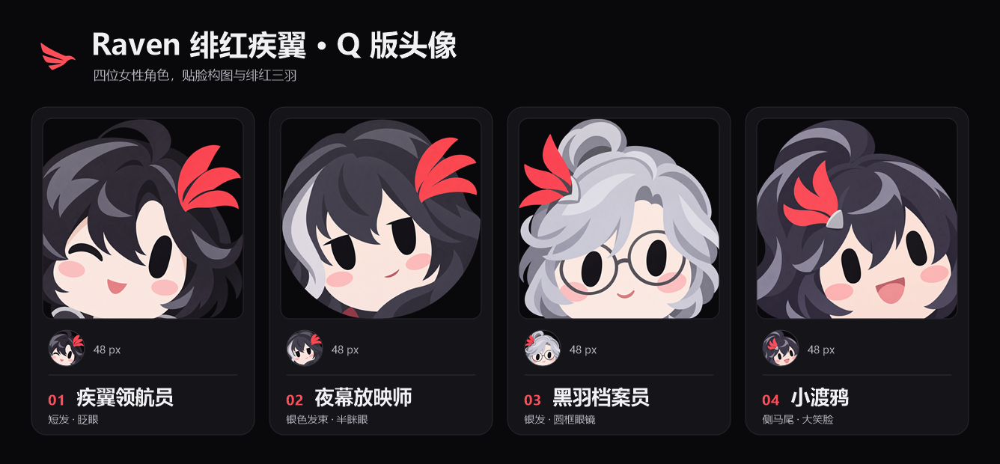

# Raven 绯红疾翼 · Q 版女性头像

四套原创女性角色沿用 Raven 的绯红三羽。头像参考贴脸大头构图，使用豆豆眼、大块发色和轻微歪头。每套附同角色的完整立绘，方便在不同界面延展。

| 方案 | 界面用途 | 透明头像 | 透明立绘 |
| --- | --- | --- | --- |
| **01 疾翼领航员** | 短发和弯眼突出俏皮感，适合欢迎页和新手引导。 | [avatar.png](01-flight-navigator/avatar.png) | [character.png](01-flight-navigator/character.png) |
| **02 夜幕放映师** | 银色发束和半眯眼更有魅力，适合影院首页和专题封面。 | [avatar.png](02-night-projectionist/avatar.png) | [character.png](02-night-projectionist/character.png) |
| **03 黑羽档案员** | 银发和圆框眼镜在小尺寸下也容易辨认，适合片库和收藏。 | [avatar.png](03-raven-archivist/avatar.png) | [character.png](03-raven-archivist/character.png) |
| **04 小渡鸦** | 侧马尾和大笑脸更活泼，适合空状态、进度反馈和完成提示。 | [avatar.png](04-little-raven/avatar.png) | [character.png](04-little-raven/character.png) |

头像为 1254 × 1254 px，立绘为 1024 × 1536 px，均带透明通道。对比图用黑曜石底色 `#09090B`，并预览了 48 px 圆形裁切。

[ImageGen 提示词](prompts.txt)

