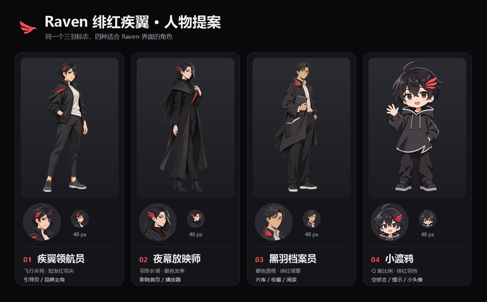

# Raven 绯红疾翼 · 人物提案

把启动图标的三片羽翼变成发夹、领章和衣服轮廓。四位角色共用黑曜石与绯红的视觉语言，保留各自的脸型、剪影和表情，便于在界面里区分。

| 方案 | 人物与界面用途 | 透明立绘 | 透明头像 |
| --- | --- | --- | --- |
| **01 疾翼领航员** | 爽朗、有行动力，像带用户找到下一部片的领航员。 | [character.png](01-flight-navigator/character.png) | [avatar.png](01-flight-navigator/avatar.png) |
| **02 夜幕放映师** | 沉稳、克制，可以出现在影片推荐和影院主题页。 | [character.png](02-night-projectionist/character.png) | [avatar.png](02-night-projectionist/avatar.png) |
| **03 黑羽档案员** | 温和、细心，适合收藏管理、阅读入口和离线片库。 | [character.png](03-raven-archivist/character.png) | [avatar.png](03-raven-archivist/avatar.png) |
| **04 小渡鸦** | 亲切俏皮，适合收藏为空、下载完成和轻量提示。 | [character.png](04-little-raven/character.png) | [avatar.png](04-little-raven/avatar.png) |

立绘为 1024 × 1536 px，头像为 1254 × 1254 px，均为带透明通道的 PNG。对比图里的圆形底板是界面预览，可以在产品界面按实际主题添加底色和遮罩。插画保留了绯红饰件的明暗变化，界面品牌色仍用 Raven Crimson `#FF4D58`。

[ImageGen 立绘与头像提示词](prompts.txt)

